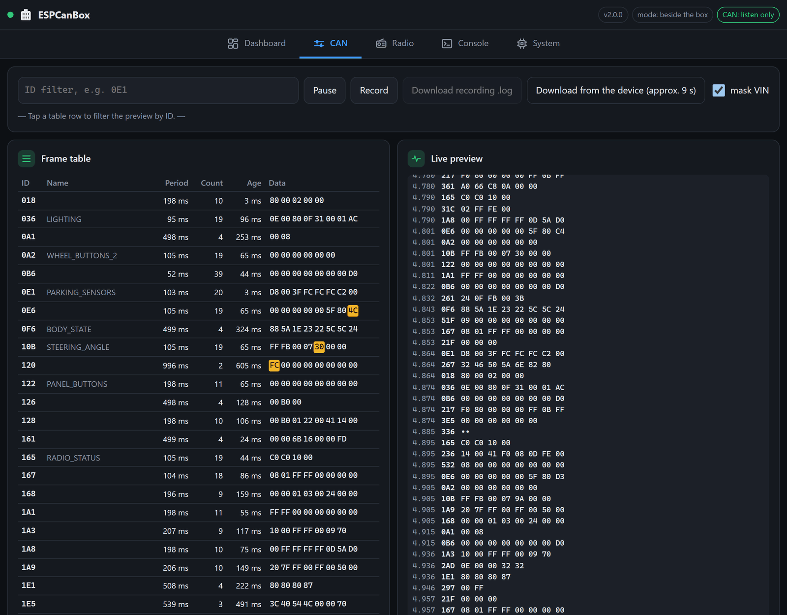
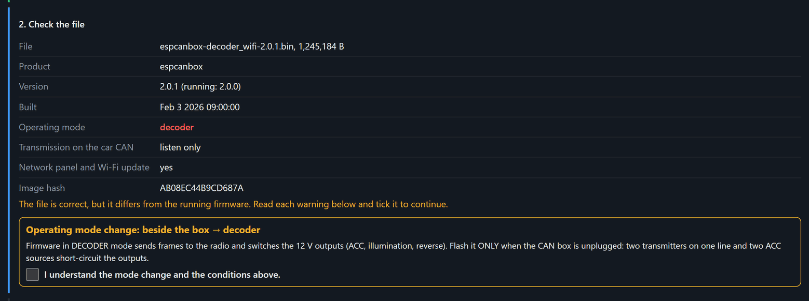

<!-- Nombre del proyecto: "project_name" en project.json. tools/set_project_name.py --apply reescribe la línea de título ("# ...") bajo el logotipo. El logotipo es un dibujo: ninguna herramienta lo reescribe; el logotipo animado de la cabecera se genera a partir de él con tools/make_logo_animation.py (docs/en/contributing/brand.md). -->
<p align="center">
  <picture>
    <source media="(prefers-color-scheme: dark)" srcset="docs/assets/brand/logo-animated.svg">
    <source media="(prefers-color-scheme: light)" srcset="docs/assets/brand/logo-animated.svg">
    
  </picture>
</p>

# ESPCanBox

Un dispositivo abierto con ESP32-S3 que se coloca entre el bus CAN del coche y una radio Android
y puede sustituir a la caja de interfaz CAN de posventa que se vende con la radio.

[English](README.md) | [Polski](README.pl.md) | [Deutsch](README.de.md) | Español | [Русский](README.ru.md) | [Українська](README.uk.md)

> [!NOTE]
> **Traducción automática, pendiente de revisión.** Este archivo es una traducción de
> [README.md](README.md). El texto vinculante es el inglés. Cómo avisar de un error:
> [Traducciones](docs/en/contributing/translations.md#send-your-work).

> [!WARNING]
> **Proyecto de aficionado, ofrecido TAL CUAL (AS IS), sin ninguna garantía.** Lo usas bajo tu
> propia responsabilidad y en tu propio coche.
>
> - Por defecto el dispositivo **solo escucha** el bus del coche. Para transmitir hace falta una
>   compilación aparte (`decoder_tx_wifi`) y armarla a mano. Lee
>   [Transmitir en el bus CAN](docs/en/safety/transmit.md) antes de compilarla.
> - No lo uses para nada que afecte a la seguridad (frenos, dirección, airbags, luces obligatorias
>   por ley). No está diseñado ni probado para eso.
> - El firmware y la placa se desarrollaron y midieron en **un** coche con **una** radio.
>   Ningún otro coche está probado.
> - Este proyecto no está vinculado, respaldado ni relacionado con Peugeot, Stellantis,
>   Simple Soft, Raise, Junsun ni FYT. Sus nombres se usan solo para indicar qué se ha probado.

## Capturas de pantalla

<table>
  <tr>
    <td align="center" valign="top" width="50%"><a href="docs/assets/screenshots/panel-dashboard.png"></a><br><sub>Resumen: estado del coche y sensores de aparcamiento</sub></td>
    <td align="center" valign="top" width="50%"><a href="docs/assets/screenshots/panel-can.png"></a><br><sub>Pestaña CAN: tramas en vivo</sub></td>
  </tr>
  <tr>
    <td align="center" valign="top" width="50%"><a href="docs/assets/screenshots/panel-radio-keymap.png"></a><br><sub>Pestaña Radio: reasignación de botones</sub></td>
    <td align="center" valign="top" width="50%"><a href="docs/assets/screenshots/panel-system-firmware-wizard.png"></a><br><sub>Actualización de firmware desde el navegador</sub></td>
  </tr>
</table>

Todas las pantallas con su explicación: [Recorrido por el panel](docs/en/reference/panel-tour.md) (en inglés). Las imágenes salen del dispositivo simulado, no de un coche.

## Para quién es

Para aficionados que saben soldar una placa pequeña, usar un multímetro y compilar firmware con
PlatformIO (las guías muestran cada comando). Lo que obtienes depende de tu coche y de tu radio:

- **Peugeot 508 SW (PSA AEE2010) con una radio Android que habla el protocolo «XP»:** el
  dispositivo puede sustituir a la caja CAN: botones, sensores de aparcamiento, ordenador de a
  bordo y alimentación de la radio.
- **Cualquier otro coche:** escucha y graba el bus CAN (compilación `listen_generic_wifi`), luego
  decodifícalo y escribe tu propio perfil de coche con las guías
  [Adáptalo a tu coche](docs/es/make-it-yours/porting-checklist.md). No se envía nada a la radio
  hasta que exista tu perfil.
- **Cualquier otra radio:** por ahora «XP» es el único protocolo de radio. Otra radio necesita un
  protocolo nuevo en el firmware ([Asigna la radio](docs/es/make-it-yours/radio-mapping.md)).

## Qué hace

- **Escucha el bus CAN del coche** y nunca transmite en las compilaciones por defecto. Solo la
  compilación aparte `decoder_tx_wifi` contiene código de transmisión; un script lo comprueba
  después de cada compilación.
- **Pita para los sensores de aparcamiento** por su propio altavoz pequeño.
- **Habla con la radio** en modo decodificador, como hacía la caja CAN: botones del volante y del
  panel central, pantalla de los sensores de aparcamiento, ordenador de a bordo, temperatura
  exterior, estado del climatizador, puertas y ajustes del vehículo.
- **Conmuta tres líneas de 12 V** para la radio en modo decodificador: ACC (alimentación de la
  radio), iluminación, marcha atrás.
- **Panel web** en su propia red Wi-Fi: estado, tramas CAN en directo, consola, grabación,
  actualización del firmware. Idiomas del panel: inglés, polaco, alemán, español, ruso, ucraniano
  (los cuatro últimos son traducciones automáticas pendientes de revisión).
- **Consola USB** con un formato de línea fijo que pueden leer las herramientas
  (consulta [Consola](docs/en/reference/console.md)).
- **Perfiles de coche y protocolos de radio elegidos al compilar:** `psa_aee2010` (coche de
  referencia) o `generic` (cualquier coche, solo escucha); protocolo de radio `XP` o `NONE`. Hay
  una plantilla para tu propio coche en `firmware/lib/car_example` (consulta
  [Escribir un perfil](docs/es/make-it-yours/write-a-profile.md)).
- **Pruebas en tu ordenador** de toda la lógica, con grabaciones del coche, sin hardware
  (consulta [Pruebas en el ordenador](docs/en/testing/host-tests.md)).
- **Compilación de transmisión opcional** (`decoder_tx_wifi`): por defecto solo puede enviar una
  trama, la petición de ajustes del vehículo `15B` (comprobada solo por ID y longitud), y solo
  después de armarla. La trama de prueba `1A9` existe solo en una compilación con
  `-DCAN_TX_EXPERIMENTAL=1`. El
  climatizador desde la radio de esta forma **no** funcionó. Detalles:
  [Transmitir en el bus CAN](docs/en/safety/transmit.md).

Estado: la versión 2.0.0 compila, pasa las pruebas en el ordenador, se probó en banco en una placa ESP32-S3-WROOM-1-N16R8 y se probó en un solo coche el 20-11-2026, incluido el sueño profundo y el despertar desde el bus.

## Coches compatibles

| Coche | Perfil de firmware | Estado |
|---|---|---|
| Peugeot 508 SW, 2015 (PSA AEE2010) | `psa_aee2010` | medido (measured) en un coche |
| cualquier coche | `generic` (compilación `listen_generic_wifi`) | solo escucha: graba tramas, no envía nada a la radio, salidas de 12 V apagadas |

En el coche de referencia el bus de la radio funciona a 125 kbit/s (medido). Sus tensiones parecen
de CAN de baja velocidad tolerante a fallos (low-speed fault-tolerant) (CANH unos 0.65 V, CANL
unos 4.5 V de media con el encendido puesto); todavía no está confirmado con un osciloscopio.
Detalles: `vehicles/peugeot-508-sw-2015/README.md` y `vehicles/SUPPORTED.md`.

## Radios compatibles

| Protocolo de radio | Firmware | Estado |
|---|---|---|
| «XP» (protocolo de la caja CAN Simple Soft, radio Android de la plataforma FYT, perfil CAN «XP Simple Soft -> Peugeot 508 -> Type 2») | `-DRADIO_PROTOCOL=XP` | medido en una radio (grabaciones UART de la caja y de la radio) |
| sin radio | `-DRADIO_PROTOCOL=NONE` | no se envía nada por el UART |

Descripción del protocolo, solo a partir de grabaciones: `radios/xp-simple-soft/protocol.md`.

## Inicio rápido

Así pones en marcha el dispositivo en tu mesa, sin coche. Necesitas una placa ESP32-S3 con 16 MB
de flash y 8 MB de PSRAM (N16R8) y un cable USB. Guía completa:
[Inicio rápido](docs/es/quick-start/flash.md).

1. **Lee [Seguridad](docs/es/getting-started/safety.md).** No va nada al coche antes de eso.
2. **Instala las herramientas.** Instala [uv](https://docs.astral.sh/uv/); ejecuta PlatformIO sin
   instalarlo aparte. Git for Windows (Git Bash) no hace falta para flashear: se necesita para
   las pruebas en el ordenador y para las páginas de «Adáptalo a tu coche» (tu propio coche o tu
   propia radio).
3. **Compila y flashea la compilación de solo escucha con el panel web.** Escríbelo en la
   carpeta principal del repositorio (en Windows, en PowerShell):

   ```
   uvx platformio run -d firmware -e listen_wifi -t upload
   ```

4. **Abre la consola USB** (115200 baudios), por ejemplo
   `uvx platformio device monitor -d firmware`. Lo que escribes no se ve; pulsa Intro después de
   cada comando. Escribe `ver`, después `stat`, después `wifi`
   (nombre de la red) y `wifi showpass` (contraseña).
   No dejes la contraseña en ningún registro que compartas.
5. **Abre el panel.** Conecta un móvil o un portátil a la red Wi-Fi del dispositivo (su nombre lo
   muestra `wifi`), abre `http://10.50.8.1` e inicia sesión con esa contraseña. Elige tu idioma
   en la pantalla de inicio de sesión.

Para otro coche que no sea el de referencia, usa después `listen_generic_wifi`.

Siguiente: [Prueba en banco](docs/es/quick-start/bench-test.md), luego
[Adáptalo a tu coche](docs/es/make-it-yours/porting-checklist.md) para otro coche, o
[Instalación en el coche](docs/en/install-in-car/checklist.md) para el coche de referencia.

¿Aún no tienes placa? El dispositivo simulado ejecuta el panel en tu ordenador con una grabación:
`python -I firmware/tools/mock_device.py firmware/test_data/captures/can_20261111_191045.log`
(en Linux y macOS: `python3`; consulta [Primer arranque](docs/es/quick-start/first-boot.md)).

## Documentación

- [Presentación](docs/es/index.md) y [Cómo funciona](docs/en/getting-started/how-it-works.md)
- [Seguridad](docs/es/getting-started/safety.md), [Transmitir en el bus CAN](docs/en/safety/transmit.md),
  [Modelo de seguridad](docs/en/safety/security.md)
- [Hardware](docs/en/hardware/overview.md): placa prototipo, lista de componentes, caja, cableado
- [Adáptalo a tu coche](docs/es/make-it-yours/porting-checklist.md): graba, decodifica y añade tu
  propio coche
- [Referencia](docs/en/reference/architecture.md): protocolo, consola, API del panel, pines
- [Solución de problemas](docs/en/troubleshooting/index.md) y [Preguntas frecuentes](docs/en/troubleshooting/faq.md)

La documentación se lee mejor como sitio generado: con menú, búsqueda y selector de idioma. Para
verla en tu ordenador, ejecuta esto en la carpeta principal del repositorio y abre
http://127.0.0.1:8000:

```
uvx --from mkdocs-material==9.8.1 --with mkdocs-static-i18n==1.3.1 mkdocs serve
```

La dirección del sitio en línea se añadirá aquí tras la publicación. Los archivos de `docs/` también
se pueden leer directamente en GitHub; todos los enlaces entre ellos funcionan también allí.

## Idiomas

- Documentación: inglés (`docs/en/`, vinculante). Traducción automática, pendiente de revisión:
  [13 páginas en español](docs/es/index.md) (presentación, seguridad, inicio rápido, «Adáptalo a
  tu coche»); si falta una página, se muestra la inglesa. Cómo ayudar: [Traducciones](docs/en/contributing/translations.md).
- Panel web: en, pl, de, es, ru, uk en `firmware/web/i18n/`.
- Consola USB, comandos de consola y códigos de la API: solo en inglés, a propósito (las
  herramientas los leen).

## Contribuir

Consulta [CONTRIBUTING.md](CONTRIBUTING.md), [CODE_OF_CONDUCT.md](CODE_OF_CONDUCT.md) y
[ROADMAP.md](ROADMAP.md). Problemas de seguridad: [SECURITY.md](SECURITY.md). Cambios:
[CHANGELOG.md](CHANGELOG.md).

Es un proyecto de aficionado. Las preguntas y las pull requests son bienvenidas, pero no hay
ninguna promesa de respuesta ni de arreglo en ningún plazo.

## Licencias

- código: Apache-2.0 ([LICENSE](LICENSE), [NOTICE](NOTICE));
- documentación e imágenes: CC BY 4.0 ([LICENSE-docs](LICENSE-docs));
- hardware (archivos KiCad, caja): CERN-OHL-S-2.0 ([LICENSE-hardware](LICENSE-hardware)).

Qué licencia cubre qué archivos:

| Licencia | Archivos |
|---|---|
| Apache-2.0 | `firmware/` (con el panel web, los datos de prueba y las grabaciones), `tools/`, el código de `extras/`, `vehicles/*/*.dbc`, `hardware/prototype-v1/enclosure/gen_enclosure.py`, los archivos de compilación y CI, y todo archivo que no aparezca en las dos filas de abajo |
| CC BY 4.0 | `docs/`, todo archivo Markdown (`*.md`), los logotipos (`docs/assets/brand/`, `hardware/brand/`), las fotos, capturas de pantalla, renders y dibujos |
| CERN-OHL-S-2.0 | en `hardware/prototype-v1/`: los archivos KiCad, los PDF y archivos de impresión, `bom.csv`, los modelos de la caja (STL) |

**Licencia de cada archivo.** Los archivos no llevan cabecera de licencia propia. A un archivo
sin cabecera propia se le aplica la tabla de arriba; un archivo que indica su propia licencia
queda bajo esa licencia. Las partes de otros proyectos que contiene una imagen de firmware
(núcleo Arduino para ESP32 bajo LGPL-2.1-or-later, ESP-IDF y sus componentes, las bibliotecas de
ejecución del compilador) figuran con su licencia y enlace en [NOTICE](NOTICE). Cada archivo de
una versión publicada incluye los textos de las licencias, NOTICE y una nota sobre dónde obtener
el código fuente de esa versión exacta ([LICENSES/](LICENSES/THIRD-PARTY.md)).

Peugeot, Stellantis, Simple Soft, Raise, Junsun, FYT y los demás nombres de productos y empresas
pertenecen a sus propietarios. Se usan solo para describir la compatibilidad. Este proyecto no
está vinculado, respaldado ni relacionado con ninguno de ellos. ESP32 es una marca comercial de
Espressif Systems; los demás nombres son marcas de sus respectivos propietarios y se usan solo
para describir la compatibilidad.

Autor: grabowski98.
