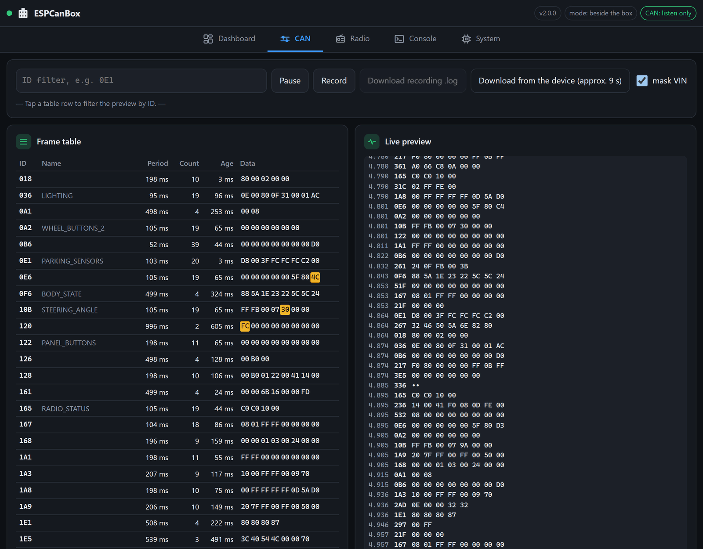
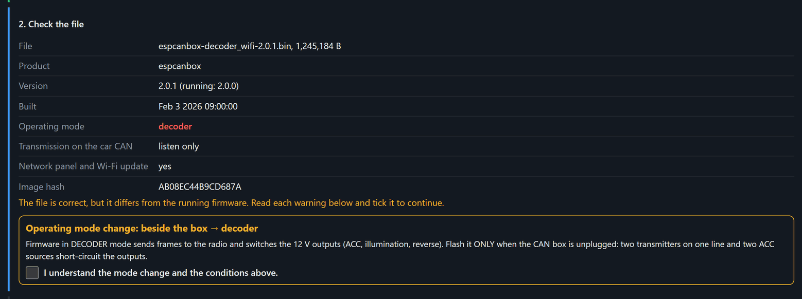

<!-- Project name: "project_name" in project.json. tools/set_project_name.py --apply rewrites the title line ("# ...") under the logo. The logo is a drawing: no tool rewrites it; the animated header logo is generated from it by tools/make_logo_animation.py (docs/en/contributing/brand.md). -->
<p align="center">
  <picture>
    <source media="(prefers-color-scheme: dark)" srcset="docs/assets/brand/logo-animated.svg">
    <source media="(prefers-color-scheme: light)" srcset="docs/assets/brand/logo-animated.svg">
    
  </picture>
</p>

# ESPCanBox

An open ESP32-S3 device that sits between a car's CAN bus and an Android radio and can replace
the aftermarket CAN interface box sold with the radio.

English | [Polski](README.pl.md) | [Deutsch](README.de.md) | [Español](README.es.md) | [Русский](README.ru.md) | [Українська](README.uk.md)

> [!WARNING]
> **Hobby project, provided AS IS, without any warranty.** You use it at your own risk, on your
> own car.
>
> - By default the device **only listens** to the car bus. Transmitting needs a separate build
>   (`decoder_tx_wifi`) and arming by hand. Read [Transmitting on the CAN bus](docs/en/safety/transmit.md)
>   before you build it.
> - Do not use it for anything that affects safety (brakes, steering, airbags, lights required by
>   law). It is not designed or tested for that.
> - The firmware and the board were developed and measured on **one** car with **one** radio.
>   Every other car is untested.
> - This project is not affiliated with, endorsed by or connected to Peugeot, Stellantis,
>   Simple Soft, Raise, Junsun or FYT. Their names are used only to say what was tested.

## Screenshots

<table>
  <tr>
    <td align="center" valign="top" width="50%"><a href="docs/assets/screenshots/panel-dashboard.png"></a><br><sub>Dashboard: car state and parking sensors</sub></td>
    <td align="center" valign="top" width="50%"><a href="docs/assets/screenshots/panel-can.png"></a><br><sub>CAN tab: live frames</sub></td>
  </tr>
  <tr>
    <td align="center" valign="top" width="50%"><a href="docs/assets/screenshots/panel-radio-keymap.png"></a><br><sub>Radio tab: key remapping</sub></td>
    <td align="center" valign="top" width="50%"><a href="docs/assets/screenshots/panel-system-firmware-wizard.png"></a><br><sub>Firmware update from the browser</sub></td>
  </tr>
</table>

Every screen, with what it means: [Panel tour](docs/en/reference/panel-tour.md). The pictures come from the device mock, not from a car.

## Who it is for

Hobbyists who can solder a small board, use a multimeter and build firmware with PlatformIO
(the guides show every command). What you get depends on your car and radio:

- **Peugeot 508 SW (PSA AEE2010) with an Android radio that speaks the "XP" protocol:** the
  device can replace the CAN box: buttons, parking sensors, trip computer and radio power.
- **Any other car:** listen and record the CAN bus (build `listen_generic_wifi`), then decode it
  and write your own car profile with the [Make it yours](docs/en/make-it-yours/porting-checklist.md)
  guides. Nothing is sent to the radio until your profile exists.
- **Any other radio:** "XP" is the only radio protocol so far. Another radio needs a new
  protocol in the firmware ([Radio mapping](docs/en/make-it-yours/radio-mapping.md)).

## What it does

- **Listens to the car's CAN bus** and never transmits in the default builds. Only the separate
  build `decoder_tx_wifi` contains transmit code; a script checks this after every build.
- **Beeps for the parking sensors** from its own small speaker.
- **Talks to the radio** in decoder mode, like the CAN box did: steering wheel and centre panel
  buttons, parking sensor display, trip computer, outside temperature, climate state, doors and
  vehicle settings.
- **Switches three 12 V lines** for the radio in decoder mode: ACC (radio power), illumination,
  reverse.
- **Web panel** over its own Wi-Fi network: status, live CAN frames, console, recording,
  firmware update. Panel languages: English, Polish, German, Spanish, Russian, Ukrainian (the
  last four are machine translations that need review).
- **USB console** with a fixed line format that tools can read
  (see [Console](docs/en/reference/console.md)).
- **Car profiles and radio protocols chosen at build time:** `psa_aee2010` (reference car) or
  `generic` (any car, listen only); radio protocol `XP` or `NONE`. A template for your own car is
  in `firmware/lib/car_example` (see [Write a profile](docs/en/make-it-yours/write-a-profile.md)).
- **Tests on your computer** of all the logic, on recordings from the car, without hardware
  (see [Host tests](docs/en/testing/host-tests.md)).
- **Optional transmit build** (`decoder_tx_wifi`): by default it can send only one frame, the
  vehicle settings request `15B` (checked by ID and length only), and only after you arm it.
  The trial frame `1A9` exists only in a build with `-DCAN_TX_EXPERIMENTAL=1`. Climate control from the radio
  this way did **not** work. Details: [Transmitting on the CAN bus](docs/en/safety/transmit.md).

Status of release 2.0.0: the firmware in this repository was reorganised from the version that
ran in the reference car before it; it compiles, passes the host tests and was bench-tested on an
ESP32-S3-WROOM-1-N16R8 board. It was tried in one car on 2026-11-20, including deep sleep and
wake-up from the bus; the transmit guards (after ignition-on, cranking, reverse) are covered by
host tests only. Details: [CHANGELOG.md](CHANGELOG.md).

## Supported cars

| Car | Firmware profile | Status |
|---|---|---|
| Peugeot 508 SW, 2015 (PSA AEE2010) | `psa_aee2010` | measured on one car |
| any car | `generic` (build `listen_generic_wifi`) | listen-only: records frames, sends nothing to the radio, 12 V outputs off |

On the reference car the bus at the radio runs at 125 kbit/s (measured). Its voltages look like
low-speed fault-tolerant CAN (CANH about 0.65 V, CANL about 4.5 V average with ignition on); this
is not yet confirmed with an oscilloscope. Details: `vehicles/peugeot-508-sw-2015/README.md` and
`vehicles/SUPPORTED.md`.

## Supported radios

| Radio protocol | Firmware | Status |
|---|---|---|
| "XP" (Simple Soft CAN box protocol, Android radio on the FYT platform, CAN profile "XP Simple Soft -> Peugeot 508 -> Type 2") | `-DRADIO_PROTOCOL=XP` | measured on one radio (UART recordings of the box and the radio) |
| no radio | `-DRADIO_PROTOCOL=NONE` | nothing is sent on the UART |

Protocol description, only from recordings: `radios/xp-simple-soft/protocol.md`.

## Quick start

This gets the device running on your desk, with no car. You need an ESP32-S3 board with 16 MB
flash and 8 MB PSRAM (N16R8) and a USB cable. Full guide: [Quick start](docs/en/quick-start/flash.md).

1. **Read [Safety](docs/en/getting-started/safety.md).** Nothing goes into the car before that.
2. **Install the tools.** Install [uv](https://docs.astral.sh/uv/); it runs PlatformIO without a
   separate install. Git for Windows (Git Bash) is not needed to flash: it is needed for the
   tests on your computer and for the pages of "Make it yours" (your own car or radio).
3. **Build and flash the listen-only build with the web panel.** Type this in the top folder of
   the repository (on Windows in PowerShell):

   ```
   uvx platformio run -d firmware -e listen_wifi -t upload
   ```

4. **Open the USB console** (115200 baud), for example
   `uvx platformio device monitor -d firmware`. Your typing is not shown; press Enter after each
   command. Type `ver`, then `stat`, then `wifi` (network name) and `wifi showpass` (password).
   Keep the password out of any log you share.
5. **Open the panel.** Connect a phone or a laptop to the Wi-Fi network of the device (its name
   is printed by `wifi`), open `http://10.50.8.1` and log in with that password. Pick your
   language on the login screen.

For a car other than the reference car, use `listen_generic_wifi` later.

Next: [Bench test](docs/en/quick-start/bench-test.md), then
[Make it yours](docs/en/make-it-yours/porting-checklist.md) for another car, or
[Install in the car](docs/en/install-in-car/checklist.md) for the reference car.

No board yet? The mock device runs the panel on your computer with a recording:
`python -I firmware/tools/mock_device.py firmware/test_data/captures/can_20261111_191045.log`
(on Linux and macOS: `python3`; see [First boot](docs/en/quick-start/first-boot.md)).

## Documentation

- [Overview](docs/en/index.md) and [How it works](docs/en/getting-started/how-it-works.md)
- [Safety](docs/en/getting-started/safety.md), [Transmitting on the CAN bus](docs/en/safety/transmit.md),
  [Security model](docs/en/safety/security.md)
- [Hardware](docs/en/hardware/overview.md): prototype board, parts list, enclosure, wiring
- [Make it yours](docs/en/make-it-yours/porting-checklist.md): record, decode and add your own car
- [Reference](docs/en/reference/architecture.md): protocol, console, panel API, pins
- [Troubleshooting](docs/en/troubleshooting/index.md) and [FAQ](docs/en/troubleshooting/faq.md)

The documentation reads best as the built site: menu, search, language switcher. To see it on your
computer, run this in the top folder of the repository and open http://127.0.0.1:8000:

```
uvx --from mkdocs-material==9.8.1 --with mkdocs-static-i18n==1.3.1 mkdocs serve
```

The address of the site online will be added here after publication. The files in `docs/` can also
be read directly on GitHub; every link between them works there too.

## Languages

- Documentation: English (`docs/en/`, binding). Machine translations, not yet reviewed:
  [Polski](docs/pl/index.md) (every page), [Deutsch](docs/de/index.md), [Español](docs/es/index.md),
  [Русский](docs/ru/index.md), [Українська](docs/uk/index.md) (13 pages each); a missing page
  falls back to English. How to help: [Translations](docs/en/contributing/translations.md).
- Web panel: en, pl, de, es, ru, uk in `firmware/web/i18n/`.
- USB console, console commands and API codes: English only, on purpose (tools read them).

## Contributing

See [CONTRIBUTING.md](CONTRIBUTING.md), [CODE_OF_CONDUCT.md](CODE_OF_CONDUCT.md) and
[ROADMAP.md](ROADMAP.md). Security problems: [SECURITY.md](SECURITY.md). Changes:
[CHANGELOG.md](CHANGELOG.md).

This is a hobby project. Questions and pull requests are welcome, but there is no promise of an
answer or a fix within any time.

## Licences

- code: Apache-2.0 ([LICENSE](LICENSE), [NOTICE](NOTICE));
- documentation and images: CC BY 4.0 ([LICENSE-docs](LICENSE-docs));
- hardware (KiCad files, enclosure): CERN-OHL-S-2.0 ([LICENSE-hardware](LICENSE-hardware)).

Which licence covers which files:

| Licence | Files |
|---|---|
| Apache-2.0 | `firmware/` (with the web panel, the test data and the recordings), `tools/`, the code in `extras/`, `vehicles/*/*.dbc`, `hardware/prototype-v1/enclosure/gen_enclosure.py`, build and CI files, and every file not named in the two rows below |
| CC BY 4.0 | `docs/`, every Markdown file (`*.md`), the logos (`docs/assets/brand/`, `hardware/brand/`), the photos, screenshots, renders and drawings |
| CERN-OHL-S-2.0 | in `hardware/prototype-v1/`: the KiCad files, the PDF and print files, `bom.csv`, the enclosure models (STL) |

**Licensing of files.** The files have no licence header of their own. A file without its own
header is covered by the table above; a file that names its own licence follows it. The parts of
other projects that a firmware image contains (Arduino core for ESP32 under LGPL-2.1-or-later,
ESP-IDF and its components, the compiler runtime) are listed with their licences and links in
[NOTICE](NOTICE). Every release archive carries the licence texts, NOTICE and a note on where to
get the source of the exact version ([LICENSES/](LICENSES/THIRD-PARTY.md)).

Peugeot, Stellantis, Simple Soft, Raise, Junsun, FYT and the other product and company names
belong to their owners. They are used only to describe compatibility. This project is not
affiliated with, endorsed by or connected to any of them. ESP32 is a trademark of Espressif
Systems; other names are trademarks of their respective owners and are used only to describe
compatibility.

Author: grabowski98.
