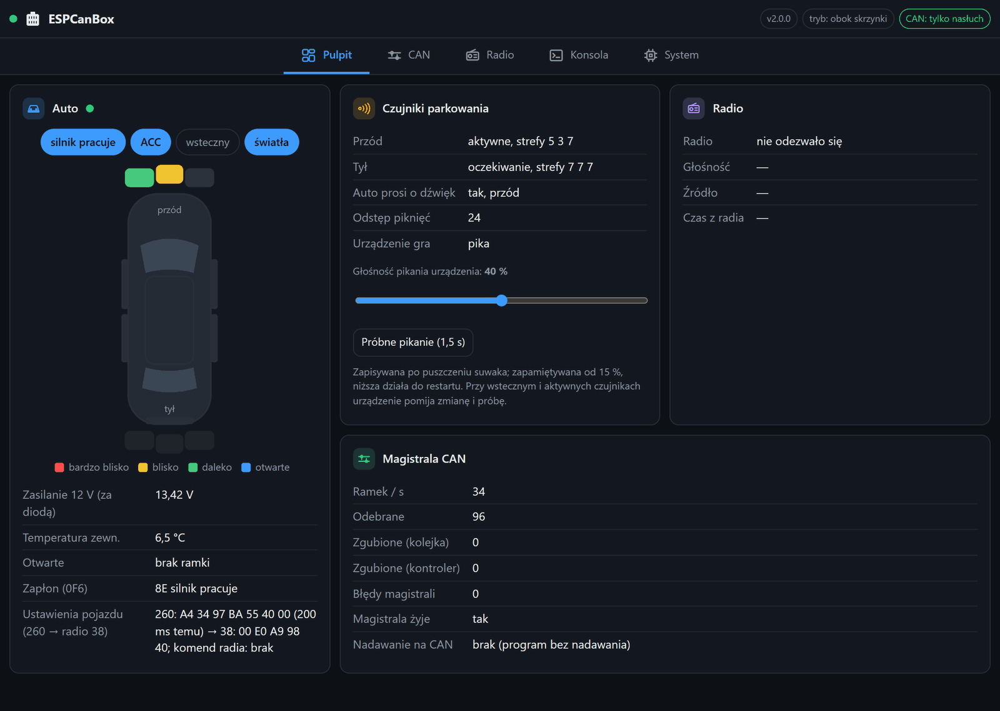
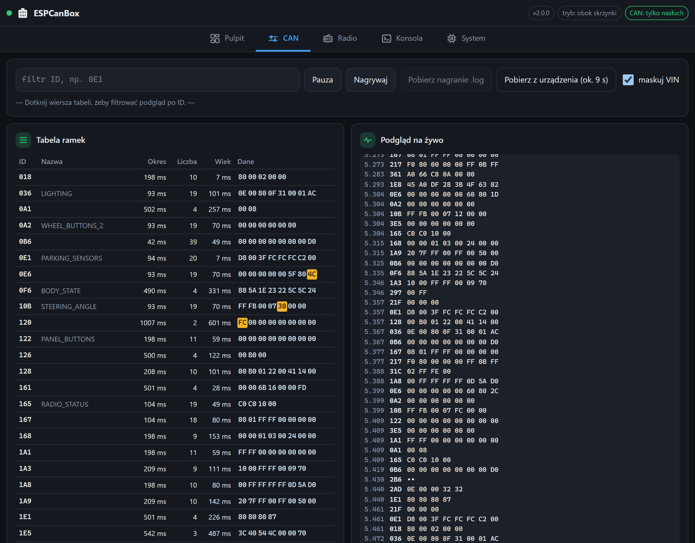
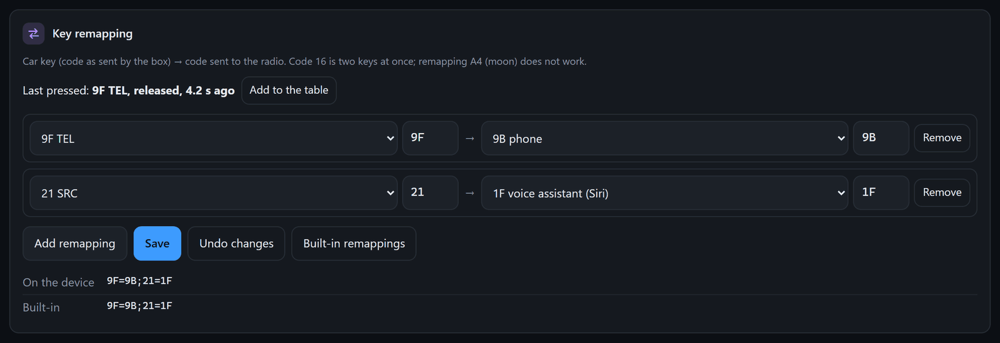
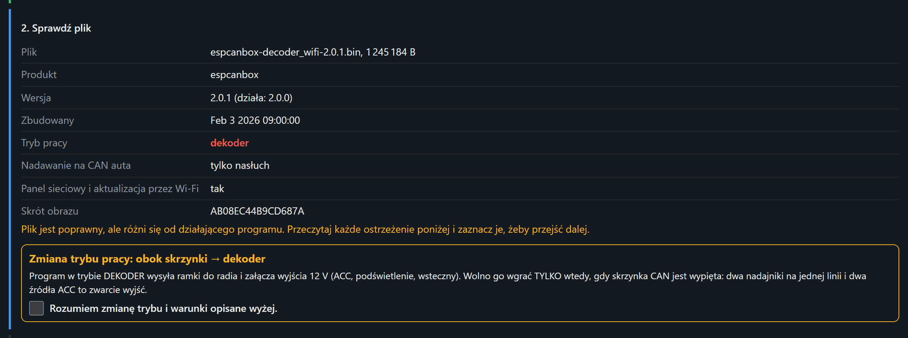

<!-- Nazwa projektu: "project_name" w project.json. tools/set_project_name.py --apply przepisuje wiersz tytułu ("# ...") pod logo. Logo jest rysunkiem: żadne narzędzie go nie przepisuje; animowane logo w nagłówku powstaje z niego przez tools/make_logo_animation.py (docs/pl/contributing/brand.md). -->
<p align="center">
  <picture>
    <source media="(prefers-color-scheme: dark)" srcset="docs/assets/brand/logo-animated.svg">
    <source media="(prefers-color-scheme: light)" srcset="docs/assets/brand/logo-animated.svg">
    
  </picture>
</p>

# ESPCanBox

Otwarte urządzenie na ESP32-S3, które łączy magistralę CAN auta z radiem na Androidzie i może
zastąpić skrzynkę CAN sprzedawaną razem z radiem.

[English](README.md) | Polski | [Deutsch](README.de.md) | [Español](README.es.md) | [Русский](README.ru.md) | [Українська](README.uk.md)

> [!NOTE]
> **Tłumaczenie maszynowe, wymaga sprawdzenia.** Ten plik to tłumaczenie [README.md](README.md).
> Wiążący jest tekst angielski. Jak zgłosić poprawkę:
> [Tłumaczenia](docs/pl/contributing/translations.md#send-your-work).

> [!WARNING]
> **Projekt hobbystyczny, udostępniony w obecnym stanie (AS IS), bez żadnej gwarancji.**
> Używasz go na własne ryzyko, we własnym aucie.
>
> - Domyślnie urządzenie **tylko słucha** magistrali auta. Nadawanie wymaga osobnej kompilacji
>   (`decoder_tx_wifi`) i ręcznego uzbrojenia. Zanim ją zbudujesz, przeczytaj
>   [Nadawanie na magistralę CAN](docs/pl/safety/transmit.md).
> - Nie używaj go do niczego, co wpływa na bezpieczeństwo (hamulce, układ kierowniczy, poduszki
>   powietrzne, światła wymagane przepisami). Nie był do tego projektowany ani sprawdzany.
> - Program i płytka powstały i były mierzone w **jednym** aucie z **jednym** radiem. Na żadnym
>   innym aucie go nie sprawdzano.
> - Projekt nie jest związany z firmami Peugeot, Stellantis, Simple Soft, Raise, Junsun ani FYT
>   ani przez nie wspierany. Ich nazwy służą tylko do opisu tego, na czym go sprawdzono.

## Zrzuty ekranu

<table>
  <tr>
    <td align="center" valign="top" width="50%"><a href="docs/assets/screenshots/pl/panel-dashboard.png"></a><br><sub>Pulpit: stan auta i czujniki parkowania</sub></td>
    <td align="center" valign="top" width="50%"><a href="docs/assets/screenshots/pl/panel-can.png"></a><br><sub>Karta CAN: ramki na żywo</sub></td>
  </tr>
  <tr>
    <td align="center" valign="top" width="50%"><a href="docs/assets/screenshots/panel-radio-keymap.png"></a><br><sub>Karta Radio: zamiana przycisków</sub></td>
    <td align="center" valign="top" width="50%"><a href="docs/assets/screenshots/pl/panel-system-firmware-wizard.png"></a><br><sub>Aktualizacja programu z przeglądarki</sub></td>
  </tr>
</table>

Wszystkie ekrany z opisem: [Przegląd panelu](docs/pl/reference/panel-tour.md). Obrazki pochodzą z makiety urządzenia, nie z auta.

## Dla kogo

Dla hobbystów, którzy umieją przylutować małą płytkę, posługują się miernikiem i zbudują program
w PlatformIO (opisy podają każde polecenie). Co dostajesz, zależy od auta i radia:

- **Peugeot 508 SW (PSA AEE2010) z radiem na Androidzie, które mówi protokołem „XP”:**
  urządzenie może zastąpić skrzynkę CAN: przyciski, czujniki parkowania, komputer pokładowy
  i zasilanie radia.
- **Każde inne auto:** nasłuch i nagrywanie magistrali CAN (kompilacja `listen_generic_wifi`),
  potem rozpoznanie ramek i własny profil auta według opisów
  [Dostosuj do siebie](docs/pl/make-it-yours/porting-checklist.md). Do radia nic nie
  idzie, dopóki nie ma twojego profilu.
- **Każde inne radio:** „XP” to na razie jedyny protokół radia. Inne radio wymaga nowego
  protokołu w programie ([Przyciski i radio](docs/pl/make-it-yours/radio-mapping.md)).

## Co robi

- **Słucha magistrali CAN auta**: kontroler ESP32-S3 w trybie nasłuchu, nadajnik modułu CAN
  wyciszony (nóżka SLNT w stanie wysokim). Wszystkie środowiska kompilacji poza `decoder_tx_wifi`
  w ogóle nie zawierają kodu nadawania (sprawdza to `firmware/tools/check_no_can_tx.sh`).
- **Pika przy czujnikach parkowania** z własnego głośnika (moduł wzmacniacza I2S), według
  ramki `0E1`.
- **Rozmawia z radiem** w trybie dekodera: UART 38400, protokół „XP” skrzynki Simple Soft.
  Przyciski kierownicy i panelu środkowego, wykres czujników, komputer pokładowy, temperatura
  zewnętrzna, stan klimatyzacji, drzwi, stan ustawień pojazdu.
- **Steruje trzema wyjściami 12 V** w trybie dekodera: ACC (zasilanie radia), podświetlenie,
  bieg wsteczny.
- **Panel WWW** przez własną sieć Wi-Fi (środowiska `*_wifi`): stan, ramki CAN na żywo, konsola,
  nagrywanie, aktualizacja programu przez Wi-Fi. Języki panelu: angielski, polski, niemiecki,
  hiszpański, rosyjski, ukraiński (cztery ostatnie to tłumaczenia maszynowe do sprawdzenia).
- **Konsola USB** 115200 ze stałym formatem linii: ramki jako `can0 ID#DATA`, komentarze od `#`
  ([Konsola USB](docs/pl/reference/console.md)).
- **Profil auta i protokół radia wybierane przy kompilacji:** `psa_aee2010` (auto wzorcowe) albo
  `generic` (dowolne auto, tylko nasłuch); protokół radia `XP` albo `NONE`. Szablon własnego auta:
  `firmware/lib/car_example` ([Pisanie profilu auta](docs/pl/make-it-yours/write-a-profile.md)).
- **Testy na komputerze** całej logiki na nagraniach z auta, bez sprzętu
  ([Testy na komputerze](docs/pl/testing/host-tests.md)).
- **Opcjonalna kompilacja z nadawaniem** (`decoder_tx_wifi`): domyślnie umie nadać tylko ramkę
  `15B` (ustawienia pojazdu), sprawdzaną wyłącznie po identyfikatorze i długości, i dopiero po
  uzbrojeniu. Ramka `1A9` jest tylko w kompilacji z `-DCAN_TX_EXPERIMENTAL=1`. Sterowanie
  klimatyzacją ramką `364` **nie zadziałało**, więc program jej nie ma.

Stan wydania 2.0.0: program w tym repozytorium to przeorganizowana wersja tego, który wcześniej pracował w
aucie wzorcowym; kompiluje się, przechodzi testy na komputerze i był sprawdzony na stole na płytce
ESP32-S3-WROOM-1-N16R8. 20.11.2026 przeszedł próbę w jednym aucie, razem z uśpieniem i
wybudzeniem z magistrali; zabezpieczenia nadawania (po włączeniu zapłonu, rozruch, wsteczny)
sprawdzają tylko testy na komputerze. Szczegóły: [CHANGELOG.md](CHANGELOG.md).

## Obsługiwane auta

| Auto | Profil w programie | Stan |
|---|---|---|
| Peugeot 508 SW, 2015 (PSA AEE2010) | `psa_aee2010` | zmierzone w jednym aucie |
| dowolne auto | `generic` (kompilacja `listen_generic_wifi`) | tylko nasłuch: zapisuje ramki, nic nie wysyła do radia, wyjścia 12 V wyłączone |

W aucie wzorcowym magistrala przy radiu pracuje z prędkością 125 kbit/s (pomiar). Napięcia linii
wyglądają na CAN low-speed fault-tolerant (CANH ok. 0,65 V, CANL ok. 4,5 V średnio przy
włączonym zapłonie); nie jest to jeszcze potwierdzone oscyloskopem. Szczegóły:
`vehicles/peugeot-508-sw-2015/README.md` i `vehicles/SUPPORTED.md`.

## Obsługiwane radia

| Protokół radia | W programie | Stan |
|---|---|---|
| „XP” (protokół skrzynki Simple Soft, radio Android na platformie FYT, profil CAN „XP Simple Soft -> Peugeot 508 -> Type 2”) | `-DRADIO_PROTOCOL=XP` | zmierzone na jednym radiu (nagrania linii UART skrzynki i radia) |
| bez radia | `-DRADIO_PROTOCOL=NONE` | nic nie idzie na UART |

Opis protokołu, wyłącznie z nagrań: `radios/xp-simple-soft/protocol.md`.

## Szybki start

Uruchomienie urządzenia na biurku, bez auta. Potrzebujesz płytki ESP32-S3 z 16 MB flash i 8 MB
PSRAM (N16R8) i kabla USB. Pełny opis: [Szybki start](docs/pl/quick-start/flash.md).

1. **Przeczytaj [Bezpieczeństwo](docs/pl/getting-started/safety.md).** Przed tym krokiem nie podłączaj
   niczego do auta.
2. **Zainstaluj narzędzia.** Zainstaluj [uv](https://docs.astral.sh/uv/); uruchamia PlatformIO bez
   osobnej instalacji. Git for Windows (Git Bash) nie jest potrzebny do wgrania programu:
   przydaje się do testów na komputerze i do stron działu „Dostosuj do siebie”.
3. **Zbuduj i wgraj wersję tylko do nasłuchu, z panelem WWW.** Wpisz to w głównym folderze
   repozytorium (w Windows w PowerShell):

   ```
   uvx platformio run -d firmware -e listen_wifi -t upload
   ```

4. **Otwórz konsolę USB** (115200), na przykład `uvx platformio device monitor -d firmware`.
   Wpisywanych liter nie widać; po każdym poleceniu naciśnij Enter. Wpisz `ver`, potem `stat`,
   potem `wifi` (nazwa sieci) i `wifi showpass` (hasło). Nie wklejaj hasła do żadnego logu, który udostępniasz.
5. **Otwórz panel.** Połącz telefon albo laptop z siecią Wi-Fi urządzenia (jej nazwę wypisuje
   `wifi`), wejdź na `http://10.50.8.1` i zaloguj się tym hasłem. Język wybierzesz na ekranie
   logowania.

Dla innego auta niż wzorcowe użyj później `listen_generic_wifi`.

Dalej: [Test na stole](docs/pl/quick-start/bench-test.md), potem
[Dostosuj do siebie](docs/pl/make-it-yours/porting-checklist.md) dla innego auta albo
[Montaż w aucie](docs/pl/install-in-car/checklist.md) dla auta wzorcowego.

Nie masz jeszcze płytki? Makieta urządzenia uruchamia panel na komputerze z nagraniem:
`python -I firmware/tools/mock_device.py firmware/test_data/captures/can_20261111_191045.log`
(w Linuksie i macOS: `python3`; [Pierwsze uruchomienie](docs/pl/quick-start/first-boot.md)).

## Dokumentacja

Cała dokumentacja jest też po polsku, w `docs/pl/` (tłumaczenie maszynowe, wymaga sprawdzenia;
wiążący jest tekst angielski w `docs/en/`).

- [Przegląd](docs/pl/index.md) i [Jak to działa](docs/pl/getting-started/how-it-works.md)
- [Bezpieczeństwo](docs/pl/getting-started/safety.md), [Nadawanie na magistralę CAN](docs/pl/safety/transmit.md),
  [Model zabezpieczeń](docs/pl/safety/security.md)
- [Sprzęt](docs/pl/hardware/overview.md): płytka prototypowa, lista części, obudowa, okablowanie
- [Dostosuj do siebie](docs/pl/make-it-yours/porting-checklist.md): nagranie, rozpoznanie i dodanie
  własnego auta
- [Informacje techniczne](docs/pl/reference/architecture.md): protokół, konsola, API panelu, piny
- [Rozwiązywanie problemów](docs/pl/troubleshooting/index.md) i [Najczęstsze pytania](docs/pl/troubleshooting/faq.md)

Dokumentację najlepiej czytać jako zbudowaną stronę: z menu, wyszukiwarką i przełącznikiem języków.
Żeby ją zobaczyć na swoim komputerze, uruchom w głównym folderze repozytorium i otwórz
http://127.0.0.1:8000:

```
uvx --from mkdocs-material==9.8.1 --with mkdocs-static-i18n==1.3.1 mkdocs serve
```

Adres strony w sieci zostanie tu dodany po publikacji. Pliki w `docs/` da się też czytać wprost na
GitHubie; wszystkie linki między nimi działają także tam.

## Języki

- Dokumentacja: angielski (`docs/en/`, wiążący). Tłumaczenia maszynowe, do sprawdzenia:
  [polski](docs/pl/index.md) (wszystkie strony), [niemiecki](docs/de/index.md),
  [hiszpański](docs/es/index.md), [rosyjski](docs/ru/index.md), [ukraiński](docs/uk/index.md)
  (po 13 stron); strona bez tłumaczenia pokazuje się po angielsku. Jak pomóc:
  [Tłumaczenia](docs/pl/contributing/translations.md).
- Panel WWW: en, pl, de, es, ru, uk w `firmware/web/i18n/`.
- Konsola USB, jej polecenia i kody API: celowo tylko po angielsku (czytają je narzędzia).

## Współpraca

Zobacz [CONTRIBUTING.md](CONTRIBUTING.md), [CODE_OF_CONDUCT.md](CODE_OF_CONDUCT.md) i
[ROADMAP.md](ROADMAP.md). Problemy z bezpieczeństwem: [SECURITY.md](SECURITY.md). Zmiany:
[CHANGELOG.md](CHANGELOG.md).

To projekt hobbystyczny. Pytania i poprawki są mile widziane, ale nie ma obietnicy odpowiedzi
ani poprawki w żadnym terminie.

## Licencje

- kod: Apache-2.0 ([LICENSE](LICENSE), [NOTICE](NOTICE));
- dokumentacja i obrazy: CC BY 4.0 ([LICENSE-docs](LICENSE-docs));
- sprzęt (pliki KiCad, obudowa): CERN-OHL-S-2.0 ([LICENSE-hardware](LICENSE-hardware)).

Która licencja obejmuje które pliki:

| Licencja | Pliki |
|---|---|
| Apache-2.0 | `firmware/` (z panelem WWW, danymi testowymi i nagraniami), `tools/`, kod w `extras/`, `vehicles/*/*.dbc`, `hardware/prototype-v1/enclosure/gen_enclosure.py`, pliki budowania i CI oraz każdy plik niewymieniony w dwóch wierszach niżej |
| CC BY 4.0 | `docs/`, każdy plik Markdown (`*.md`), logo (`docs/assets/brand/`, `hardware/brand/`), zdjęcia, zrzuty ekranu, rendery i rysunki |
| CERN-OHL-S-2.0 | w `hardware/prototype-v1/`: pliki KiCad, pliki PDF i do druku, `bom.csv`, modele obudowy (STL) |

**Licencje plików.** Pliki nie mają własnych nagłówków licencyjnych. Plik bez własnego nagłówka
obejmuje tabela wyżej; plik, który podaje własną licencję, jest na tej licencji. Części innych
projektów zawarte w obrazie programu (rdzeń Arduino dla ESP32 na licencji LGPL-2.1-or-later,
ESP-IDF z komponentami, biblioteki uruchomieniowe kompilatora) są wymienione z licencjami
i odnośnikami w [NOTICE](NOTICE). Każde archiwum wydania zawiera teksty licencji, NOTICE i notkę,
skąd wziąć źródła dokładnie tej wersji ([LICENSES/](LICENSES/THIRD-PARTY.md)).

Peugeot, Stellantis, Simple Soft, Raise, Junsun, FYT i inne nazwy produktów i firm należą do
ich właścicieli. Służą tylko do opisu zgodności. Projekt nie jest z nimi związany ani przez nie
wspierany. ESP32 jest znakiem towarowym firmy Espressif Systems; pozostałe nazwy są znakami
towarowymi ich właścicieli i służą tylko do opisu zgodności.

Autor: grabowski98.
