# Überblick

> [!NOTE]
> **Maschinelle Übersetzung, Prüfung ausstehend**
>
> Diese Seite wurde automatisch übersetzt. Verbindlich ist die englische Seite. Fehler in der
> Übersetzung melden: [Übersetzungen](../en/contributing/translations.md#send-your-work).

Dieses Projekt ist ein offenes Gerät mit ESP32-S3. Es sitzt zwischen dem CAN-Bus eines Autos und
einem Android-Radio. Es kann die nachgerüstete CAN-Box („die Box“) ersetzen, die mit dem Radio
verkauft wird.

> [!CAUTION]
> **Hobbyprojekt, ohne Gewähr**
>
> Die Nutzung erfolgt auf eigenes Risiko, am eigenen Auto. Standardmäßig hört das Gerät auf dem
> Fahrzeugbus **nur mit**. Zum Senden brauchen Sie einen eigenen Build und müssen ihn von Hand
> scharf schalten. Setzen Sie es für nichts ein, was die Sicherheit betrifft. Lesen Sie
> [Sicherheit](getting-started/safety.md), bevor Sie etwas anschließen.

> [!NOTE]
> **Keine Verbindung zu Herstellern**
>
> Dieses Projekt ist nicht mit Peugeot, Stellantis, Simple Soft, Raise, Junsun oder FYT
> verbunden und wird von ihnen weder unterstützt noch empfohlen. Ihre Namen stehen hier nur, um
> zu sagen, was getestet wurde.

## Was das Gerät macht {#what-the-device-does}

- **Hört den CAN-Bus des Autos mit**, im Modus „nur Mithören“, der Transceiver bleibt dabei
  stumm. Alle Build-Umgebungen außer `decoder_tx_wifi` enthalten überhaupt keinen Sendecode.
- **Piept für die Parksensoren** aus dem eigenen Lautsprecher, anhand von Frame `0E1`.
- **Spricht mit dem Radio** im Decoder-Modus, über UART, im „XP“-Protokoll der Simple-Soft-Box:
  Tasten, Anzeige der Parksensoren, Bordcomputer, Außentemperatur, Zustand der Klimaanlage,
  Türen und Fahrzeugeinstellungen.
- **Schaltet drei 12-V-Ausgänge** im Decoder-Modus: ACC (Stromversorgung des Radios),
  Beleuchtung und Rückwärtsgang.
- **Web-Panel** über ein eigenes WLAN: Status, CAN-Frames live, Konsole, Aufzeichnung und
  Firmware-Aktualisierung.
- **USB-Konsole** mit festem Zeilenformat (`can0 ID#DATA`, Kommentare beginnen mit `#`).

Wie die Teile zusammenspielen: [So funktioniert es](../en/getting-started/how-it-works.md).

## Was getestet ist {#what-is-tested}

Firmware und Platine wurden an **einem** Auto mit **einem** Radio entwickelt und gemessen:

| Auto | Profil | Status |
|---|---|---|
| Peugeot 508 SW, 2015 (PSA AEE2010) | `psa_aee2010` | gemessen (measured) an einem Auto |
| jedes Auto | `generic` | nur Mithören: zeichnet Frames auf, sendet nichts an das Radio, 12-V-Ausgänge aus |

Am Referenzauto läuft der Bus am Radio mit 125 kbit/s (gemessen: fehlerfrei empfangen). Seine
Spannungen sehen nach fehlertolerantem Low-Speed-CAN aus; zur Bestätigung ist ein Oszilloskop
nötig. Details: [Peugeot 508 SW](../en/reference/vehicles/peugeot-508.md).

Stand: Version 2.0.0 kompiliert, besteht die Host-Tests, wurde auf dem Prüftisch auf einer Platine ESP32-S3-WROOM-1-N16R8 getestet und am 20.11.2026 in einem einzigen Auto ausprobiert, einschließlich Tiefschlaf und Aufwachen durch den Bus.

## Wo anfangen? {#where-to-start}

Gehen Sie die Seiten in dieser Reihenfolge durch:

1. [Sicherheit](getting-started/safety.md): was schiefgehen kann und die Regeln des Projekts.
2. [Was Sie brauchen](../en/getting-started/requirements.md): Platine, Teile und Werkzeug.
3. [Schnellstart](quick-start/flash.md): bauen, flashen und das Panel am Schreibtisch öffnen,
   ohne Auto.
4. Danach einer von zwei Wegen:
    - **Ihr Auto ist nicht das Referenzauto:** [Für Ihr Auto anpassen](make-it-yours/porting-checklist.md)
      zeigt, wie Sie den Bus finden, aufzeichnen, Frames dekodieren und ein Profil schreiben.
    - **Sie haben das Referenzauto und das Referenzradio:** [Einbau im Auto](../en/install-in-car/checklist.md).
5. [Beitragen](make-it-yours/contribute.md): Ihre Aufzeichnungen oder die Beschreibung Ihres Autos.

Noch keine Platine? Das Mock-Gerät startet das Web-Panel auf Ihrem Computer mit einer
Aufzeichnung aus dem Auto, siehe [Erster Start](quick-start/first-boot.md).

## Lizenzen {#licences}

Code Apache-2.0, Dokumentation CC BY 4.0, Hardware CERN-OHL-S-2.0. Welche Lizenz für welche
Dateien gilt und welche Teile anderer Projekte in den Firmware-Images stecken: `README.md` und
`NOTICE` im Repository. Autor: grabowski98.
