# Overview

This project is an open ESP32-S3 device that sits between a car's CAN bus and an Android radio.
It can replace the aftermarket CAN interface box ("the box") that is sold with the radio.

> [!CAUTION]
> **Hobby project, provided as is**
>
> You use it at your own risk, on your own car. By default the device **only listens** to the
> car bus. Transmitting needs a separate build and arming by hand. Do not use it for anything
> that affects safety. Read [Safety](getting-started/safety.md) before you connect anything.

> [!NOTE]
> **Not affiliated**
>
> This project is not affiliated with, endorsed by or connected to Peugeot, Stellantis,
> Simple Soft, Raise, Junsun or FYT. Their names are used only to say what was tested.

## What the device does

- **Listens to the car CAN bus** in listen-only mode, with the transceiver held silent. Every
  build environment except `decoder_tx_wifi` contains no transmit code at all.
- **Beeps for the parking sensors** from its own speaker, from frame `0E1`.
- **Talks to the radio** in decoder mode, over UART, in the "XP" protocol of the Simple Soft box:
  buttons, parking sensor display, trip computer, outside temperature, climate state, doors and
  vehicle settings.
- **Drives three 12 V outputs** in decoder mode: ACC (radio power), illumination and reverse.
- **Web panel** over its own Wi-Fi network: status, live CAN frames, console, recording and
  firmware update.
- **USB console** with a fixed line format (`can0 ID#DATA`, comments starting with `#`).

How the parts fit together: [How it works](getting-started/how-it-works.md).

## What is tested

The firmware and the board were developed and measured on **one** car with **one** radio:

| Car | Profile | Status |
|---|---|---|
| Peugeot 508 SW, 2015 (PSA AEE2010) | `psa_aee2010` | measured on one car |
| any car | `generic` | listen only: records frames, sends nothing to the radio, 12 V outputs off |

On the reference car the bus at the radio runs at 125 kbit/s (measured: received without
errors). Its voltages look like low-speed fault-tolerant CAN; an oscilloscope is needed to
confirm it. Details: [Peugeot 508 SW](reference/vehicles/peugeot-508.md).

The firmware tree of this repository was reorganised from the version that ran in the reference
car before it. Release 2.0.0 compiles, passes the host tests, was bench-tested on an ESP32-S3-WROOM-1-N16R8
board and was tried in one car on 2026-11-20.

## Where to start

Follow the pages in this order:

1. [Safety](getting-started/safety.md): what can go wrong and the rules of the project.
2. [What you need](getting-started/requirements.md): board, parts and tools.
3. [Quick start](quick-start/flash.md): build, flash and open the panel on your desk, without a car.
4. Then one of two paths:
    - **Your car is not the reference car:** [Make it yours](make-it-yours/porting-checklist.md)
      shows how to find the bus, record it, decode frames and write a profile.
    - **You have the reference car and radio:** [Install in the car](install-in-car/checklist.md).
5. [Contribute](make-it-yours/contribute.md) your recordings or your car description.

No board yet? The mock device runs the web panel on your computer with a recording from the car,
see [First boot](quick-start/first-boot.md).

## Licences

Code Apache-2.0, documentation CC BY 4.0, hardware CERN-OHL-S-2.0. Which licence covers which
files, and the parts of other projects in the firmware images: `README.md` and `NOTICE` in the
repository. Author: grabowski98.
