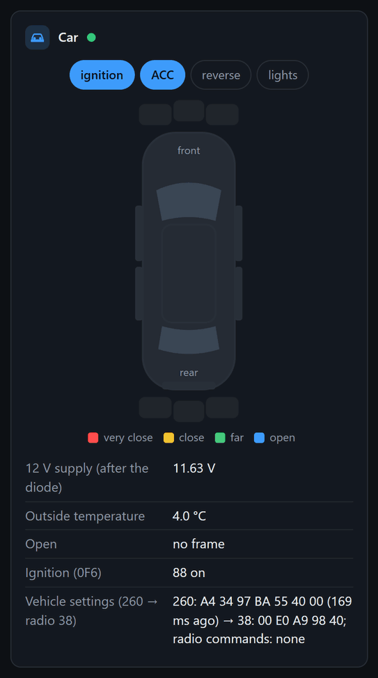
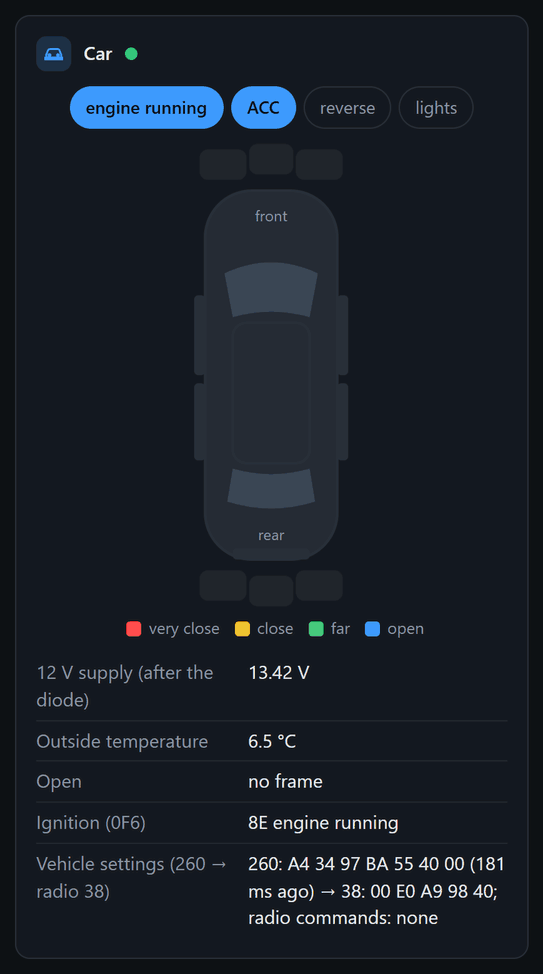
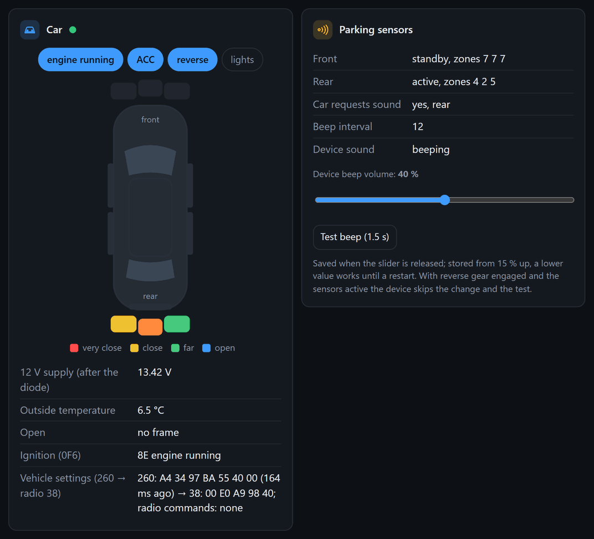
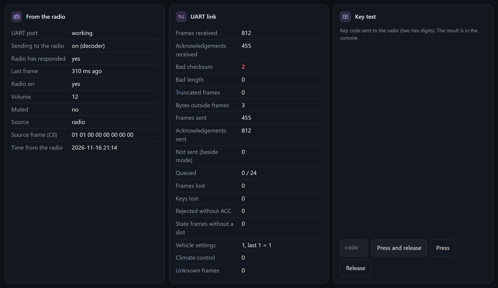

# First drive

This page tells you what to check on the first drive with the device, in which order. The first
drive is a test, not a trip. Do it in two rounds: first the device only listens next to the CAN
box, then (if you want) it replaces the box. Keep a computer on USB with the console open the whole
time, and write down what you see.

## Before you start

> [!WARNING]
> **You need a helper**
>
> The driver only drives. The helper holds the laptop and types the commands. Lay the USB cable
> so that it cannot reach the pedals or the gear lever.

- Park where you can drive slowly and stop at any time. You need an obstacle (a wall, a box) to
  approach later, in Round 1 step 5, to wake the parking sensors.
- Park with the obstacle out of sensor range: the sensors must stay quiet while you plug or unplug
  anything. Ignition off and key out at that moment.

> [!WARNING]
> **Plug and unplug only with the ignition off and the sensors quiet**
>
> On the reference car the factory parking tone sometimes kept sounding after the ignition was
> switched off during a continuous tone, for about a minute and up to 10-15 minutes
> (measured: observed in the car, many repetitions). It happened with the CAN box connected,
> when the box disappeared from the bus during a continuous tone, and once without any box. The
> cause is not known. Do not unplug the box or the device while a sensor beeps. Full story:
> [The parking tone bug](../case-studies/parking-tone-bug.md).

> [!TIP]
> **Record this drive**
>
> A recording of the first drive is the most useful thing you can bring home. The console output
> is not saved by itself. Start one of the recording tools from
> [Record the bus](../make-it-yours/record.md) before you drive. The raw frame dump (`dump` on the
> USB console) is kept only if your serial terminal saves to a file. Mark every action you do
> (ignition, lights, reverse) so you can find it later.

## Round 1: beside the box (listen only)

Build `listen` or `listen_wifi`. The CAN box stays connected and does everything as before.

1. Connect the device as in [CAN connection](can-connection.md) and
   [Radio connection](radio-connection.md#which-wires-to-connect-in-each-mode): only ground,
   +12 V, CANH, CANL and the radio TX line.
2. Open the console. The start lines must say `LISTEN ONLY` and
   `Mode: alongside the box (sends nothing).`, and `# can=ok audio=ok radio=ok`.
3. Ignition on. Type `stat`. Expected:
   - `[stat] mode=alongside the box can=ok audio=ok radio=ok`;
   - `rx=` rises, `lost=0`, `errors=0`, `bus=active`;
   - `ignition=1`, and the raw ignition byte changes when you start the engine;
   - the last line `can-tx=none` (no transmit code in this build).

    If you see something else, switch the ignition off and go to
    [When something goes wrong](#when-something-goes-wrong).
4. The LED of the ESP32 module: green while frames arrive, yellow while the device makes a sound,
   off when the bus is quiet, red after a driver error at start.
5. Drive slowly towards the obstacle. The device beeps from its own speaker by the parking sensor
   frame, in both modes, next to the car's own beeper. `stat` shows the zones in the `[park]`
   line. Set the volume with `vol 0-100` (limited to 80); `vol 0` silences it until the next
   start.
6. Reverse gear, lights on, steering wheel buttons: nothing changes for the radio (the box still
   drives it), but the device sees them. `keys` prints the button events.
7. Ignition off, key out. Watch the console: the bus keeps talking for a while, then goes quiet.
   On the reference car: about 100 s of full traffic, then 14 s of frame `036` only, then
   silence (measured: listen-only recording). About 30 s after the last frame the device goes to
   sleep. The USB computer keeps it awake, and without USB you cannot see the console: sleep
   shows only as a low current, see
   [Power and ACC, Step 3](power-and-acc.md#step-3-measure-the-parked-current).

## Round 2: decoder (the device replaces the box)

Only for a car with a profile that drives a radio (`psa_aee2010` on the reference car). Build
`decoder` or `decoder_wifi`. The device still does not transmit on the car bus.

> [!CAUTION]
> **Unplug the CAN box first**
>
> The box and the device must never be connected at the same time in this mode: two UART
> transmitters on one wire and two ACC outputs on one wire short each other.

1. Ignition off, sensors quiet. Unplug the CAN box. Connect all device wires
   ([Radio connection](radio-connection.md)).
2. Ignition on. The radio starts. The start line said `LISTEN ONLY` and
   `Mode: DECODER (sends to the radio, drives ACC).`; `stat` shows `mode=DECODER` and `acc=1`.
3. `radio`: frames from the radio arrive (`received frames=` rises). Some radios send a malformed `C5` frame; each one counts as one bad checksum and three garbage bytes, so `bad checksum=` rising slowly with `garbage=` exactly three times as large is normal. Any other ratio means a wiring or baud-rate problem.
4. Check one function at a time and write the result down:

    | Check | What you should see |
    |---|---|
    | steering wheel buttons | volume, next / previous, source work on the radio |
    | parking sensors | the radio shows the sensor picture; the device speaker beeps |
    | reverse gear | the radio shows the camera, `stat` `reverse=1` |
    | lights | the radio dims (if set to follow ILL), `stat` `lights=1` |
    | ignition off | the radio switches off about 2.5 s later |

5. If something does not work, switch the ignition off and plug the CAN box back in. The car
   works as before.

### What happened on the reference car

| Observation | Status |
|---|---|
| reception with the device: 17 169 frames without errors or losses | measured: device console |
| decoder mode, CAN box unplugged: the device recorded about 10 s of CAN frames (140.5-148.3 s and 300.2-302.5 s of the session); about 26 600 frames in between were lost by the recording in the web panel, whose browser tab was hidden, not by the device ([Record the bus](../make-it-yours/record.md)) | measured: `firmware/test_data/captures/centralka_can_20261117_184411.log` |
| in decoder mode the radio sends its commands to the device (for example vehicle settings), and the console names each of them | measured: device console |
| the factory beeping through the steering column module had been switched off in the body control unit, so the device speaker was the only parking beeper | measured: observed in the car |
| which radio functions work in decoder mode in the car, one by one | not all checked yet; the [Peugeot 508 SW](../reference/vehicles/peugeot-508.md) page lists what is measured |

## After parking: the remote key

Some aftermarket CAN boxes are known to stop the remote key from working after the car has been
parked for a while. On the reference car one box did that; with that box unplugged the remote
worked (measured: observed in the car, several tries). With another box it worked after every
parking, including overnight. Whether **the device** affects the remote key was not measured yet.

1. Lock the car with the remote, leave it for one to two hours, then open it with the remote.
2. Repeat over a few days, also after a night.
3. Write down each time: how long the car was parked, whether it was driven long before, and the
   result. A weak battery can cause the same problem, so note the battery state too.

If the remote stops working, open the car with the key blade, unplug the device and repeat the
test without it.

## When something goes wrong

- No frames, rising `errors=`, `bus=quiet` with the ignition on: see
  [CAN connection](can-connection.md#step-4-connect) and
  [Troubleshooting](../troubleshooting/index.md).
- Red LED at start: a driver failed to start. The outputs stay off and the device does not
  restart in a loop. Read the start lines in the console.
- The radio does not start in decoder mode: check `acc=1` in `stat`, then the ACC wire with a
  meter (12 V with the ignition on).

Never switch to the transmit build (`decoder_tx_wifi`) to "fix" something. Transmitting is a
separate, deliberate step: [Transmitting on the CAN bus](../safety/transmit.md). After you flash
any new program, the transmit build starts disarmed and needs `cantx on` and a restart again
([Arming](../safety/transmit.md#arming)).

Next: share your result ([Share your car](../make-it-yours/contribute.md)) or record your car
([Record the bus](../make-it-yours/record.md)).
