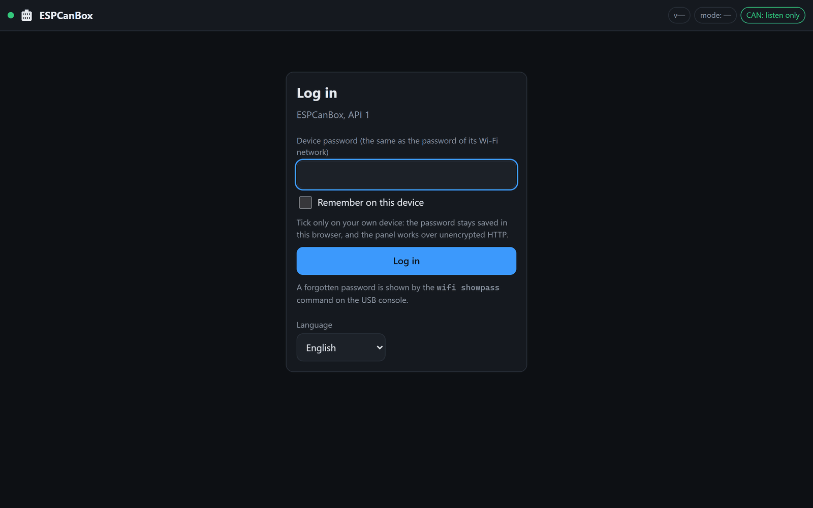
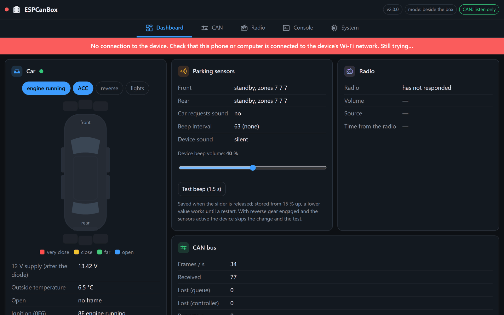

# First boot

This page shows how to read the device password and open the web panel on your phone or laptop.

It is about the builds with network (`listen_wifi`, `decoder_wifi`, `decoder_tx_wifi`,
`listen_generic_wifi`). They open their own Wi-Fi network with a web panel. The builds without
network (`listen`, `decoder`) contain no Wi-Fi code at all; for them only the USB console exists.

No board yet? Skip to [Try the panel without a board](#try-the-panel-without-a-board).

## 1. Flash a build with network

If you flashed `listen_wifi` as on the page [Flash the firmware](flash.md) (a ready image or your
own build), go to step 2.
Otherwise, in the terminal opened in the `firmware` folder (as on that page), run:

```text
uvx platformio run -e listen_wifi -t upload
uvx platformio device monitor
```

Keep the board connected to the computer. While a computer is on USB the device keeps Wi-Fi on,
even with no CAN traffic.

## 2. Read the password from the USB console

On the very first start the device generates a random password of 12 characters and stores it.
The console prints:

```text
[wifi] device password generated; the command wifi showpass shows it
```

You may not see this line: it comes at start-up, often before the monitor is connected. That is
fine. In the monitor (your typing is not shown; press Enter after each command):

1. Type `wifi`. Write down the network name from its output.
2. Type `wifi showpass`. The password is in the line `[wifi] password: <12 characters>`.

The password is both the **Wi-Fi key** of the device network and the **panel password**. It is
printed only on the USB console, never in the panel. A forgotten password is always shown again
by `wifi showpass` over USB.

> [!WARNING]
> **Keep the password out of shared logs**
>
> The line printed by `wifi showpass` contains the password. Do not paste it into a bug
> report, a forum post or a recording you share.

Optional commands:

| Command | What it shows or does |
|---|---|
| `wifi` | state of the network: its name, the address `http://10.50.8.1`, the `.local` name, connected devices, home network |
| `wifi showpass` | the device password |
| `wifi pass <new password>` | sets your own password: 10 to 63 printable characters, no spaces |
| `wifi newpass` | a new random password; the old one stops working on all devices |

All `wifi` commands work only from the USB console; the panel refuses them.

## 3. Connect to the device network

1. On your phone or laptop, open the Wi-Fi list. The network name is the project name, a `-`
   and four hex digits from the chip's MAC address (`<project name>-XXXX`). The `wifi` command prints the exact
   name.
2. Join it with the password from step 2. It is a WPA2 network.
3. If the phone asks whether to stay connected to a network without internet, choose to stay
   connected.

At most four devices can be connected at the same time (for example the radio, your phone and a laptop).

> [!NOTE]
> **VPN and mobile data**
>
> A VPN on your laptop or phone can route the address `10.50.8.1` away from the Wi-Fi network.
> Turn the VPN off while you use the panel. If the panel does not open on a phone, also turn
> off mobile data for a moment.

## 4. Open the panel

1. Open `http://10.50.8.1` in the browser. The `.local` name printed by `wifi` works too on
   systems that support mDNS.
2. Log in with the device password. Tick **Remember on this device** only on your own phone or
   laptop: then a new tab opens the panel without asking again.

The panel uses plain `http://`, not `https://`; if your browser switches to `https://` by itself,
type the address with `http://` in front.

Expected: the panel shows five tabs: **Dashboard**, **CAN**, **Radio**, **Console** and
**System**.

[](../../assets/screenshots/panel-dashboard.png)

[](../../assets/screenshots/panel-login.png)

## 5. Choose the language

The language picker is on the login screen and on the **System** tab. The panel starts in
English. Your choice is stored in the device, so another phone opens in the same language,
the login screen too. Only English is inside the panel page; another language is loaded from the
device when you pick it, and until then the panel shows English.

Available: English, Polish, German, Spanish, Russian and Ukrainian. German, Spanish, Russian and
Ukrainian are machine translations; the System tab says so while they wait for review. The
console lines, frame IDs and the `can0 ID#DATA` format are never translated.

## When Wi-Fi is on

On the desk, keep the board connected to a computer: then Wi-Fi stays on all the time. From a USB
charger or a power bank Wi-Fi goes off 60 s after start if there is no CAN traffic and you do not
use the panel.

In the car the device sits on permanent 12 V, so it does not keep Wi-Fi running all the time.
Wi-Fi is on:

- while there is traffic on the CAN bus or the radio has ACC;
- while a computer is connected to USB;
- for a short time after the bus goes quiet, if the panel is in use: up to 60 s after the last
  request from a logged-in client and at most 10 minutes in total, and only if the supply voltage
  is high enough (when the board measures it);
- for the first 60 s after a start with a silent bus, so you have time to connect.

`wifi off` turns the network off and keeps it off after a restart; `wifi on` turns it back on.

[](../../assets/screenshots/panel-offline.png)

## Optional: your home network

The device can also join your home Wi-Fi, so you can open the panel from your home network:

```text
wifi sta <network name>|<password>
```

The first `|` separates the name from the password; the password is required (8 to 63
characters, or 64 hex digits as a ready WPA2 key). `wifi sta off` forgets the network. The device
tries to connect every 30 s (every 5 minutes while someone is connected to its own network), and
never while the engine runs.

From the home network the panel is **read-only** by default. `wifi lan on` allows changes from
the home network too; `wifi lan off` blocks them again. Arming the CAN transmit build is never
allowed from the home network, only from the device's own network or USB.

## Try the panel without a board

`firmware/tools/mock_device.py` is a mock of the device: it replays a CAN recording and answers
the same HTTP requests as the firmware, with the same panel page. It needs only Python 3.

In the terminal opened in the `firmware` folder, run (on Linux and macOS type `python3` instead
of `python`):

```text
python -I tools/mock_device.py test_data/captures/can_20261111_191045.log
```

It prints the address and a random mock password:

```text
Device mock: http://127.0.0.1:8080/  (frames in the capture: ..., VIN masked)
mock password: ...
```

1. Open `http://127.0.0.1:8080/`. Expected: the login screen.
2. Log in with the mock password. Expected: the Dashboard with traffic from the recording.
3. Keep the terminal window open while you use the panel. Stop the mock with Ctrl+C.

Use a recording that has traffic from the start, such as `can_20261111_191045.log`; a recording
that starts with a quiet bus shows no traffic during that time.

Useful options:

| Option | Effect |
|---|---|
| `--password <text>` | your own mock password (10 to 63 characters) |
| `--port 8081` | another port |
| `--mode decoder` | behave like a decoder build |
| `--lan` | behave as if you were on the home network (read-only, login lockout) |
| `--lan --lan-admin` | as after `wifi lan on` |
| `--speed 2` | replay twice as fast |
| `--no-loop` | do not repeat the recording |

The mock simplifies a few things (for example the beeper and key decoding); the list is at the
top of the script.

## Next

[Bench test](bench-test.md): check the board before it goes into the car.
