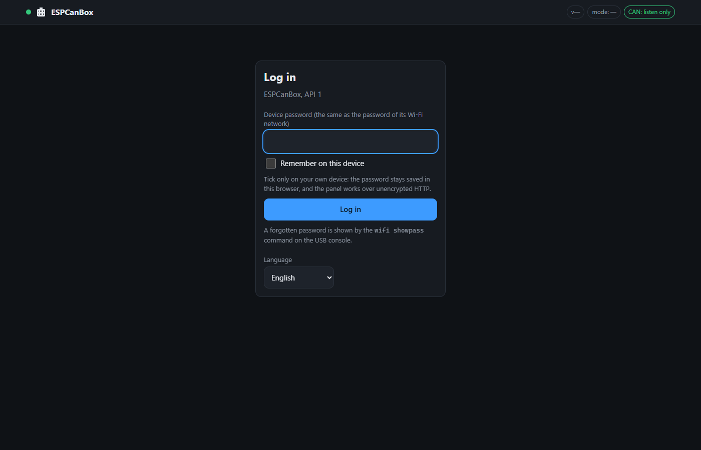
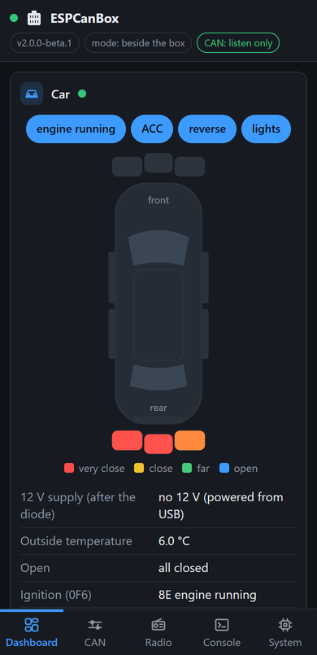
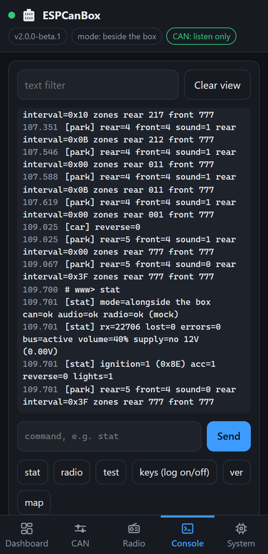
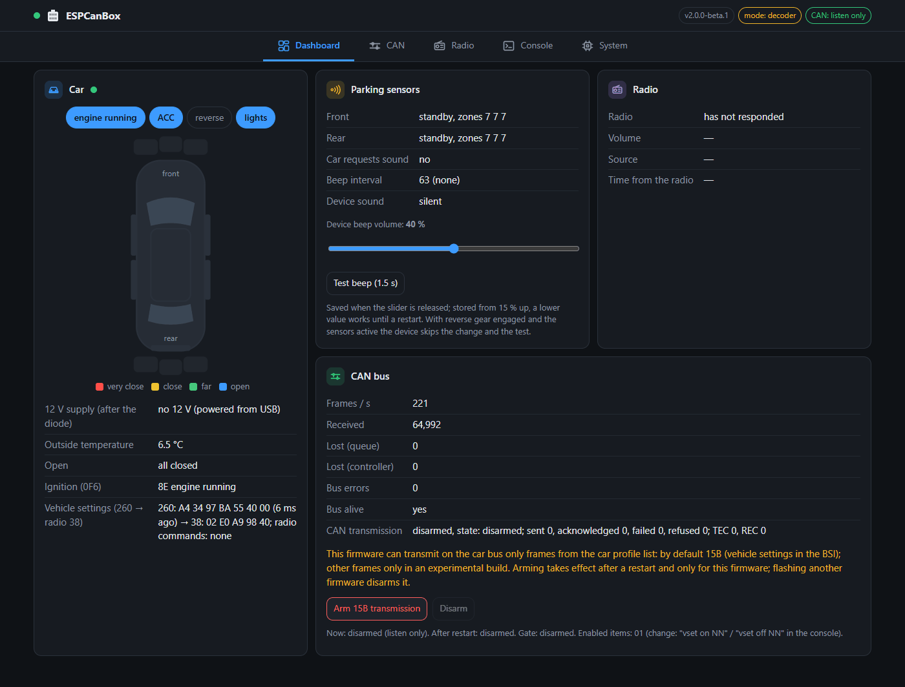
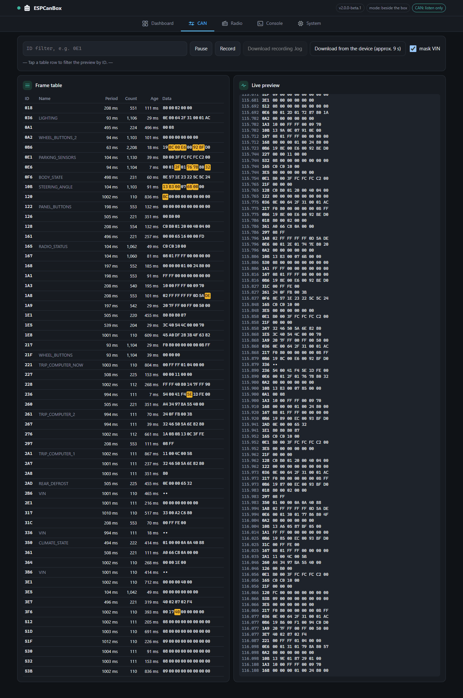
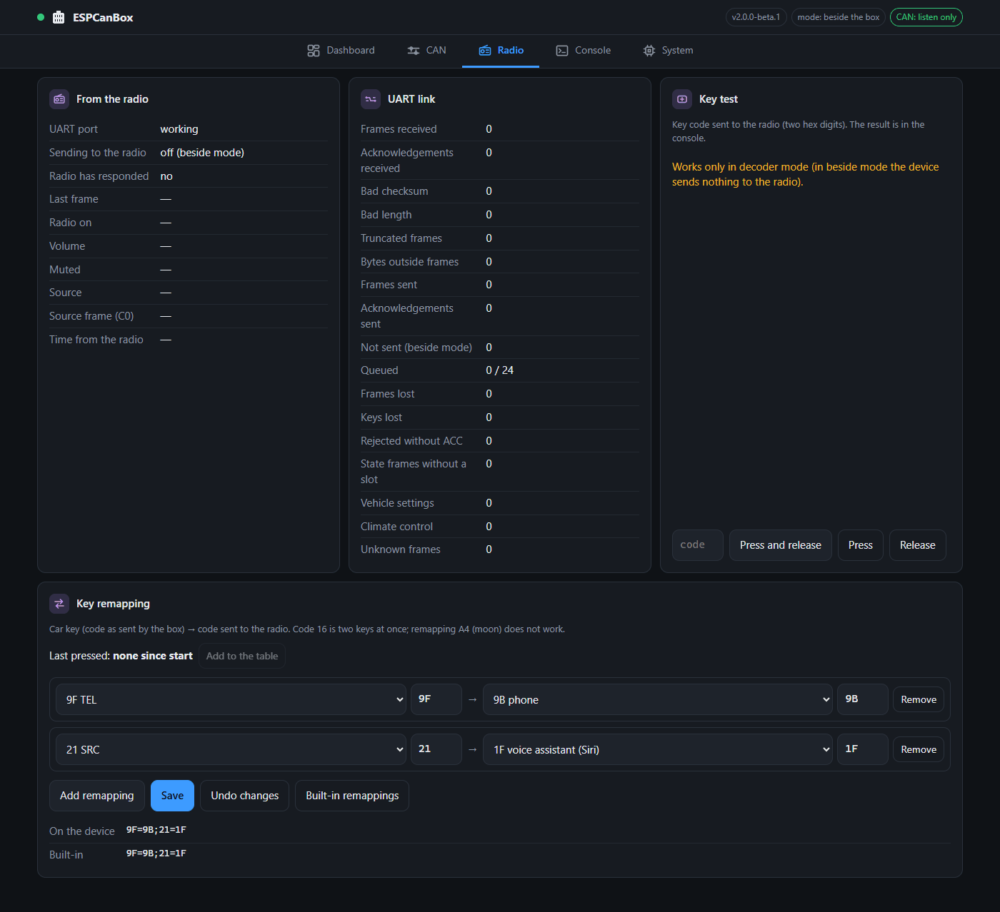
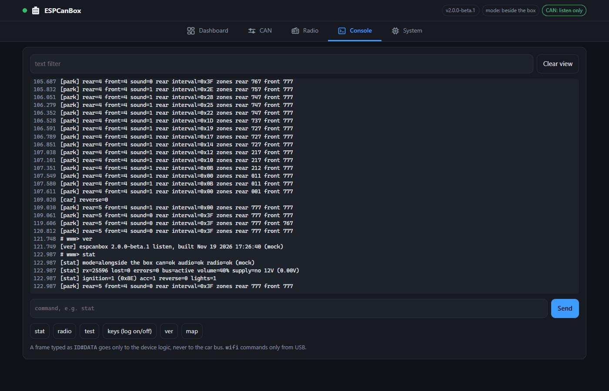
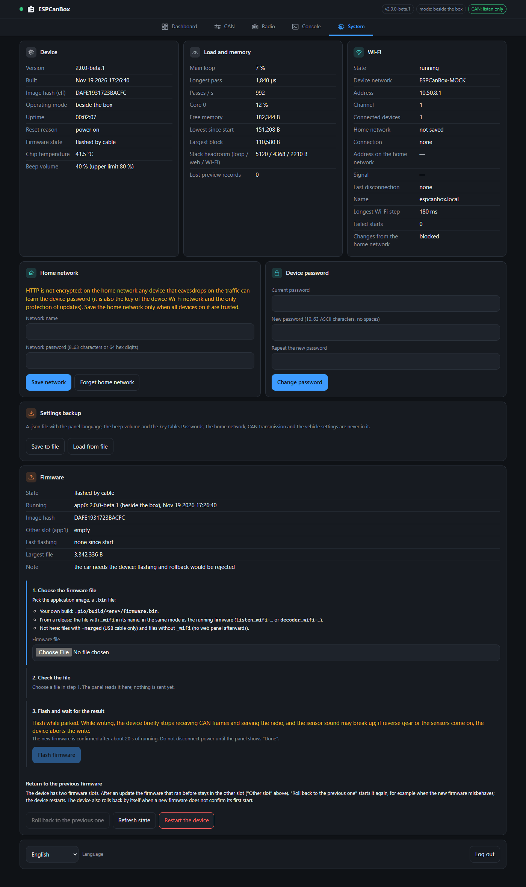
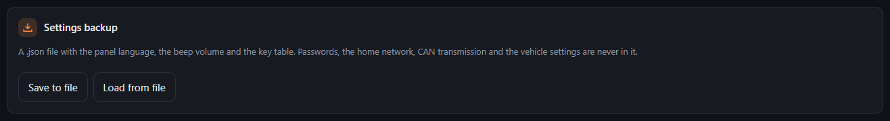
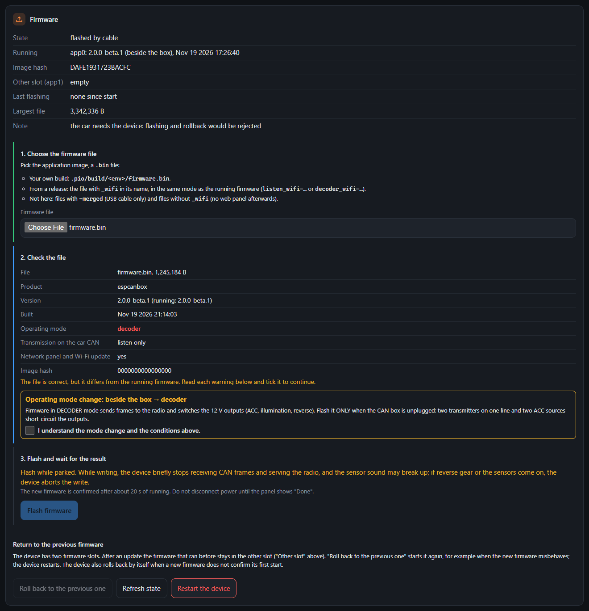

# Web panel guide

This page says how to open the web panel and what each card and button does. The web panel is a
small web page served by the device itself. You open it on a phone, a laptop or the browser of
the radio. It shows what the device sees on the CAN bus and on the radio line, and it lets you
change a few settings and update the firmware over Wi-Fi.

The panel exists only in the programs built with network (`listen_wifi`, `decoder_wifi`,
`decoder_tx_wifi`, `listen_generic_wifi`). This page follows `firmware/web/index.html` and the
English dictionary `firmware/web/i18n/en.json`. The requests behind each card are on
[Panel API](panel-api.md).

> [!TIP]
> **Try it without a board**
>
> `firmware/tools/mock_device.py` replays a CAN recording and serves the same panel on your
> computer. In `firmware/` run
> `python -I tools/mock_device.py test_data/captures/can_20261111_191045.log` and open
> `http://127.0.0.1:8080/`. The password is printed at start. More options:
> [Panel API, chapter 9](panel-api.md#9-requirements-for-the-mock-firmwaretoolsmock_devicepy).

The screenshots on this page come from the mock device with a recording, never from a car. They
show the dark scheme and the English texts.

## Open the panel

1. Find the device password. Connect USB and type `wifi showpass` on the
   [console](console.md). It is also the key of the device Wi-Fi network.
2. Connect the phone or laptop to the device network. Its name ends with four hex digits. Type
   `wifi` on the console to see the exact name: `[wifi] device network: <name>, address http://10.50.8.1`.
3. Open `http://10.50.8.1/`. The `.local` name that `wifi` prints works too, but not on every
   system. Use `http`, not `https`.
4. Type the password and press **Log in**. You can pick the language on the same screen.
   Expected: the cards of the Dashboard fill in.

[](../../assets/screenshots/panel-login.png)

The password is kept only for the current tab: a new tab or a browser restart asks for it again.
Tick **Remember on this device** before **Log in** to keep it in the browser instead, so every
tab opens the panel without asking, also after a browser restart. Tick it only on your own phone or
laptop: the password stays saved in that browser until you press **Log out** (System tab), and the
panel works over unencrypted HTTP. A password change made in the panel updates the saved copy. When
the device rejects the saved password (changed elsewhere), the panel forgets it and asks again.

The device switches Wi-Fi off when the car is asleep. Wi-Fi runs while:

- the car is awake (frames on the bus, or ACC to the radio), or
- a computer is connected to USB.

After the bus goes quiet, Wi-Fi stays on only for a logged-in client that asked something in the
last 60 s. That lasts at most 10 minutes, and only while the supply behind the input diode is at
least 11.0 V (about 11.8 V at the battery), when the board measures it. After a start with a
silent bus, the first 60 s count as such a request. More rules:
[Panel API](panel-api.md#post-apirestart). If the panel does not open, see
[Troubleshooting](../troubleshooting/index.md#the-web-panel-does-not-open).

The name of the network and the `.local` name come from `ap_ssid_prefix` and `mdns_host` in
`project.json`; change them there only if you rename the project.

> [!WARNING]
> **The home network is less safe**
>
> The panel uses plain HTTP. On a home network any device that listens to the traffic can learn
> the password, and that password also protects firmware updates. From the home network the panel
> is read only until you type `wifi lan on` on USB. See [Security model](../safety/security.md).

## The top bar and the tabs

- **Dot** next to the name: the connection to the device. When it is lost, a banner says
  "No connection to the device" and the panel keeps trying.
- **Badges:** the firmware version, the operating mode (`mode: beside the box` or
  `mode: decoder`, the decoder badge is highlighted) and a fixed badge "CAN: listen only".
  "Beside the box" is the same mode that the console prints as `alongside the box` and `ver` as
  `listen`.

> [!WARNING]
> **The badge \"CAN: listen only\" never changes**
>
> It stays the same in the program with CAN transmission (`decoder_tx_wifi`). The real state of
> transmission is only on the **CAN bus** card of the Dashboard.

- **Tabs**: Dashboard, CAN, Radio, Console, System, at the bottom on a phone and under the top bar
  on a wide screen. A tab in the background of the browser does not poll the device.

[](../../assets/screenshots/panel-phone-dashboard.png) [](../../assets/screenshots/panel-phone-console.png)

## Dashboard

[](../../assets/screenshots/panel-dashboard.png)

### Car

- Chips: **ignition** (shown as "engine running" when the ignition byte says so), **ACC**,
  **reverse**, **lights**. A lit chip means "on".
- A top view of the car: three sensor zones in front and three at the back, coloured from "very
  close" to "far", and the five doors, which light up when open.
- Rows: **12 V supply (after the diode)** (or "no 12 V (powered from USB)"), **Outside
  temperature**, **Open** (which doors are open, or "all closed", or "no frame"), **Ignition
  (0F6)**, **Vehicle settings (260 → radio 38)**.

The vehicle settings row only reads. It shows the last frame `260` with its age, the state the
device sends to the radio in frame `38`, and the last radio command `80` with its result, for
example `260: A4 1C 8F BB C5 50 00 (212 ms ago) → 38: 02 90 A9 B8 40; radio commands: none`.

### Parking sensors

- Rows: **Front**, **Rear** (state and zones), **Car requests sound**, **Beep interval**,
  **Device sound** (silent, beeping, continuous tone). A tag "no fresh frame" appears when frame
  `0E1` stops coming.
- **Device beep volume** slider: 0 to 80 %. The panel sends the new value only when you release
  the slider, because every change is a flash write. Below 15 % the value works only until a
  restart.
- **Test beep (1.5 s)**.

While reverse gear is engaged or the sensors are active, the device skips volume changes and the
test from the panel.

### Radio {#dashboard-radio}

Radio on or off, volume, source and the time the radio reports. The Radio tab has more.

### CAN bus

Rows: **Frames / s**, **Received**, **Lost (queue)**, **Lost (controller)**, **Bus errors**,
**Bus alive**, **CAN transmission**.

In a program without transmission, **CAN transmission** says "none (firmware without
transmission)". In the program built with `decoder_tx_wifi` the card also shows a box with a
warning and two buttons:

> [!CAUTION]
> **Transmits on the car bus**
>
> **Arm 15B transmission** lets the device send frame `15B` to the body control unit after the
> next restart. Read [Transmitting on the CAN bus](../safety/transmit.md) first. The button asks once
> more before it does anything.

- **Arm 15B transmission** sends `cantx on`. Arming takes effect after a restart and only for this
  firmware.
- **Disarm** sends `cantx off` and works at once.
- Both buttons work only when your phone is connected to the **device network**. Through the home
  network they stay disabled and the box says so.
- Below the buttons: the state now, the state after a restart, the gate state (with the reason of
  an error, if any) and the enabled items of the settings mask.

[](../../assets/screenshots/panel-dashboard-decoder-tx.png)

## CAN

[](../../assets/screenshots/panel-can.png)

- **ID filter** (for example `0E1`): shows only one identifier in the live preview. You can also
  tap a row of the table.
- **Pause / Resume**: stops the live preview on the screen.
- **Record / Stop recording** and **Download recording .log**: the browser collects frames for as
  long as you want and saves a file in the recording format `(s.mmm) can0 ID#DATA`. Recording
  works while the panel tab stays visible: a hidden browser tab stops polling and frames get lost.
- **Download from the device (approx. 9 s)**: downloads the frames that are still in the device
  memory (`/api/trace.log`).
- **mask VIN** (on by default): hides the data of the frames that carry the VIN (`336`, `3B6`,
  `2B6`) on the screen and in both downloads. Keep it on when you share a screenshot or a file.
- **Frame table**: one row per identifier with ID, name (from the car profile), period, count, age
  and the last data. A note shows how many IDs did not fit in the table.
- **Live preview**: the newest frames.

## Radio {#radio-tab}

[](../../assets/screenshots/panel-radio.png)

- **From the radio**: UART port, sending to the radio (off in beside mode), whether the radio has
  responded, last frame, radio on, volume, muted, source, the raw source frame (`C0`), time.
- **UART link**: counters of frames received and sent, errors (bad checksum, bad length, truncated
  frames, bytes outside frames), queue, lost frames and keys, frames rejected without ACC, state
  frames without a slot, and the last vehicle setting and climate commands from the radio.
- **Key test**: type a two-digit hex code and press **Press and release**, **Press** or
  **Release**. The result is in the console. It reaches the radio only in decoder mode.
- **Key remapping**: a table "car key → radio function". **Last pressed** shows the last button
  from the car; **Add to the table** puts it in a new row. **Add remapping**, **Save**, **Undo
  changes**, **Built-in remappings** (restores the firmware defaults). At most 16 rows. The row
  below shows what is stored on the device and what is built in.

Code `16` is two car buttons at once (both volume buttons, and the panel knob press). A remapping of
`A4` (moon) has no effect. The codes are listed in
[Panel API, chapter 10](panel-api.md#10-tables-for-the-panel).

## Console

[](../../assets/screenshots/panel-console.png)

The same lines as the USB console, with a text filter and **Clear view** (clears only the
screen). Type a command and press **Send**, or use the quick buttons `stat`, `radio`, `test`,
`keys (log on/off)`, `ver`, `map`.

- A frame typed as `ID#DATA` goes only to the device logic, never to the car bus.
- `wifi` commands work only on USB: they contain passwords.
- `cantx reset` and `set NN VV` work only on USB.

All commands: [USB console](console.md).

## System

[](../../assets/screenshots/panel-system.png)

- **Device**: version, build time, image hash (`elf`), operating mode, uptime, reset reason,
  firmware state, chip temperature, beep volume.
- **Load and memory**: main loop load, longest pass, passes per second, core 0 load, free memory,
  lowest since start, largest block, stack headroom (loop / web / Wi-Fi), lost preview records.
- **Wi-Fi**: state, device network name and address, channel, connected devices, home network,
  connection, address on the home network, signal, last disconnection, name, longest Wi-Fi step,
  failed starts, whether changes from the home network are allowed.
- **Home network**: name and password (8 to 63 characters, or 64 hex digits). **Save network** or **Forget home
  network**. The device Wi-Fi restarts for about 1 to 3 s after a change; with the engine running
  the device does not join the home network.
- **Device password**: current password, new password twice (10 to 63 ASCII characters, no
  spaces). After the change every phone has to reconnect to the device network with the new
  password.
- **Settings backup**: **Save to file** downloads a `.json` file with the panel language, the
  beep volume and the key table; **Load from file** sends such a file back. Passwords, the home
  network, CAN transmission and the vehicle settings are never in it. Details:
  [Settings](settings.md).
- **Firmware**: see below.
- **Language** and **Log out** at the bottom.

[](../../assets/screenshots/panel-system-settings-backup.png)

### Firmware update

> [!WARNING]
> **Update only while parked**
>
> While the device writes the new firmware it briefly stops receiving CAN frames and serving the
> radio, and the sensor sound may break up. It refuses or aborts the update when reverse gear or
> the sensors come on.

1. On the computer, build an image of the environment you want, for example `listen_wifi`. In a
   terminal in the `firmware` directory type:

    ```bash
    uvx platformio run -e listen_wifi
    ```

    Expected: `SUCCESS`. The file is `firmware/.pio/build/listen_wifi/firmware.bin` (for another
    environment, its name instead of `listen_wifi`).
2. The **Firmware** card is a wizard in three steps. **Step 1, Choose the firmware file:** pick
   `firmware.bin` from your build, or from a release the `.bin` file without `-merged` in its name
   (the `-merged` file is only for flashing by USB cable and is refused).
3. **Step 2, Check the file:** the panel reads the marker in the file and shows the product,
   version, build time, operating mode, whether the firmware can transmit on the car CAN and
   whether it has the network panel. A file without the marker of this device is refused before
   anything is sent. When the file has another operating mode, another CAN transmission setting
   or no network panel, each difference gets its own warning with a tick box; step 3 opens only
   when every box is ticked.
4. **Step 3, Flash and wait for the result:** press **Flash firmware** and confirm. The panel shows
   the progress, then waits for the restart and checks which firmware runs. "Done" means the new
   firmware runs and is confirmed. If the new firmware does not confirm itself, the device goes
   back to the previous one and the panel says "ROLLBACK happened". After a failure the panel says
   what to do next.

[](../../assets/screenshots/panel-system-firmware-wizard.png)

**Return to the previous firmware:** the device has two firmware slots, and after an update the
firmware that ran before stays in the other slot (row "Other slot" of the state above).
**Roll back to the previous one** starts it again; the device restarts. Other buttons:
**Refresh state**, **Restart the device**.

> [!CAUTION]
> **A decoder mode image switches the 12 V outputs**
>
> An image in decoder mode sends frames to the radio and switches ACC, illumination and reverse.
> Flash it only with the CAN box unplugged: two transmitters on one line and two ACC sources
> short the outputs.

## Languages

The panel speaks English by default. The language you pick is stored in the device (NVS key
`ui_lang`), so every browser opens in it; the browser keeps only a cache (`localStorage`, key
`ui_lang`). Only English is inside the panel page: another dictionary is loaded from the device
(`GET /i18n/<lang>.json`) when you pick that language, and until then the panel shows English. The
dictionaries are in `firmware/web/i18n/`. The Polish dictionary was written by the author; German, Spanish, Russian
and Ukrainian are machine translations marked "needs native review", and the panel shows a note
when one of them is chosen.
How to improve one: [Translations](../contributing/translations.md) and the
[Glossary](../contributing/glossary.md).

Next: all commands are on [USB console](console.md). When something does not work, see
[Troubleshooting](../troubleshooting/index.md).
