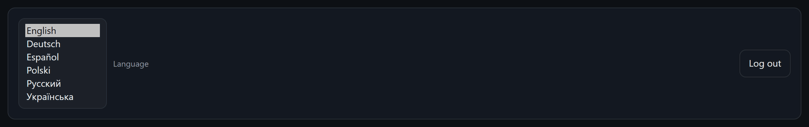
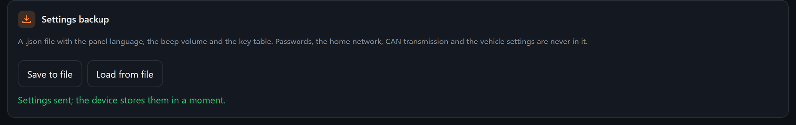
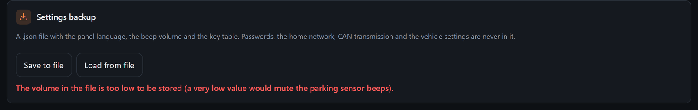

# Settings

This page lists every setting you can change on the device, where the device keeps it and
whether it survives a restart. A setting kept in **NVS** (the non-volatile storage area of the
ESP32 flash) survives a restart, a power cut and a firmware update over Wi-Fi or USB `upload`. It is
erased only by flashing the merged image (all partitions) from address 0, because that file also
covers the NVS area. Code: `firmware/src/settings.h`.

## Where each setting lives

| Setting | Changed by | Lives in | After a restart |
|---|---|---|---|
| Device password (panel login and device Wi-Fi key) | USB `wifi pass`, `wifi newpass`; `POST /api/password` | NVS `pass` | kept |
| Home network (name and password) | USB `wifi sta`; `POST /api/wifi` | NVS `sta_ssid`, `sta_pass` | kept |
| Key remap table | `map FROM TO`, `map reset` (USB or panel console); `POST /api/keymap`; import | NVS `keymap` | kept |
| Beep volume, 15..100 % | `vol N`; import | NVS `vol` | kept |
| Beep volume below 15 % | `vol N` | RAM only | back to the stored value (at least 15 %), on purpose: one `vol 0` must not mute the parking sensors for good |
| Network on / off | USB `wifi on`, `wifi off` | NVS `net_on` | kept |
| Changes from the home network | USB `wifi lan on`, `wifi lan off` | NVS `lan_admin` | kept |
| Panel language | `lang CODE`, `lang default`; panel language menu (`POST /api/lang`); import | NVS `ui_lang`; the browser keeps a cache in `localStorage` | kept; the device value wins over the browser cache |
| CAN transmit arming (`decoder_tx_wifi` only) | `cantx on`, `cantx off` | NVS `cantx` (build string of the program) | kept **only for the same program**: any other program clears it at start. Takes effect only after a restart. Unchanged by this page |
| Vehicle settings item mask (`decoder_tx_wifi` only) | `vset on NN`, `vset off NN` | NVS `vsetmask` | kept |
| Door side swap | `doorswap` | RAM only | back to the profile default (measured in the car); a test command |
| CAN frame dump on USB | `dump` | RAM only | off (diagnostic output) |
| Radio UART print | `rxlog` | RAM only | off (diagnostic output) |
| Key event print | `keys` | RAM only | default (diagnostic output) |
| Panel password in the browser | panel login | browser `sessionStorage` of one tab; `localStorage` with **Remember on this device** | `sessionStorage`: gone when the tab is closed, a new tab asks again; `localStorage`: every tab, until **Log out** |

Commands that do something once (`test`, `key`, `kd`, `ku`, `cantx reset`, `set NN VV`, a pasted
frame) store nothing. The radio cannot change a device setting: its setting commands (`80 NN VV`)
go to the car, not into NVS.

### How writes are made

- A write goes to flash only when the value changes; the same value writes nothing.
- A flash write stops CAN reception for a few milliseconds. So no write happens while the car
  needs the device (reverse gear, active parking sensors) or while the CAN transmitter window is
  open. From USB, `lang` and `settings import` are then refused ("try again shortly"); `vol` and
  `map` are done in RAM at once and written later. From the panel, writing requests wait in the
  queue until that state ends.
- Every write is checked. On a failed write the old value stays and the console says so.
- Every stored value is checked again when the device starts. A damaged or wrong value counts as
  "nothing stored" and the default applies. The panel language must also be one of the
  dictionaries built into the running image; otherwise the panel opens in English.

## Panel language

```text
lang                 show the stored language and the built-in list
lang pl              store Polish
lang default         forget the choice (English)
```

`GET /api/hello` gives the stored language without a login, so the login screen opens in it. The
panel saves a choice made after login at once, and a choice made on the login screen right after
login. See [Panel API](panel-api.md).

[](../../assets/screenshots/panel-system-language-list.png)

## Backup and restore

The backup is one JSON object without passwords:

```json
{"v":1,"lang":"pl","vol":40,"keys":"9F=9B;21=1F","net":true,"lan":false}
```

`null` means "nothing stored, the default applies". `net` and `lan` are there for information:
an import never changes them, because they decide who can reach the device. Change them with
`wifi on|off` and `wifi lan on|off` on USB. Not in the backup at all: the device password, the
home network, CAN transmit arming and the vehicle settings mask.

```text
settings                          print the backup: [settings] {"v":1,...}
settings import {"vol":40}        import; any subset of the fields
settings import {"keys":null}     back to the car profile's key remappings
```

A console line holds at most 127 characters. A full backup with a long key table does not fit in
one `settings import` line: import it in two lines, for example the key table alone
`settings import {"keys":"..."}` and the rest in a second line.

The import checks everything first. A bad field (unknown name, wrong type, a language that is not
built in, a volume below 15, a bad key table) refuses the whole line and changes nothing. Then the
fields are written one by one and the console prints
`[settings] import: lang=ok vol=ok keys=ok` (`-` = not given, `FAILED` = flash write error).

Over the network the same backup is `GET /api/settings` and `POST /api/settings`. The panel has no
export / import buttons yet (planned).

[](../../assets/screenshots/panel-system-backup-imported.png)

[](../../assets/screenshots/panel-system-backup-import-rejected.png)
