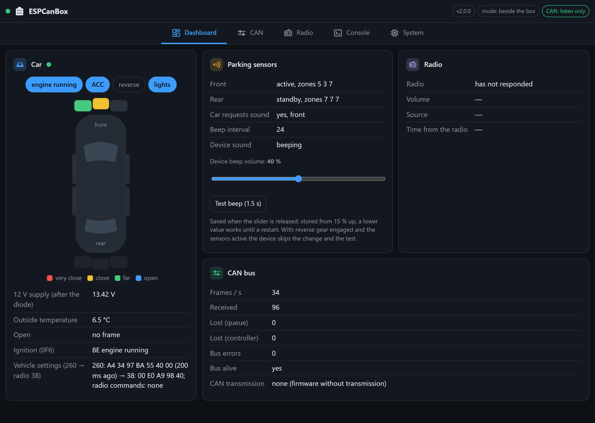

# Presentación

> [!NOTE]
> **Traducción automática, pendiente de revisión**
>
> Esta página se ha traducido automáticamente. El texto vinculante es la página en inglés.
> Si encuentras un error, consulta [cómo enviar una corrección](../en/contributing/translations.md#send-your-work).

Este proyecto es un dispositivo abierto con ESP32-S3 que se coloca entre el bus CAN del coche y
una radio Android. Puede sustituir a la caja de interfaz CAN de posventa («la caja») que se vende
con la radio.

> [!CAUTION]
> **Proyecto aficionado, tal cual**
>
> Lo usas bajo tu propia responsabilidad y en tu propio coche. Por defecto el dispositivo
> **solo escucha** el bus del coche. Para transmitir hace falta una compilación aparte y armarla a
> mano. No lo uses para nada que afecte a la seguridad. Lee [Seguridad](getting-started/safety.md)
> antes de conectar nada.

> [!NOTE]
> **Sin vínculo con las marcas**
>
> Este proyecto no está vinculado, respaldado ni relacionado con Peugeot, Stellantis,
> Simple Soft, Raise, Junsun ni FYT. Sus nombres se usan solo para indicar qué se ha probado.

## Qué hace el dispositivo {#what-the-device-does}

- **Escucha el bus CAN del coche** en modo solo escucha, con el transceptor en silencio. Ningún
  entorno de compilación, salvo `decoder_tx_wifi`, contiene código de transmisión.
- **Pita para los sensores de aparcamiento** por su propio altavoz, a partir de la trama `0E1`.
- **Habla con la radio** en modo decodificador, por UART, con el protocolo «XP» de la caja Simple
  Soft: botones, pantalla de los sensores de aparcamiento, ordenador de a bordo, temperatura
  exterior, estado del climatizador, puertas y ajustes del vehículo.
- **Controla tres salidas de 12 V** en modo decodificador: ACC (alimentación de la radio),
  iluminación y marcha atrás.
- **Panel web** en su propia red Wi-Fi: estado, tramas CAN en directo, consola, grabación y
  actualización del firmware.
- **Consola USB** con un formato de línea fijo (`can0 ID#DATA`, comentarios que empiezan por `#`).

Cómo encajan las piezas: [Cómo funciona](../en/getting-started/how-it-works.md).

## Qué se ha probado {#what-is-tested}

El firmware y la placa se desarrollaron y midieron en **un** coche con **una** radio:

| Coche | Perfil | Estado |
|---|---|---|
| Peugeot 508 SW, 2015 (PSA AEE2010) | `psa_aee2010` | medido (measured) en un coche |
| cualquier coche | `generic` | solo escucha: graba tramas, no envía nada a la radio, salidas de 12 V apagadas |

En el coche de referencia el bus de la radio funciona a 125 kbit/s (medido: recibido sin
errores). Sus tensiones parecen de CAN de baja velocidad tolerante a fallos (low-speed
fault-tolerant); hace falta un osciloscopio para confirmarlo. Detalles:
[Peugeot 508 SW](../en/reference/vehicles/peugeot-508.md).

Estado: la versión 2.0.0 compila, pasa las pruebas en el ordenador, se probó en banco en una placa ESP32-S3-WROOM-1-N16R8 y se probó en un solo coche el 20-11-2026, incluido el sueño profundo y el despertar desde el bus.

## Por dónde empezar {#where-to-start}

Sigue las páginas en este orden:

1. [Seguridad](getting-started/safety.md): qué puede salir mal y las reglas del proyecto.
2. [Qué necesitas](../en/getting-started/requirements.md): placa, componentes y herramientas.
3. [Inicio rápido](quick-start/flash.md): compilar, flashear y abrir el panel en tu mesa, sin coche.
4. Después, uno de estos dos caminos:
    - **Tu coche no es el coche de referencia:** [Adáptalo a tu coche](make-it-yours/porting-checklist.md)
      explica cómo encontrar el bus, grabarlo, decodificar tramas y escribir un perfil.
    - **Tienes el coche y la radio de referencia:** [Instalación en el coche](../en/install-in-car/checklist.md).
5. [Contribuye](make-it-yours/contribute.md) con tus grabaciones o la descripción de tu coche.

¿Aún no tienes placa? El dispositivo simulado ejecuta el panel web en tu ordenador con una
grabación del coche; consulta [Primer arranque](quick-start/first-boot.md).

## Licencias {#licences}

Código Apache-2.0, documentación CC BY 4.0, hardware CERN-OHL-S-2.0. Qué licencia cubre qué
archivos y qué partes de otros proyectos hay en las imágenes de firmware: `README.md` y `NOTICE`
en el repositorio. Autor: grabowski98.
