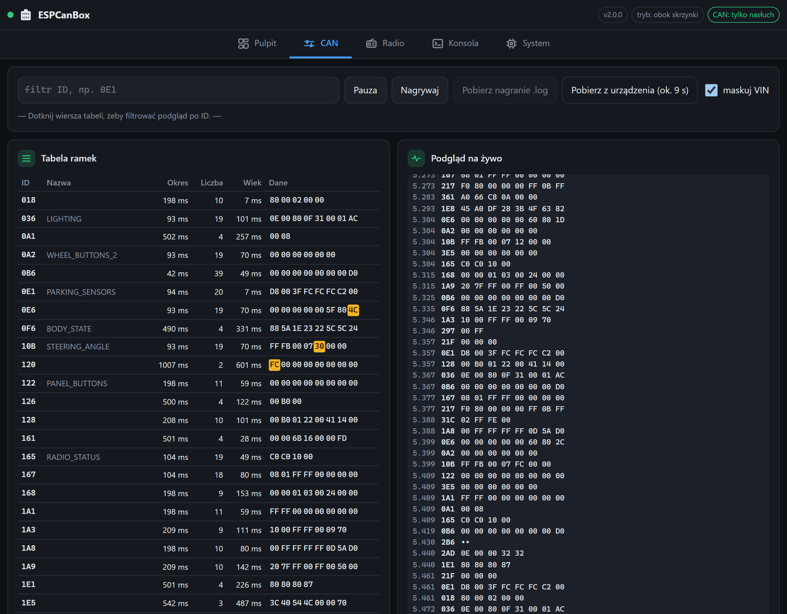

# Połączenie z CAN

> [!NOTE]
> **Tłumaczenie maszynowe, wymaga sprawdzenia**
>
> Tę stronę przetłumaczono automatycznie. Wiążący jest tekst angielski. Jak zgłosić poprawkę:
> [Tłumaczenia](../contributing/translations.md#send-your-work).

Ta strona pokazuje, jak znaleźć dwa przewody CAN (CANH i CANL), jak rozpoznać rodzaj magistrali
CAN i jak podłączyć do nich urządzenie, nie przeszkadzając autu. Urządzenie potrzebuje tych dwóch
przewodów i wspólnej masy.

## Zasady {#rules}

1. **Równolegle.** Urządzenie dołącza do istniejącej pary. Nigdy nie przecinaj przewodów CAN
   i nigdy nie wstawiaj urządzenia „szeregowo” między auto a inny moduł.
2. **Bez terminatora.** Magistrala CAN ma już swoje rezystory terminujące (120 omów), w modułach
   auta. Urządzenie nie może dokładać własnego. Na module CAN Pal prototypu v1 przełącznik
   terminatora jest na OFF.
3. **Najpierw tylko nasłuch.** Pierwsza instalacja zawsze z wersją tylko do nasłuchu, a na
   prototypie v1 z otwartą JP1. Zobacz [Nadawanie na magistralę CAN](../safety/transmit.md).
4. **Zmierz, zanim podłączysz.** Znajdź parę próbnikiem ciągłości i sprawdź ją woltomierzem.
   Nigdy nie ufaj samemu kolorowi przewodu ani rysunkowi sprzedawcy.

Pełna lista sprawdzeń przed autem jest na stronie [Lista kontrolna montażu](checklist.md).

> [!CAUTION]
> **Nie zamieniaj CANH z CANL i nigdy nie podłączaj ich do +12 V**
>
> Sprawdź każdy przewód miernikiem, zanim przykręcisz go do urządzenia. Przewód CAN na +12 V
> może uszkodzić transceiver i moduł auta na drugim końcu.

## Krok 1: znajdź parę {#step-1-find-the-pair}

W aucie ze skrzynką CAN z zestawu radia para CAN zwykle idzie ze złącza auta za radiem **tylko do
wtyczki skrzynki CAN**. Samo radio nie ma przewodów CAN.

1. Odepnij wiązkę od auta.
2. Próbnikiem ciągłości znajdź dwa przewody, które idą ze złącza auta tylko do wtyczki skrzynki CAN
   (nie do wtyczek radia).
3. Zapisz oba końce każdego przewodu i widok, którego użyłeś (strona przewodów czy strona styków,
   gdzie jest zatrzask).

Jak rozpisać całą wiązkę: [Szukanie i sprawdzanie przewodów](../hardware/wiring.md).

## Krok 2: zmierz napięcia {#step-2-measure-the-voltages}

1. Wepnij wiązkę z powrotem. Zapłon włączony.
2. Miernik na napięciu stałym, minus na masie.
3. Dotknij sondą plus po kolei każdego przewodu CAN. Przy wpiętej wiązce dotknij przewodu od tyłu
   złącza cienką sondą albo użyj rozgałęźnika (T-adaptera). Nie przekłuwaj przewodów CAN.
4. Porównaj z tabelą.

Miernik pokazuje **średnie** napięcie podczas przesyłania ramek, a to wystarcza, żeby odróżnić dwa
rodzaje magistrali.

| Co odczytujesz | Rodzaj magistrali | Co to znaczy |
|---|---|---|
| oba przewody blisko 2,5 V (CANH trochę wyżej, CANL trochę niżej) | **CAN high-speed** (ISO 11898-2) | poziom spoczynkowy około 2,5 V na obu liniach; zwykła prędkość 500 kbit/s, czasem 250 kbit/s |
| jeden przewód blisko 0 V, drugi blisko 5 V | prawdopodobnie **CAN low-speed fault-tolerant** (ISO 11898-3) | poziom spoczynkowy: CANH blisko 0 V, CANL blisko 5 V; prędkość do 125 kbit/s. Przewód blisko 0 V to CANH |
| 0 V na obu | brak ruchu, złe przewody albo magistrala śpi | spróbuj znowu przy włączonym zapłonie i pracującym silniku |
| około 12 V | przewód zasilania, nie CAN | przerwij: zły przewód |

To ogólne właściwości obu standardów, nie fakty o jednym aucie. Miernik daje tylko wskazówkę:
oscyloskop pokazuje poziom spoczynkowy i poziom w trakcie nadawania oraz długość bitu (8 µs na bit
przy 125 kbit/s, 2 µs przy 500 kbit/s).

Jak ustalić prędkość transmisji urządzeniem w trybie tylko do nasłuchu:
[Znajdź swoją magistralę CAN](../make-it-yours/find-your-bus.md).

### Przykład: Peugeot 508 SW (auto wzorcowe) {#example-peugeot-508-sw-reference-car}

| Fakt | Status |
|---|---|
| pin 10 Quadlocka = CANH, pin 13 = CANL | zmierzone (measured): ciągłość od transceivera skrzynki CAN do pinu 10, potem potwierdzone odbiorem bez błędów przy tym przypisaniu (17 169 ramek, bez błędów, bez zgubionych) |
| napięcie stałe względem masy, zapłon włączony, średnia: pin 10 = 0,65 V, pin 13 = 4,5 V; tak samo z podłączonym urządzeniem i bez niego | zmierzone: miernik |
| te poziomy wyglądają na **CAN low-speed fault-tolerant**, nie high-speed | wniosek z napięć, niepotwierdzony: potrzebny oscyloskop (poziomy spoczynkowy i dominujący) |
| prędkość 125 kbit/s | zmierzone: ramki odebrane bez błędów przy tej prędkości |
| transceiver high-speed 3,3 V (SN65HVD230, TJA1051) odbiera tę magistralę | zmierzone: wszystkie nagrania w `firmware/test_data/captures/` powstały w ten sposób |
| opór CANH-CANL dwóch skrzynek CAN z zestawów radia, bez zasilania: 48 kOhm i 59 kOhm | zmierzone: omomierz; skrzynki nie mają terminatora |

Opór z ostatniego wiersza to powód zasady 2: skrzynki CAN, które działały w tym aucie, nie miały
terminatora, więc urządzenie też nie może go mieć.

> [!WARNING]
> **Transceiver high-speed na magistrali low-speed fault-tolerant**
>
> Urządzenie wzorcowe używa transceivera high-speed na magistrali, która wygląda na low-speed
> fault-tolerant. **Odbiór** działał na każdym nagraniu. Dwóch rzeczy **nie zmierzono**:
> napięć magistrali, gdy auto śpi z podłączonym urządzeniem, i tego, co nadajnik high-speed robi
> z taką magistralą. To kolejny powód, żeby zostać przy samym nasłuchu. Po instalacji sprawdź,
> czy pilot nadal otwiera auto po długim postoju ([Pierwsza jazda](first-drive.md)).

## Krok 3: sprawdź stronę urządzenia {#step-3-check-the-device-side}

Bez zasilania:

1. Opór między zaciskami CANH i CANL urządzenia: kilkadziesiąt kiloomów. Około 120 omów oznacza,
   że terminator jest włączony: wyłącz go.
2. Brak ciągłości z CANH lub CANL do masy albo do +12 V.

Na prototypie v1 zacisk śrubowy J5 ma od góry: CANH, CANL, GND, +12V.

## Krok 4: podłącz {#step-4-connect}

1. Zapłon wyłączony, kluczyk wyjęty.
2. Najpierw podłącz masę, potem +12 V, potem CANH i CANL do tych samych przewodów, które idą do
   skrzynki CAN (albo do jej pustej wtyczki w trybie dekoder). Krótka para przewodów do zapasowej
   wtyczki albo rozgałęźnik (T-adapter) zostawia wiązkę auta nienaruszoną.
3. Podłącz komputer przez USB i otwórz konsolę (jak: ramka na początku strony
   [Lista kontrolna montażu](checklist.md)).
4. Zapłon włączony. Wpisz `stat`. Oczekiwany wynik: `rx=` rośnie przy każdym wpisaniu, `lost=0`,
   `errors=0` i `bus=active`. Dioda na module ESP32 świeci na zielono, gdy przychodzą ramki. Kilka
   błędów w chwili budzenia się magistrali może być normalne; licznik, który ciągle rośnie, nie
   jest.

Jeśli `errors=` ciągle rośnie albo nic nie przychodzi:

1. Wyłącz zapłon.
2. Sprawdź, czy CANH i CANL nie są zamienione.
3. Sprawdź przewód masy.
4. Nadal błędy: prędkość w profilu auta może być zła. Ustal ją jak na stronie
   [Znajdź swoją magistralę CAN](../make-it-yours/find-your-bus.md).

Więcej na stronie [Rozwiązywanie problemów](../troubleshooting/index.md).

## Prędkość pochodzi z profilu auta {#the-bit-rate-comes-from-the-car-profile}

Każdy profil auta ustala prędkość magistrali: 125 kbit/s dla `psa_aee2010` i domyślnie 125 kbit/s
dla `generic`, tylko dlatego, że to prędkość auta wzorcowego. Przy prędkości, której program nie
zna, kontroler CAN nie startuje, a urządzenie zostaje w stanie bezpiecznym. Jak ją zmienić:
[Znajdź swoją magistralę CAN](../make-it-yours/find-your-bus.md) i
[Pisanie profilu auta](../make-it-yours/write-a-profile.md).

Dalej: [Połączenie z radiem](radio-connection.md).
