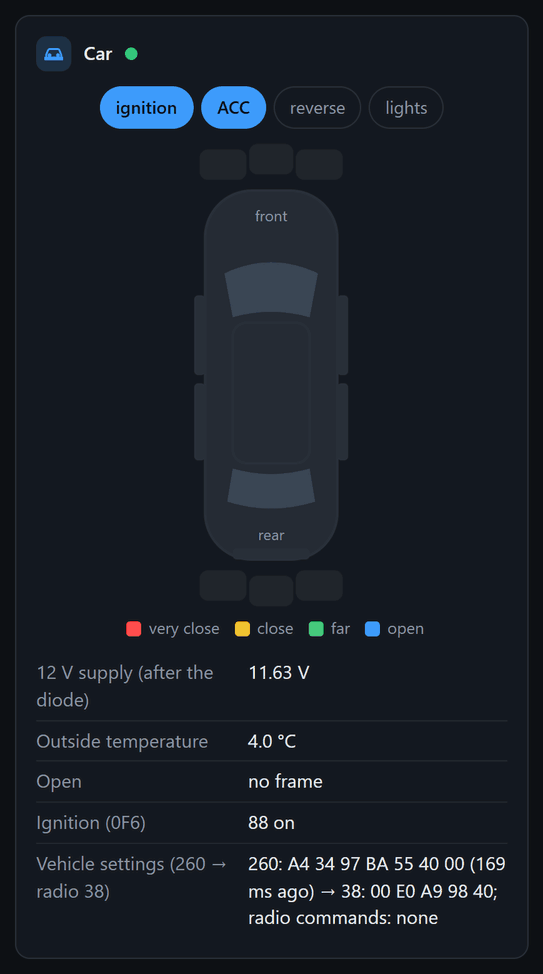
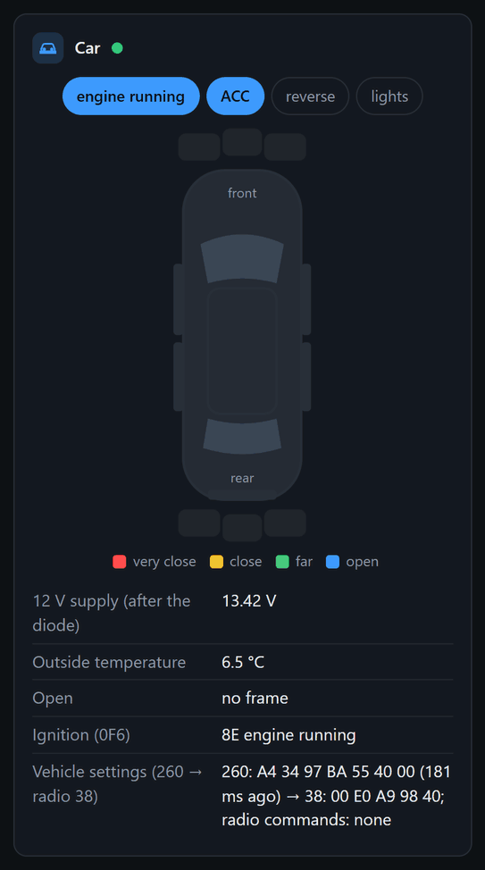
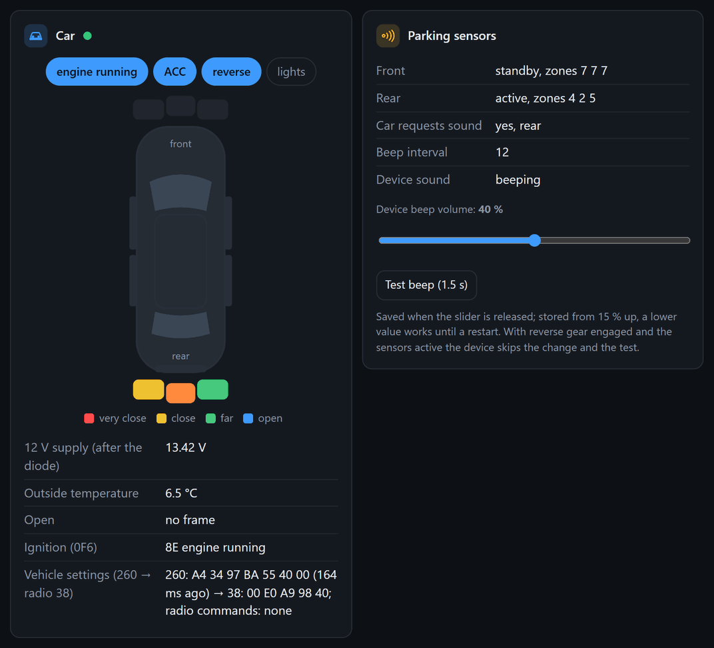
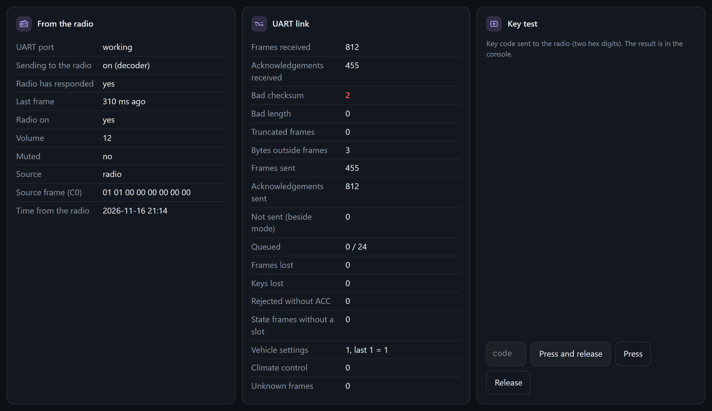

# Pierwsza jazda

> [!NOTE]
> **Tłumaczenie maszynowe, wymaga sprawdzenia**
>
> Tę stronę przetłumaczono automatycznie. Wiążący jest tekst angielski. Jak zgłosić poprawkę:
> [Tłumaczenia](../contributing/translations.md#send-your-work).

Ta strona mówi, co sprawdzić podczas pierwszej jazdy z urządzeniem i w jakiej kolejności. Pierwsza
jazda to test, nie podróż. Zrób ją w dwóch rundach: najpierw urządzenie tylko słucha obok skrzynki
CAN, potem (jeśli chcesz) zastępuje skrzynkę. Przez cały czas trzymaj komputer na USB z otwartą
konsolą i zapisuj, co widzisz.

## Zanim zaczniesz {#before-you-start}

> [!WARNING]
> **Potrzebujesz pomocnika**
>
> Kierowca tylko prowadzi. Pomocnik trzyma laptopa i wpisuje polecenia. Poprowadź kabel USB tak,
> żeby nie mógł dosięgnąć pedałów ani dźwigni zmiany biegów.

- Zaparkuj tam, gdzie możesz jechać powoli i zatrzymać się w każdej chwili. Potrzebujesz
  przeszkody (ściana, karton), do której podjedziesz później, w rundzie 1 w punkcie 5, żeby obudzić
  czujniki parkowania.
- Zaparkuj tak, żeby przeszkoda była poza zasięgiem czujników: czujniki muszą milczeć, gdy
  cokolwiek wpinasz albo wypinasz. W tym momencie zapłon wyłączony, kluczyk wyjęty.

> [!WARNING]
> **Wpinaj i wypinaj tylko przy wyłączonym zapłonie i cichych czujnikach**
>
> W aucie wzorcowym fabryczny ton czujników parkowania czasem grał dalej po wyłączeniu zapłonu
> w trakcie tonu ciągłego, przez około minutę, a nawet do 10-15 minut (zmierzone (measured):
> obserwacja w aucie, wiele powtórzeń). Działo się to z podłączoną skrzynką CAN, gdy skrzynka
> znikała z magistrali w trakcie tonu ciągłego, i raz bez żadnej skrzynki. Przyczyna nie jest
> znana. Nie wypinaj skrzynki ani urządzenia, gdy czujnik pika. Cała historia:
> [Zawieszony ton czujników parkowania](../case-studies/parking-tone-bug.md).

> [!TIP]
> **Nagraj tę jazdę**
>
> Nagranie pierwszej jazdy to najcenniejsza rzecz, jaką możesz przywieźć do domu. To, co wypisuje
> konsola, samo się nie zapisuje. Przed jazdą uruchom jedno z narzędzi do nagrywania ze strony
> [Nagrywanie magistrali](../make-it-yours/record.md). Zrzut surowych ramek (`dump` w konsoli USB)
> zostaje tylko wtedy, gdy twój terminal szeregowy zapisuje do pliku. Zaznaczaj każdą czynność
> (zapłon, światła, wsteczny), żeby potem ją znaleźć.

## Runda 1: obok skrzynki (tylko nasłuch) {#round-1-beside-the-box-listen-only}

Wersja `listen` albo `listen_wifi`. Skrzynka CAN zostaje podłączona i robi wszystko jak dotąd.

1. Podłącz urządzenie jak na stronach [Połączenie z CAN](can-connection.md) i
   [Połączenie z radiem](radio-connection.md#which-wires-to-connect-in-each-mode): tylko masa,
   +12 V, CANH, CANL i linia radio TX.
2. Otwórz konsolę. W liniach startowych musi być `LISTEN ONLY` i
   `Mode: alongside the box (sends nothing).` oraz `# can=ok audio=ok radio=ok`.
3. Zapłon włączony. Wpisz `stat`. Oczekiwany wynik:
   - `[stat] mode=alongside the box can=ok audio=ok radio=ok`;
   - `rx=` rośnie, `lost=0`, `errors=0`, `bus=active`;
   - `ignition=1`, a surowy bajt zapłonu zmienia się, gdy uruchamiasz silnik;
   - ostatnia linia `can-tx=none` (w tej wersji nie ma kodu nadawania).

    Jeśli widzisz coś innego, wyłącz zapłon i przejdź do części
    [Gdy coś pójdzie źle](#when-something-goes-wrong).
4. Dioda modułu ESP32: zielona, gdy przychodzą ramki, żółta, gdy urządzenie gra dźwięk, zgaszona,
   gdy magistrala milczy, czerwona po błędzie sterownika przy starcie.
5. Podjedź powoli do przeszkody. Urządzenie pika z własnego głośnika według ramki czujników
   parkowania, w obu trybach, obok fabrycznego brzęczyka auta. `stat` pokazuje strefy w linii
   `[park]`. Głośność ustawisz poleceniem `vol 0-100` (ograniczone do 80); `vol 0` wycisza je do
   następnego startu.
6. Bieg wsteczny, włączone światła, przyciski przy kierownicy: dla radia nic się nie zmienia
   (nadal steruje nim skrzynka), ale urządzenie je widzi. `keys` wypisuje zdarzenia przycisków.
7. Zapłon wyłączony, kluczyk wyjęty. Patrz na konsolę: magistrala jeszcze chwilę pracuje, potem
   milknie. W aucie wzorcowym: około 100 s pełnego ruchu, potem 14 s samej ramki `036`, potem
   cisza (zmierzone: nagranie tylko do nasłuchu). Około 30 s po ostatniej ramce urządzenie
   zasypia. Komputer na USB nie pozwala mu zasnąć, a bez USB nie widzisz konsoli: uśpienie widać
   tylko jako mały prąd, zobacz
   [Zasilanie i ACC, krok 3](power-and-acc.md#step-3-measure-the-parked-current).

## Runda 2: dekoder (urządzenie zastępuje skrzynkę) {#round-2-decoder-the-device-replaces-the-box}

Tylko dla auta z profilem, który obsługuje radio (`psa_aee2010` w aucie wzorcowym). Wersja
`decoder` albo `decoder_wifi`. Urządzenie nadal nie nadaje na magistralę auta.

> [!CAUTION]
> **Najpierw wypnij skrzynkę CAN**
>
> W tym trybie skrzynka i urządzenie nigdy nie mogą być podłączone jednocześnie: dwa nadajniki
> UART na jednym przewodzie i dwa wyjścia ACC na jednym przewodzie zwierają się nawzajem.

1. Zapłon wyłączony, czujniki ciche. Wypnij skrzynkę CAN. Podłącz wszystkie przewody urządzenia
   ([Połączenie z radiem](radio-connection.md)).
2. Zapłon włączony. Radio startuje. Linia startowa zawierała `LISTEN ONLY` i
   `Mode: DECODER (sends to the radio, drives ACC).`; `stat` pokazuje `mode=DECODER` i `acc=1`.
3. `radio`: przychodzą ramki z radia (`received frames=` rośnie). Niektóre radia wysyłają wadliwą ramkę `C5`; każda liczy się jako jedna zła suma i trzy bajty śmieci, więc powoli rosnące `bad checksum=` przy `garbage=` dokładnie trzy razy większym jest normalne. Inna proporcja oznacza błąd w przewodach albo w prędkości.
4. Sprawdzaj po jednej funkcji i zapisuj wynik:

    | Sprawdzenie | Co powinieneś zobaczyć |
    |---|---|
    | przyciski przy kierownicy | głośność, następny / poprzedni, źródło działają w radiu |
    | czujniki parkowania | radio pokazuje wykres czujników; głośnik urządzenia pika |
    | bieg wsteczny | radio pokazuje kamerę, `stat` `reverse=1` |
    | światła | radio przyciemnia ekran (jeśli jest ustawione na ILL), `stat` `lights=1` |
    | wyłączenie zapłonu | radio wyłącza się około 2,5 s później |

5. Jeśli coś nie działa, wyłącz zapłon i wepnij z powrotem skrzynkę CAN. Auto działa jak
   wcześniej.

### Co było w aucie wzorcowym {#what-happened-on-the-reference-car}

| Obserwacja | Status |
|---|---|
| odbiór z urządzeniem: 17 169 ramek bez błędów i bez zgubionych | zmierzone: konsola urządzenia |
| tryb dekoder, skrzynka CAN wypięta: urządzenie nagrało około 10 s ramek CAN (140,5-148,3 s i 300,2-302,5 s sesji); około 26 600 ramek pomiędzy nimi zgubiło nagrywanie w panelu WWW, którego karta przeglądarki była ukryta, a nie urządzenie ([Nagrywanie magistrali](../make-it-yours/record.md)) | zmierzone: `firmware/test_data/captures/centralka_can_20261117_184411.log` |
| w trybie dekoder radio wysyła swoje polecenia do urządzenia (np. ustawienia pojazdu), a konsola nazywa każde z nich | zmierzone: konsola urządzenia |
| fabryczne pikanie przez moduł pod kierownicą było wyłączone w BSI (moduł nadwozia), więc głośnik urządzenia był jedynym źródłem piknięć czujników | zmierzone: obserwacja w aucie |
| które funkcje radia działają w trybie dekoder w aucie, po kolei | jeszcze nie wszystkie sprawdzone; strona [Peugeot 508 SW](../reference/vehicles/peugeot-508.md) wymienia, co zmierzono |

## Po postoju: pilot {#after-parking-the-remote-key}

Wiadomo, że niektóre skrzynki CAN z zestawów radia powodują, że pilot przestaje działać po
pewnym czasie postoju. W aucie wzorcowym robiła to jedna skrzynka; po jej wypięciu pilot działał
(zmierzone: obserwacja w aucie, kilka prób). Z inną skrzynką działał po każdym postoju, także po
nocy. Czy **urządzenie** wpływa na pilota, jeszcze nie zmierzono.

1. Zamknij auto pilotem, zostaw je na godzinę do dwóch, potem otwórz pilotem.
2. Powtarzaj przez kilka dni, także po nocy.
3. Za każdym razem zapisz: jak długo auto stało, czy wcześniej jechało długo, i wynik. Słaby
   akumulator może dawać ten sam objaw, więc zapisz też stan akumulatora.

Jeśli pilot przestanie działać, otwórz auto kluczykiem mechanicznym, odepnij urządzenie i powtórz
test bez niego.

## Gdy coś pójdzie źle {#when-something-goes-wrong}

- Brak ramek, rosnące `errors=`, `bus=quiet` przy włączonym zapłonie: zobacz
  [Połączenie z CAN](can-connection.md#step-4-connect) i
  [Rozwiązywanie problemów](../troubleshooting/index.md).
- Czerwona dioda przy starcie: sterownik nie wystartował. Wyjścia zostają wyłączone, a urządzenie
  nie restartuje się w kółko. Przeczytaj linie startowe w konsoli.
- Radio nie startuje w trybie dekoder: sprawdź `acc=1` w `stat`, potem przewód ACC miernikiem
  (12 V przy włączonym zapłonie).

Nigdy nie przechodź na wersję z nadawaniem (`decoder_tx_wifi`), żeby coś „naprawić”. Nadawanie to
osobny, świadomy krok: [Nadawanie na magistralę CAN](../safety/transmit.md). Po wgraniu
każdego nowego programu wersja z nadawaniem startuje rozbrojona i znowu potrzebuje `cantx on` i
restartu ([Uzbrajanie](../safety/transmit.md#arming)).

Dalej: podziel się wynikiem ([Udostępnij swoje auto](../make-it-yours/contribute.md)) albo nagraj
swoje auto ([Nagrywanie magistrali](../make-it-yours/record.md)).
