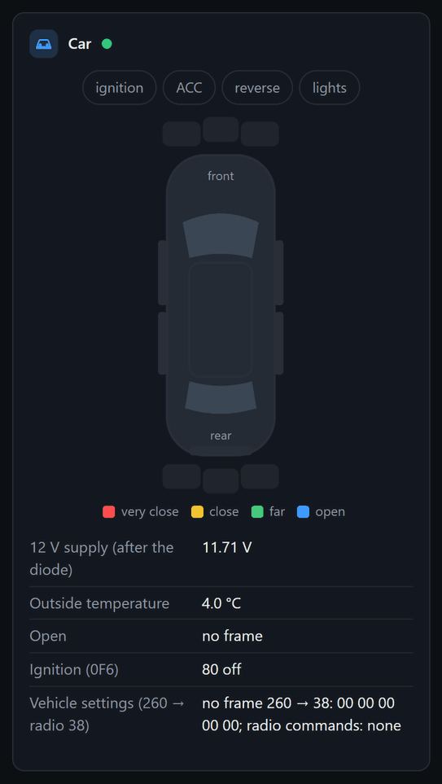

# Zasilanie i ACC

> [!NOTE]
> **Tłumaczenie maszynowe, wymaga sprawdzenia**
>
> Tę stronę przetłumaczono automatycznie. Wiążący jest tekst angielski. Jak zgłosić poprawkę:
> [Tłumaczenia](../contributing/translations.md#send-your-work).

Ta strona mówi, skąd urządzenie bierze 12 V i masę, co robi, gdy auto stoi, i skąd radio dostaje
sygnał ACC.

Słowa używane na tej stronie:

- **+12 V stałe** (często nazywane B+ albo BAT): pod napięciem cały czas, także przy zamkniętym
  aucie.
- **+12 V załączane**: pod napięciem tylko przy włączonym zapłonie (albo w pozycji akcesoriów).
- **ACC** (zasilanie akcesoriów): przewód, który mówi radiu „włącz się”. Przy skrzynce CAN
  z zestawu radia często nie pochodzi z auta, tylko z wyjścia skrzynki.

## Jak to działa w aucie wzorcowym {#how-it-works-on-the-reference-car}

W aucie wzorcowym (Peugeot 508 SW) skrzynka CAN jest zasilana z pinu 12 Quadlocka (prawdopodobnie
stałe +12 V) i sama załącza ACC radia. Jeśli pin 12 to stałe +12 V, jak zakładamy, skrzynka (i
urządzenie na jej miejscu) jest zasilana cały czas i sama decyduje, kiedy radio może pracować.
Dowody:

| Fakt | Status |
|---|---|
| dolny 1 (żółty) wtyczki skrzynki CAN ma ciągłość z pinem 12 Quadlocka, który jest +12 V | zmierzone (measured): próbnik ciągłości. To, że to +12 V jest stałe (pod napięciem przy wyjętym kluczyku), jest założeniem: napięcia w aucie nie zmierzono |
| górny 1 (czarny) wtyczki skrzynki CAN to masa, ciągłość z pinem 16 Quadlocka | zmierzone: próbnik ciągłości |
| ACC IN radia (pin 15 jego 16-pinowej wtyczki zasilania) jest zasilany z wyjścia skrzynki CAN, nie z auta | zmierzone: wypięcie skrzynki przy pracującym silniku radio odebrało jako „utrata ACC” (log radia). Która pozycja wtyczki go niesie (dolny 3, czerwony), wynika z koloru przewodu i przebiegu wiązki; ciągłości nie zapisano |
| po wyjęciu kluczyka na magistrali jest pełny ruch przez około 100 s, potem 14 s samej ramki `036`, potem cisza aż do otwarcia auta | zmierzone: nagranie tylko do nasłuchu |

Pełna mapa wiązki: [Peugeot 508 SW](../reference/vehicles/peugeot-508.md).

## Co robi urządzenie, gdy auto stoi {#what-the-device-does-when-the-car-is-parked}

- **ACC:** włączone, dopóki ramka zapłonu mówi „zapłon włączony” (każdy stan poza wyłączonym).
  Wyłącza się 2,5 s po tym, jak ramka zapłonu powie „wyłączony”. Jeśli ramka zapłonu przestanie
  przychodzić, urządzenie po 1 s bez niej uznaje zapłon za wyłączony i potem czeka te same 2,5 s,
  więc ACC gaśnie około 3,5 s po ostatniej ramce. To kopia zachowania skrzynki CAN: w aucie
  wzorcowym skrzynka wyłączała radio 2,5 s po wyłączeniu zapłonu (zmierzone: nagranie CAN i UART
  `firmware/test_data/captures/can_20261111_191045.log`; test na komputerze `power_loss` je
  odtwarza).
- **Uśpienie:** po 30 s bez ramek CAN urządzenie przechodzi w głęboki sen. Budzi się, gdy tylko
  auto znowu zacznie nadawać na magistrali. Nie zasypia, dopóki radio ma jeszcze ACC, dopóki jest
  podłączony komputer przez USB albo dopóki prosi o to panel WWW. Panel może trzymać je w stanie
  czuwania tylko wtedy, gdy zasilanie jest powyżej 11,0 V. Te wartości są ustawione
  w `src/config.h` ([Konfiguracja i piny](../reference/config-and-pins.md)).

> [!WARNING]
> **Prąd uśpienia niezmierzony**
>
> Głęboki sen i wybudzenie z magistrali wypróbowano w jednym aucie 20.11.2026. Prądu, który urządzenie pobiera
> z akumulatora, gdy auto stoi, **nie zmierzono**. Zmierz go sam, zanim zostawisz urządzenie
> w aucie na wiele dni (krok 3).

## Krok 1: ustal, czym jest twój przewód zasilania {#step-1-find-out-what-your-supply-wire-is}

Miernik na napięciu stałym, minus na dobrej masie.

1. Zapłon włączony: przewód musi pokazywać napięcie akumulatora (około 12 do 14,5 V).
2. Zapłon wyłączony, kluczyk wyjęty: przewód stały = nadal około 12 V, przewód załączany = 0 V.
3. Zamknij auto i odczekaj kilka minut: przewód stały zostaje na około 12 V.

Zapisz wynik. Rysunek sprzedawcy albo kolor przewodu nie wystarczą. Jeśli przewód pokazuje 0 V już
w punkcie 1, to nie jest przewód zasilania: sprawdź jeszcze raz swoją mapę pinów.

## Krok 2: wybierz sposób zasilania urządzenia {#step-2-choose-how-to-power-the-device}

### Wariant A: +12 V stałe (jak skrzynka CAN) {#option-a-12-v-permanent-like-the-can-box}

Tak była zasilana skrzynka CAN w aucie wzorcowym. Urządzenie może utrzymać ACC przez 2,5 s,
śledzić auto, aż magistrala ucichnie, a potem zasnąć. To jedyny wariant dla trybu dekoder, jeśli
chcesz, żeby radio zachowywało się tak jak ze skrzynką.

Koszt: urządzenie jest cały czas podłączone do akumulatora. Jeśli nie zaśnie, rozładuje
akumulator. Sprawdź to w kroku 3.

### Wariant B: +12 V załączane, ze skrzynki bezpieczników {#option-b-12-v-switched-from-the-fuse-box}

Możesz zasilić urządzenie z obwodu, który jest pod napięciem tylko przy włączonym zapłonie, np.
przez rozgałęźnik bezpiecznika („add-a-fuse”) w skrzynce bezpieczników.

> [!WARNING]
> **Nie przecinaj wiązki auta**
>
> Przewód +12 V wiązki zasila też skrzynkę CAN (a przez nią ACC radia). Zostaw go w całości.
> Zmieniasz tylko przewód, który idzie do zacisku 4 (+12V) złącza J5 urządzenia.

1. Znajdź gniazdo bezpiecznika, które jest pod napięciem tylko przy włączonym zapłonie. Użyj
   tabeli bezpieczników z instrukcji auta i potwierdź miernikiem: zapłon wyłączony = 0 V, zapłon
   włączony = 12 V, auto zamknięte = 0 V.
2. Włóż rozgałęźnik w to gniazdo, z małym bezpiecznikiem w rozgałęźniku dla urządzenia. Płytka ma
   też własny bezpiecznik wejściowy (F1, 1,1 A).
3. Poprowadź nowy przewód z rozgałęźnika do zacisku 4 (+12V) złącza J5.
    - **Obok skrzynki:** nie łącz J5-4 z przewodem +12 V skrzynki. Skrzynka zostaje zasilana jak
      dotąd.
    - **Dekoder** (skrzynka wypięta, urządzenie w jej wtyczce): nie łącz pozycji +12 V wtyczki
      wiązki (dolny 1 w wiązce wzorcowej) z J5-4. Zaizoluj ten przewód urządzenia.
4. Masę i CAN zostaw bez zmian.
5. Sprawdź przy wyłączonym zapłonie: urządzenie ma 0 V na J5-4, a radio nadal ma swoje stałe B+
   (w radiu wzorcowym pin 08 jego wtyczki zasilania, niezweryfikowane (unverified): rysunek
   sprzedawcy radia). Jeśli na J5-4 nadal jest 12 V, jest on wciąż połączony z przewodem stałym:
   znajdź to połączenie, zanim pójdziesz dalej.

Co się zmienia:

- urządzenie wyłącza się razem z zapłonem, więc radio traci ACC od razu, a nie 2,5 s później;
- urządzenie nie widzi, co robi auto po wyłączeniu zapłonu (brak nagrań auta na postoju);
- urządzenie nie może rozładować akumulatora na postoju.

> [!NOTE]
> **Niesprawdzone w aucie wzorcowym**
>
> Wariant B był planowany dla skrzynki CAN w aucie wzorcowym, ale **nie ma zgłoszenia, że go
> wypróbowano** z urządzeniem. To standardowy sposób podłączenia; sprawdź każdy krok miernikiem.

## Krok 3: zmierz prąd na postoju {#step-3-measure-the-parked-current}

Zrób to raz z urządzeniem i raz bez niego.

> [!WARNING]
> **Rozłączenie obwodu akumulatora kasuje część ustawień**
>
> Odpięcie minusa akumulatora może zresetować radio, zegar i niektóre ustawienia auta.
> W niektórych autach budzi całe auto. Postępuj według instrukcji auta. Poniższe kroki nie
> przerywają obwodu, gdy wpinasz miernik.

1. Auto zamknięte, wszystkie drzwi zamknięte. Poczekaj, aż auto zaśnie (w aucie wzorcowym
   magistrala milknie około dwóch minut po wyjęciu kluczyka).
2. Miernik na zakresie 10 A prądu stałego. Jedną sondę przypnij do bieguna minus akumulatora,
   drugą do klemy minusowej.
3. Poluzuj klemę i zdejmij ją z bieguna. Prąd płynie teraz przez miernik.
4. Poczekaj, aż odczyt się ustali: auto może się obudzić i znowu zasnąć.
5. Zapisz wartość. Nie otwieraj drzwi i nie uruchamiaj silnika, gdy miernik jest w obwodzie.
6. Załóż klemę z powrotem na biegun, zanim odepniesz miernik.

Porównaj obie wartości. Różnica to koszt urządzenia na postoju.

## Napięcie akumulatora w konsoli {#the-battery-voltage-in-the-console}

Na prototypie v1 dzielnik mierzy zasilanie. `stat` wypisuje je jako `supply=12.31V (after the
diode)`: wartość jest **za diodą wejściową**, około 0,8 V (0,7-0,9 V) poniżej napięcia akumulatora
(spadku na diodzie nie zmierzono dokładnie). Przy zasilaniu tylko z USB, bez 12 V, linia mówi
`supply=no 12V`.

## ACC do radia: co robi który tryb {#acc-to-the-radio-which-mode-does-what}

| Tryb | Wyjście ACC urządzenia | Kto zasila ACC radia |
|---|---|---|
| obok skrzynki (`listen`, `listen_wifi`) | zawsze wyłączone | skrzynka CAN |
| dekoder (`decoder`, `decoder_wifi`) | idzie za ramką zapłonu, jak wyżej | urządzenie |
| profil `generic` | zawsze wyłączone (profil nie ma ramki zapłonu) | skrzynka CAN: zostaw ją na miejscu, urządzenie tylko słucha |

Dalej: [Połączenie z CAN](can-connection.md). Jak podłączyć wyjścia ACC, ILL i REV:
[Połączenie z radiem](radio-connection.md).

