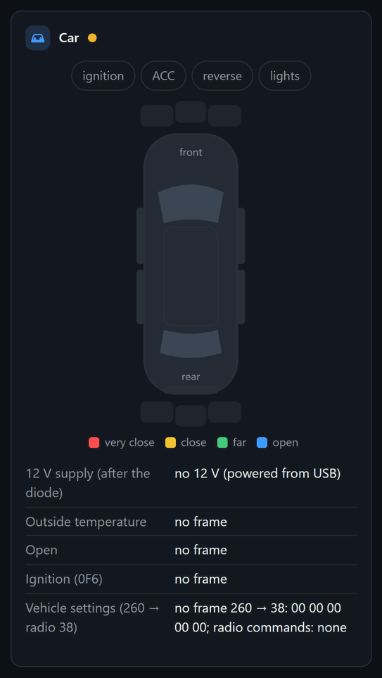

# Test na stole

> [!NOTE]
> **Tłumaczenie maszynowe, wymaga sprawdzenia**
>
> Tę stronę przetłumaczono automatycznie. Wiążący jest tekst angielski. Jak zgłosić poprawkę:
> [Tłumaczenia](../contributing/translations.md#send-your-work).

Ta strona sprawdza urządzenie na biurku, zanim zbliży się do auta. Każda część wymaga trochę
więcej sprzętu niż poprzednia. Zatrzymaj się przy pierwszej rzeczy, która się nie zgadza,
i znajdź przyczynę.

To krótka wersja na pierwszą kompilację. Pełny protokół krok po kroku dla nowej kompilacji
programu, z testami dla programistów, jest na stronie
[Protokół testu na stole](../testing/bench-test-protocol.md).

## 1. Płytka ESP32-S3 na USB {#1-the-esp32-s3-board-on-usb}

Wgraj `listen_wifi` (albo `listen`) jak na stronie [Wgraj program](flash.md) i otwórz monitor.
Potem wpisz (wpisywanych liter nie widać; po każdym poleceniu naciśnij Enter):

| Polecenie | Co powinieneś zobaczyć |
|---|---|
| `ver` | wersję i czas kompilacji |
| `stat` | `[stat] mode=alongside the box can=ok audio=ok radio=ok` i liczniki; bez 12 V zasilanie pokazuje `no 12V` |
| `help` | listę poleceń |
| `cantx` | `[cantx] built=0: no CAN transmit in this build (CAN listen only)` |

Dioda LED na płytce ESP32-S3 pokazuje stan: niebieska przy starcie, zgaszona, gdy magistrala
milczy, zielona, gdy przychodzą ramki, żółta, gdy urządzenie pika, czerwona, gdy sterownik nie
wystartował (wyjścia zostają wyłączone) albo kontroler CAN nie działa.

Możesz wkleić ramkę CAN do konsoli, na przykład `0E1#B0F000FCFC1EC200`. Urządzenie traktuje ją
tak, jakby przyszła z auta, więc możesz wypróbować dekodowanie bez auta. Oczekiwany wynik: linia
`[park]` w następnym `stat` się zmienia.

## 2. Płytka bazowa na 12 V, bez modułów {#2-the-carrier-board-on-12-v-without-modules}

Płytka bazowa to płytka, która łączy płytkę ESP32-S3 z autem. Najpierw sprawdź ją pustą: bez
płytki ESP32-S3 i bez modułów w gniazdach.

> [!WARNING]
> **Użyj ograniczenia prądu**
>
> Zasil płytkę bazową z zasilacza laboratoryjnego z ograniczeniem prądu ustawionym na ok.
> 100 mA. Jeśli zasilacz dojdzie do ograniczenia, od razu wyłącz i szukaj zwarcia.

1. Bez zasilania, multimetrem: brak zwarcia między +12 V a masą, +5 V a masą, +3,3 V a masą.
   Między CANH a CANL powinieneś odczytać dziesiątki kΩ, nie ok. 120 Ω.
2. 12 V na wejściu zasilania (w prototypie v1: złącze J5, `+12V` i `GND`). Na szynie 5 V
   powinieneś odczytać ok. 4,6-4,8 V (wyjście przetwornicy 5 V za diodą).
3. Wyłącz, włóż płytkę ESP32-S3, włącz. Teraz na pinach 3,3 V jest 3,3 V, a prąd wynosi
   dziesiątki mA.

Strona prototypu ma pełną listę kontrolną z pinami gniazd:
[Płytka prototypu](../hardware/prototype-pcb.md).

## 3. Z modułami {#3-with-the-modules}

1. Wyłącz. Włóż moduł CAN (przełącznik terminatora OFF) i moduł wzmacniacza z głośnikiem.
2. Włącz i podłącz USB. Wpisz `stat`. Oczekiwany wynik: `can=ok audio=ok radio=ok` i napięcie
   zasilania zamiast `no 12V`. (Przy samym USB, bez 12 V, prototyp też pokazał
   `can=ok audio=ok radio=ok`; zmierzone, measured: ESP32-S3 + moduł CAN + wzmacniacz.)
3. Wpisz `test`. Oczekiwany wynik: 1,5 s testowego pikania z głośnika.
4. Wpisz `vol 30`, żeby zmienić głośność. Program ogranicza ją do 80 %, żeby chronić mały
   głośnik. Wartość poniżej 15 % działa tylko do następnego restartu.

## 4. Wyjścia 12 V (tylko kompilacje dekodera) {#4-the-12-v-outputs-decoder-builds-only}

> [!WARNING]
> **Nie przy podłączonej skrzynce CAN**
>
> Wgrywaj `decoder` albo `decoder_wifi` na stole, a w aucie tylko przy wypiętej skrzynce CAN.
> Wyjścia urządzenia i skrzynki nigdy nie mogą sterować tym samym przewodem.

Wyjścia ACC, ILL i REV przełączają się tylko w trybie dekoder i idą za autem: ACC według ramek
zapłonu, ILL według bitu świateł, REV według bitu biegu wstecznego. Bez ruchu na CAN zostają
wyłączone. Raportu z testu tych wyjść na stole od osoby budującej urządzenie jeszcze nie ma
(**niezweryfikowane**, unverified); sprawdź je multimetrem i małym obciążeniem, zanim podłączysz
radio.

## 5. Panel WWW (kompilacje z Wi-Fi) {#5-the-web-panel-builds-with-wi-fi}

Z `listen_wifi` na płytce zaloguj się według strony [Pierwsze uruchomienie](first-boot.md).
Potem:

1. Panel się otwiera i pokazuje **Pulpit**.
2. Na zakładce **Konsola** wpisz `stat`. Oczekiwany wynik: ta sama odpowiedź co na USB.

Aktualizacja i powrót do poprzedniego programu przez Wi-Fi to kroki 7.1-7.7
[Protokołu testu na stole](../testing/bench-test-protocol.md).

Testy panelu dla programistów

Sprawdź je na wartościach w panelu albo ze `stat` w konsoli:

1. Gdy Wi-Fi startuje i się zatrzymuje, pętla główna nie zwalnia („Przebiegi / s”
   i „Najdłuższy krok Wi-Fi” na zakładce System).
2. Aktualizacja programu przez panel działa, tak samo powrót do poprzedniego programu. Zły
   plik zostaje odrzucony.
3. Ze źródłem CAN na stole: w czasie aktualizacji liczniki zgubionych ramek CAN zostają na
   zerze, a liczniki łącza z radiem nie pokazują zgubionych ramek, gdy przeglądarka trzyma
   panel otwarty.
4. Skaner Wi-Fi w telefonie przy kilku startach nigdy nie pokazuje otwartej sieci o nazwie
   `ESP_...`.
5. Głęboki sen i prąd w uśpieniu po włączonym wcześniej Wi-Fi: zmierz je. Nie zmierzono ich
   jeszcze na sprzęcie.

Kroki 1 i 2 powyżej oraz punkty 1, 2 i 4 sprawdzono na prototypie na USB, bez CAN i radia
(zmierzone: test na stole wcześniejszej kompilacji tego programu). Punkty 3 i 5 wymagają
ruchu na CAN albo 12 V i są wciąż otwarte, podobnie jak czas, przez który radio zostaje bez
ACC, gdy urządzenie restartuje się po aktualizacji.

## 6. Przed autem {#6-before-the-car}

- Transil (`D2` w prototypie v1) jest wlutowany, a kondensator wejściowy jest na 35 V lub więcej.
- Nigdzie nie ma terminatora 120 Ω: przełącznik terminatora modułu CAN jest na OFF.
- `JP1` w prototypie v1 jest otwarta (sprzętowo tylko do nasłuchu), chyba że celowo budujesz
  program z nadawaniem.
- Znasz piny swojego auta.

## Dalej {#next}

[Lista kontrolna montażu](../install-in-car/checklist.md) dla auta wzorcowego albo
[Znajdź swoją magistralę CAN](../make-it-yours/find-your-bus.md) dla innego auta.
