# Przewodnik po panelu WWW

> [!NOTE]
> **Tłumaczenie maszynowe, wymaga sprawdzenia**
>
> Tę stronę przetłumaczono automatycznie. Wiążący jest tekst angielski. Jak zgłosić poprawkę:
> [Tłumaczenia](../contributing/translations.md#send-your-work).

Ta strona mówi, jak otworzyć panel WWW i co robi każda karta i każdy przycisk. Panel WWW to mała
strona internetowa, którą serwuje samo urządzenie. Otwierasz ją na telefonie, laptopie albo
w przeglądarce radia. Pokazuje, co urządzenie widzi na magistrali CAN i na linii do
radia. Pozwala też zmienić kilka ustawień i zaktualizować program przez Wi-Fi.

Panel istnieje tylko w programach zbudowanych z siecią (`listen_wifi`, `decoder_wifi`,
`decoder_tx_wifi`, `listen_generic_wifi`). Ta strona opisuje `firmware/web/index.html`
i angielski słownik `firmware/web/i18n/en.json`. Zapytania stojące za każdą kartą są na stronie
[API panelu](panel-api.md).

> [!TIP]
> **Wypróbuj bez płytki**
>
> `firmware/tools/mock_device.py` odtwarza nagranie CAN i serwuje ten sam panel na twoim
> komputerze. W `firmware/` uruchom
> `python -I tools/mock_device.py test_data/captures/can_20261111_191045.log` i otwórz
> `http://127.0.0.1:8080/`. Hasło jest wypisywane przy starcie. Więcej opcji:
> [API panelu, rozdział 9](panel-api.md#9-requirements-for-the-mock-firmwaretoolsmock_devicepy).

Zrzuty ekranu na tej stronie pochodzą z makiety urządzenia z nagraniem, nigdy z auta. Pokazują
schemat ciemny; panel jest po polsku tam, gdzie zrobiono polski obrazek, w pozostałych po angielsku.
Wszystkie ekrany w jednym miejscu: [Przegląd panelu](panel-tour.md).

## Otwieranie panelu {#open-the-panel}

1. Znajdź hasło urządzenia. Podłącz USB i wpisz `wifi showpass` w
   [konsoli](console.md). To jest też klucz sieci Wi-Fi urządzenia.
2. Połącz telefon albo laptop z siecią urządzenia. Jej nazwa kończy się czterema cyframi
   szesnastkowymi. Dokładną nazwę pokazuje polecenie `wifi` w konsoli:
   `[wifi] device network: <name>, address http://10.50.8.1`.
3. Otwórz `http://10.50.8.1/`. Nazwa `.local`, którą wypisuje `wifi`, też działa, ale nie
   w każdym systemie. Użyj `http`, nie `https`.
4. Wpisz hasło i naciśnij **Zaloguj**. Na tym samym ekranie możesz wybrać język.
   Oczekiwane: karty Pulpitu się wypełniają.

[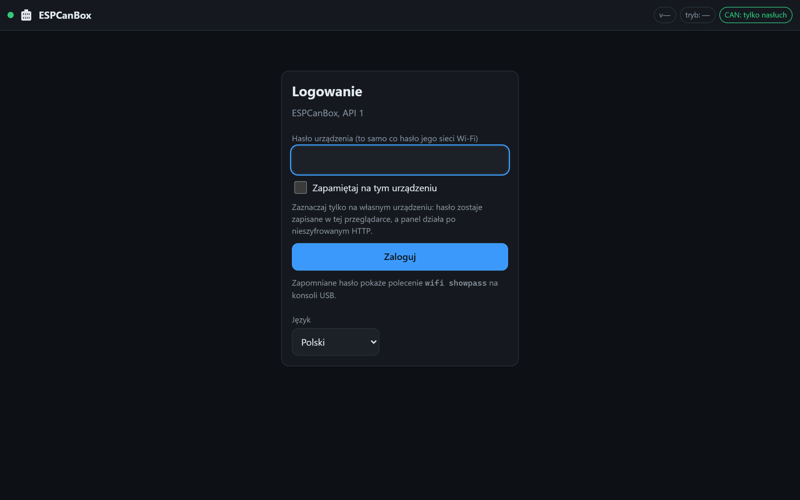](../../assets/screenshots/pl/panel-login.png)

Hasło jest pamiętane tylko w bieżącej karcie: nowa karta albo ponowne uruchomienie przeglądarki
pyta o nie znowu. Zaznacz **Zapamiętaj na tym urządzeniu** przed **Zaloguj**, żeby przeglądarka je
zapamiętała: wtedy każda karta otwiera panel bez pytania, także po ponownym uruchomieniu
przeglądarki. Zaznaczaj to tylko na własnym telefonie albo laptopie: hasło zostaje zapisane w tej
przeglądarce do naciśnięcia **Wyloguj** (zakładka System), a panel działa po nieszyfrowanym HTTP.
Zmiana hasła w panelu aktualizuje zapisaną kopię. Gdy urządzenie odrzuci zapisane hasło (zmienione
gdzie indziej), panel je zapomina i pyta ponownie.

Urządzenie wyłącza Wi-Fi, gdy auto śpi. Wi-Fi działa, gdy:

- auto jest wybudzone (ramki na magistrali albo ACC radia), albo
- do USB jest podłączony komputer.

Gdy magistrala ucichnie, Wi-Fi zostaje włączone tylko dla zalogowanego klienta, który o coś pytał
w ostatnich 60 s. Trwa to najwyżej 10 minut i tylko wtedy, gdy zasilanie za diodą wejściową ma
co najmniej 11,0 V (ok. 11,8 V na akumulatorze), o ile płytka je mierzy. Po starcie przy cichej
magistrali pierwsze 60 s liczy się jak takie pytanie. Więcej zasad:
[API panelu](panel-api.md#post-apirestart). Jeśli panel się nie otwiera, zobacz
[Rozwiązywanie problemów](../troubleshooting/index.md#the-web-panel-does-not-open).

Nazwa sieci i nazwa `.local` pochodzą z `ap_ssid_prefix` i `mdns_host` w `project.json`; zmieniaj
je tam tylko wtedy, gdy zmieniasz nazwę projektu.

> [!WARNING]
> **Sieć domowa jest mniej bezpieczna**
>
> Panel używa zwykłego HTTP. W sieci domowej każde urządzenie, które podsłuchuje ruch, może
> poznać hasło, a to hasło chroni też aktualizacje programu. Z sieci domowej panel jest tylko do
> odczytu, dopóki nie wpiszesz `wifi lan on` na USB. Zobacz [Model zabezpieczeń](../safety/security.md).

[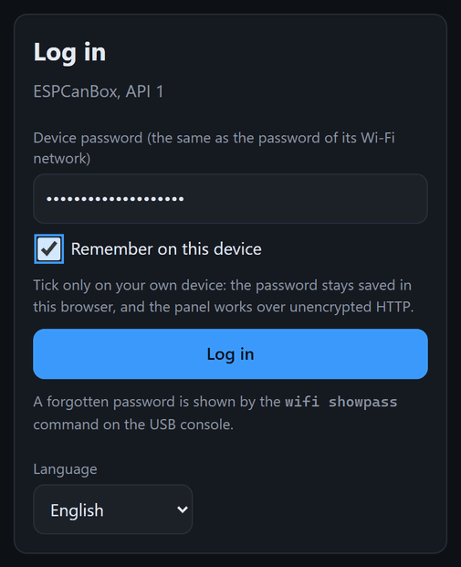](../../assets/screenshots/panel-login-remember.png)

[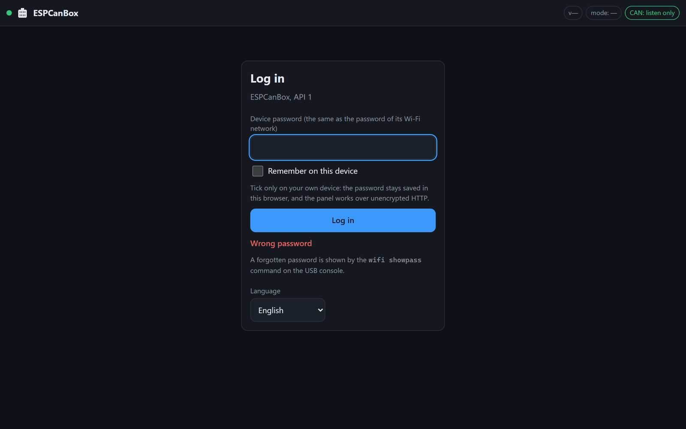](../../assets/screenshots/panel-login-wrong-password.png)

[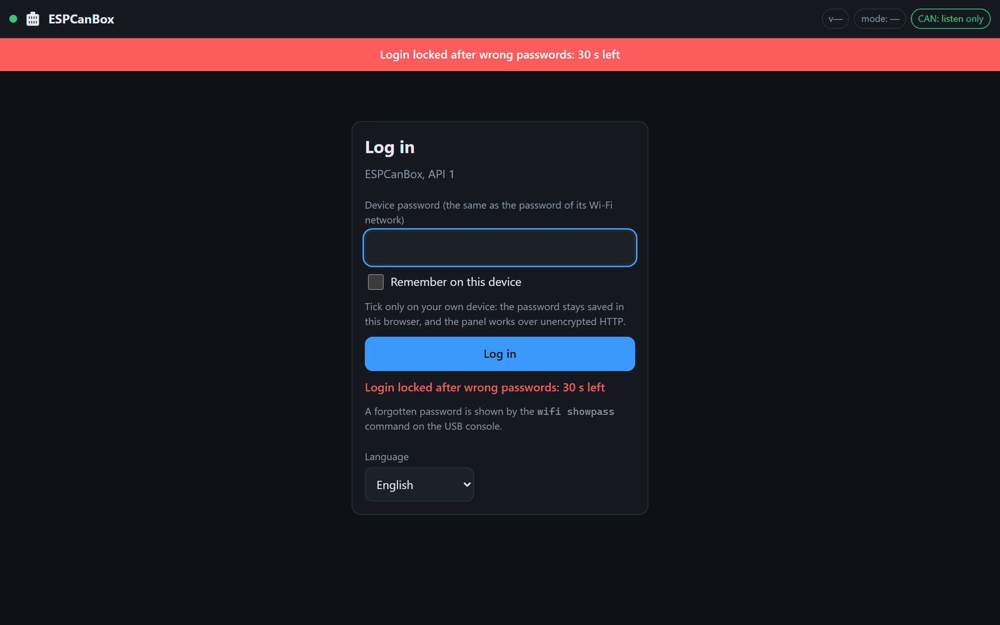](../../assets/screenshots/panel-login-locked-out.png)

## Górny pasek i zakładki {#the-top-bar-and-the-tabs}

- **Kropka** obok nazwy: połączenie z urządzeniem. Gdy zniknie, baner mówi
  „Brak połączenia z urządzeniem”, a panel próbuje dalej.
- **Plakietki:** wersja programu, tryb pracy (`tryb: obok skrzynki` albo `tryb: dekoder`,
  plakietka dekodera jest wyróżniona) i stała plakietka „CAN: tylko nasłuch”. „Obok skrzynki” to
  ten sam tryb, który konsola wypisuje jako `alongside the box`, a `ver` jako `listen`.

> [!WARNING]
> **Plakietka „CAN: tylko nasłuch” nigdy się nie zmienia**
>
> Zostaje taka sama w programie z nadawaniem na CAN (`decoder_tx_wifi`). Prawdziwy stan
> nadawania jest tylko na karcie **Magistrala CAN** na Pulpicie.

- **Zakładki**: Pulpit, CAN, Radio, Konsola, System, na telefonie na dole, a na szerokim ekranie
  pod górnym paskiem. Zakładka przeglądarki w tle nie odpytuje urządzenia.

[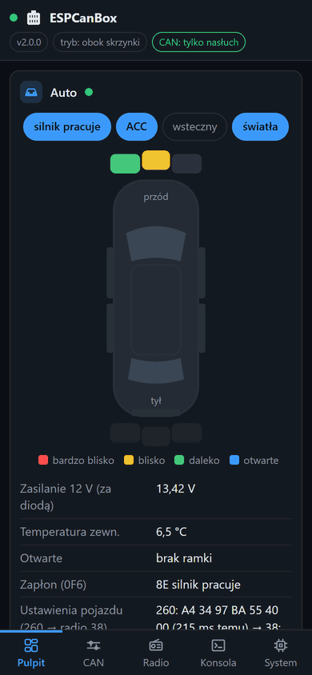](../../assets/screenshots/pl/panel-phone-dashboard.png) [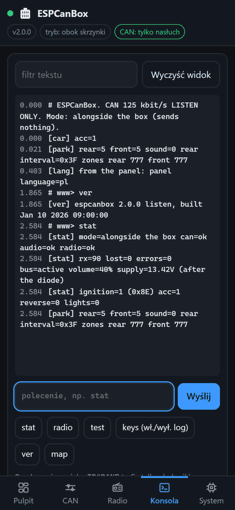](../../assets/screenshots/pl/panel-phone-console.png)

## Pulpit {#dashboard}

[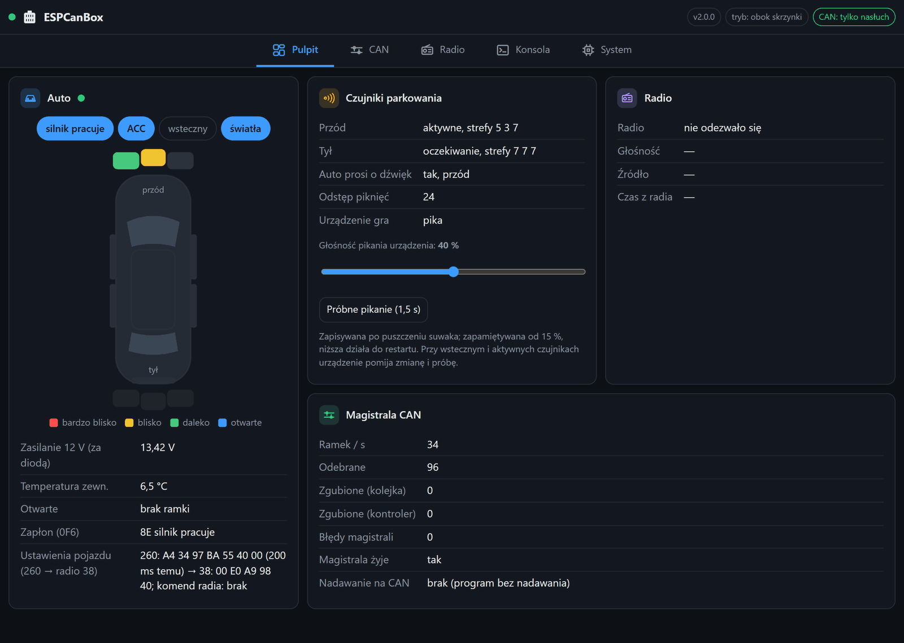](../../assets/screenshots/pl/panel-dashboard.png)

### Auto {#car}

- Etykiety: **zapłon** (pokazywany jako „silnik pracuje”, gdy tak mówi bajt zapłonu), **ACC**,
  **wsteczny**, **światła**. Podświetlona etykieta oznacza „włączone”.
- Widok auta z góry: trzy strefy czujników z przodu i trzy z tyłu, w kolorach od „bardzo blisko”
  do „daleko”, oraz pięcioro drzwi, które podświetlają się, gdy są otwarte.
- Wiersze: **Zasilanie 12 V (za diodą)** (albo „brak 12 V (zasilanie z USB)”), **Temperatura
  zewn.**, **Otwarte** (które drzwi są otwarte, albo „wszystko zamknięte”, albo „brak ramki”),
  **Zapłon (0F6)**, **Ustawienia pojazdu (260 → radio 38)**.

Wiersz ustawień pojazdu tylko czyta. Pokazuje ostatnią ramkę `260` z jej wiekiem, stan, który
urządzenie wysyła do radia w ramce `38`, oraz ostatnią komendę radia `80` z jej wynikiem, na
przykład `260: A4 1C 8F BB C5 50 00 (212 ms ago) → 38: 02 90 A9 B8 40; radio commands: none`.

### Czujniki parkowania {#parking-sensors}

- Wiersze: **Przód**, **Tył** (stan i strefy), **Auto prosi o dźwięk**, **Odstęp piknięć**,
  **Urządzenie gra** (cisza, pika, ton ciągły). Gdy ramka `0E1` przestaje przychodzić, pojawia się
  oznaczenie „brak świeżej ramki”.
- Suwak **Głośność pikania urządzenia**: 0 do 80 %. Panel wysyła nową wartość dopiero po puszczeniu
  suwaka, bo każda zmiana to zapis do flash. Poniżej 15 % wartość działa tylko do restartu.
- **Próbne pikanie (1,5 s)**.

Gdy włączony jest bieg wsteczny albo czujniki są aktywne, urządzenie pomija zmiany głośności
i próbę z panelu.

[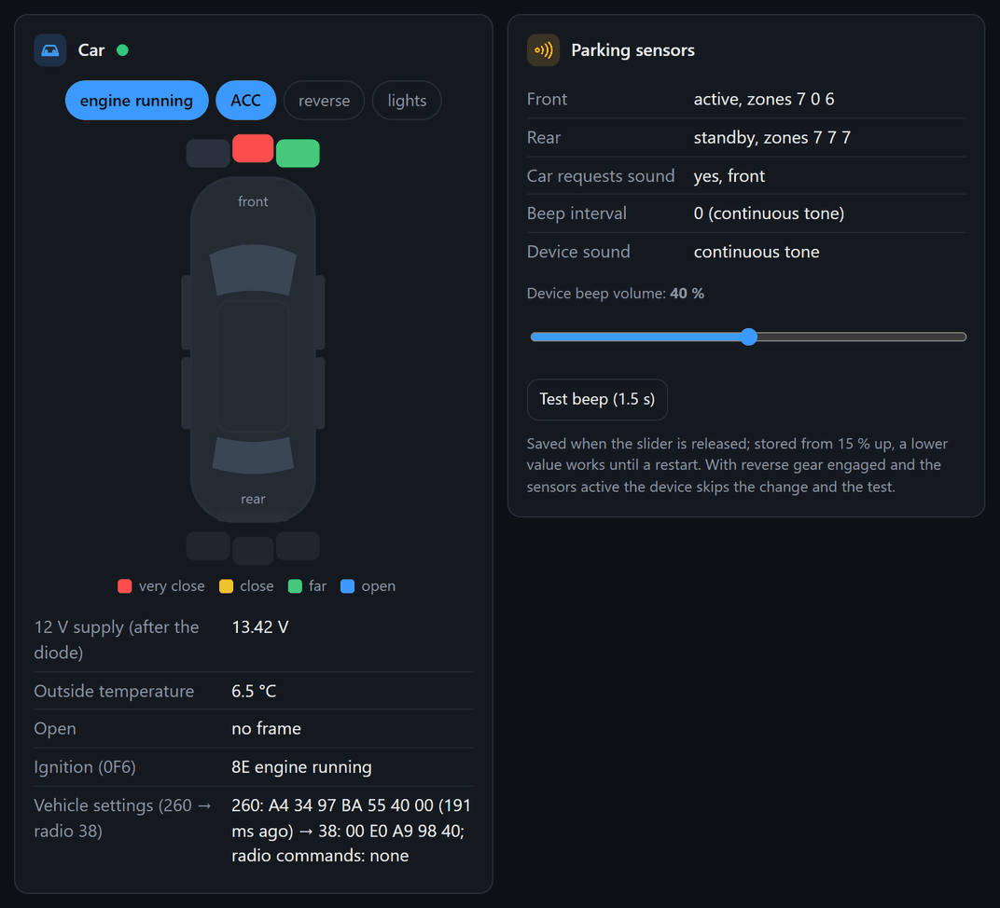](../../assets/screenshots/panel-dashboard-park-continuous.png)

[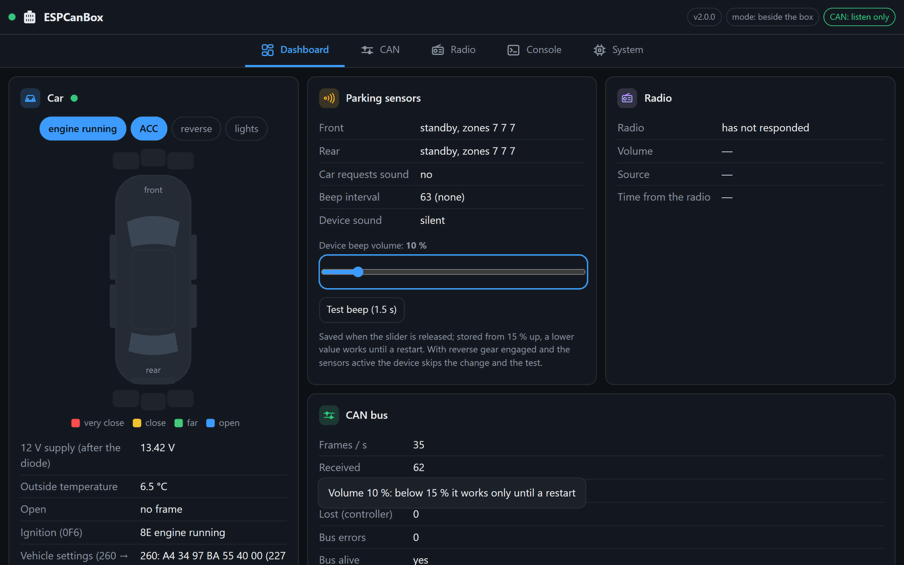](../../assets/screenshots/panel-dashboard-volume-low.png)

### Radio {#dashboard-radio}

Radio włączone albo wyłączone, głośność, źródło i czas, który podaje radio. Więcej jest w zakładce
Radio.

[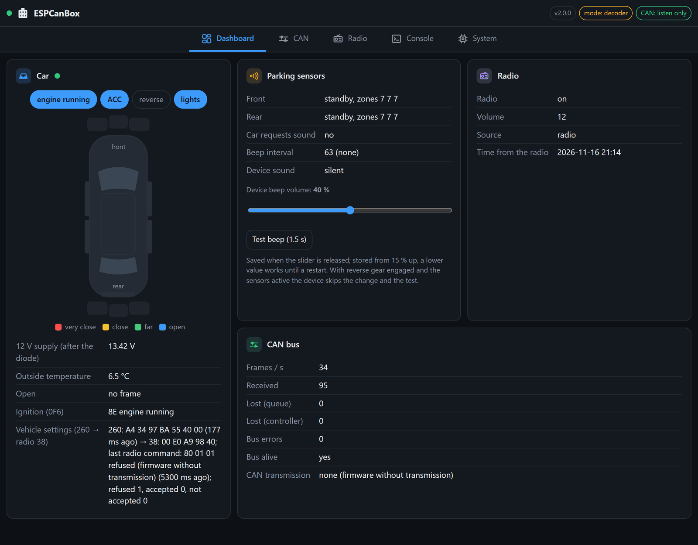](../../assets/screenshots/panel-dashboard-radio-linked.png)

### Magistrala CAN {#can-bus}

Wiersze: **Ramek / s**, **Odebrane**, **Zgubione (kolejka)**, **Zgubione (kontroler)**, **Błędy
magistrali**, **Magistrala żyje**, **Nadawanie na CAN**.

W programie bez nadawania **Nadawanie na CAN** pokazuje „brak (program bez nadawania)”. W programie
zbudowanym z `decoder_tx_wifi` karta pokazuje też ramkę z ostrzeżeniem i dwa przyciski:

> [!CAUTION]
> **Nadaje na magistralę auta**
>
> **Uzbrój nadawanie 15B** pozwala urządzeniu wysyłać ramkę `15B` do BSI (modułu nadwozia) po
> następnym restarcie. Najpierw przeczytaj [Nadawanie na magistralę CAN](../safety/transmit.md). Przycisk
> jeszcze raz pyta, zanim cokolwiek zrobi.

- **Uzbrój nadawanie 15B** wysyła `cantx on`. Uzbrojenie działa po restarcie i tylko dla tego
  programu.
- **Rozbrój** wysyła `cantx off` i działa od razu.
- Oba przyciski działają tylko wtedy, gdy telefon jest połączony z **siecią urządzenia**. Przez
  sieć domową są nieaktywne, a ramka to mówi.
- Pod przyciskami: stan teraz, stan po restarcie, stan bramy (z przyczyną błędu, jeśli jest)
  i włączone pozycje maski ustawień.

[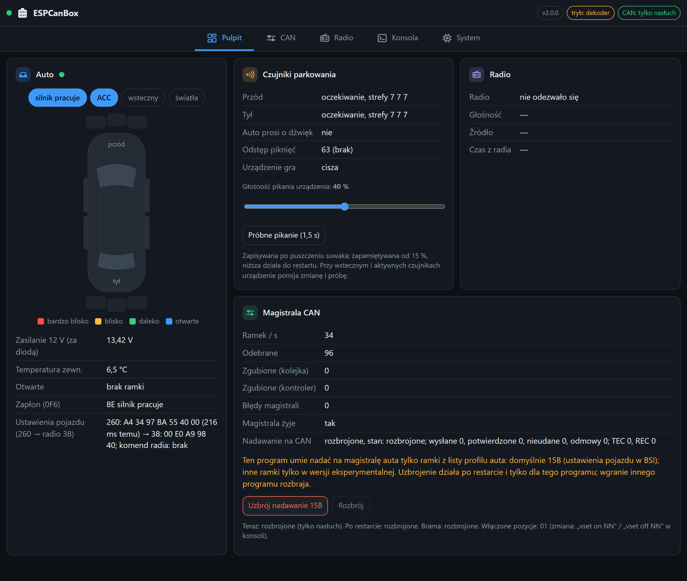](../../assets/screenshots/pl/panel-dashboard-decoder-tx.png)

## CAN {#can}

[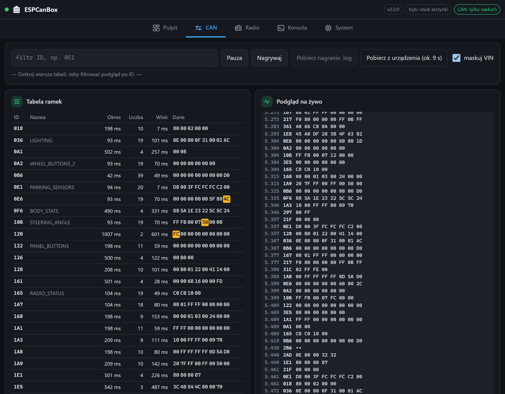](../../assets/screenshots/pl/panel-can.png)

- **Filtr ID** (na przykład `0E1`): pokazuje w podglądzie na żywo tylko jeden identyfikator.
  Możesz też dotknąć wiersza tabeli.
- **Pauza / Wznów**: zatrzymuje podgląd na żywo na ekranie.
- **Nagrywaj / Zatrzymaj nagrywanie** i **Pobierz nagranie .log**: przeglądarka zbiera ramki tak
  długo, jak chcesz, i zapisuje plik w formacie nagrania `(s.mmm) can0 ID#DATA`. Nagrywanie działa,
  dopóki zakładka panelu jest widoczna: ukryta zakładka przeglądarki przestaje odpytywać i ramki
  przepadają.
- **Pobierz z urządzenia (ok. 9 s)**: pobiera ramki, które są jeszcze w pamięci urządzenia
  (`/api/trace.log`).
- **maskuj VIN** (domyślnie włączone): ukrywa dane ramek niosących VIN (`336`, `3B6`, `2B6`) na
  ekranie i w obu pobieranych plikach. Zostaw to włączone, gdy udostępniasz zrzut ekranu albo plik.
- **Tabela ramek**: jeden wiersz na identyfikator z ID, nazwą (z profilu auta), okresem, liczbą,
  wiekiem i ostatnimi danymi. Uwaga pokazuje, ile ID nie zmieściło się w tabeli.
- **Podgląd na żywo**: najnowsze ramki.

[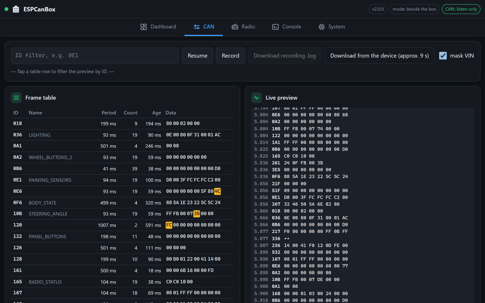](../../assets/screenshots/panel-can-paused.png)

[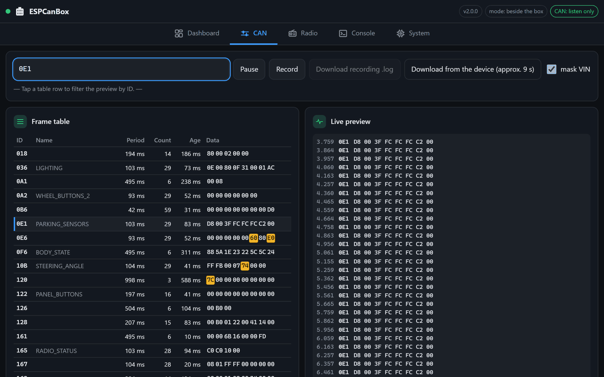](../../assets/screenshots/panel-can-filter.png)

## Radio {#radio-tab}

[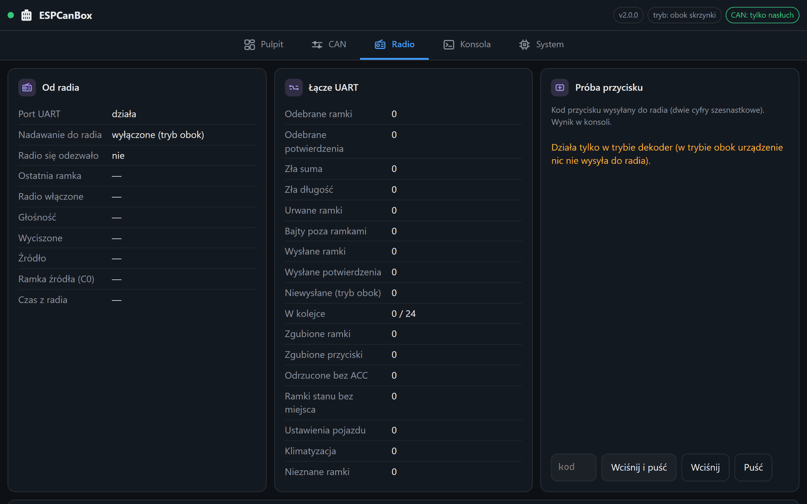](../../assets/screenshots/pl/panel-radio.png)

- **Od radia**: port UART, nadawanie do radia (wyłączone w trybie obok), czy radio się odezwało,
  ostatnia ramka, radio włączone, głośność, wyciszone, źródło, surowa ramka źródła (`C0`), czas.
- **Łącze UART**: liczniki ramek odebranych i wysłanych, błędy (zła suma kontrolna, zła długość,
  urwane ramki, bajty poza ramkami), kolejka, zgubione ramki i przyciski, ramki odrzucone bez ACC,
  ramki stanu bez miejsca oraz ostatnie komendy ustawień pojazdu i klimatyzacji od radia.
- **Próba przycisku**: wpisz dwucyfrowy kod szesnastkowy i naciśnij **Wciśnij i puść**,
  **Wciśnij** albo **Puść**. Wynik jest w konsoli. Do radia trafia tylko w trybie dekoder.
- **Zamiana przycisków**: tabela „przycisk auta → funkcja radia”. **Ostatnio naciśnięty**
  pokazuje ostatni przycisk z auta; **Dodaj do tabeli** wstawia go w nowy wiersz. **Dodaj
  zamianę**, **Zapisz**, **Cofnij zmiany**, **Zamiany wbudowane** (przywraca ustawienia
  domyślne programu). Najwyżej 16 wierszy. Wiersz pod spodem pokazuje, co jest zapisane na
  urządzeniu, a co jest wbudowane.

Kod `16` to dwa przyciski auta naraz (oba przyciski głośności oraz wciśnięcie pokrętła panelu).
Zamiana dla `A4` (księżyc) nie działa. Kody są w
[API panelu, rozdział 10](panel-api.md#10-tables-for-the-panel).

[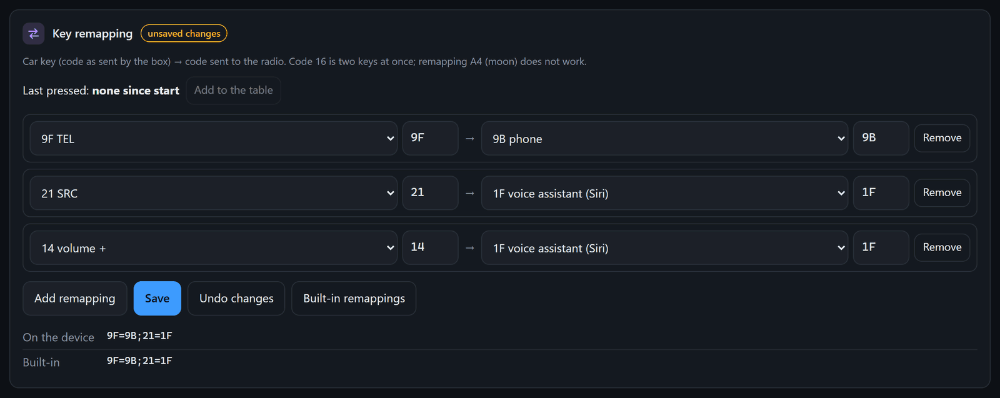](../../assets/screenshots/panel-radio-keymap-edit.png)

[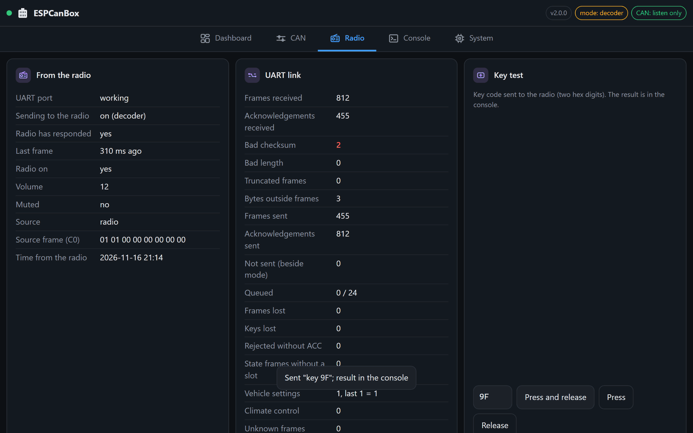](../../assets/screenshots/panel-radio-key-test-decoder.png)

## Konsola {#console}

[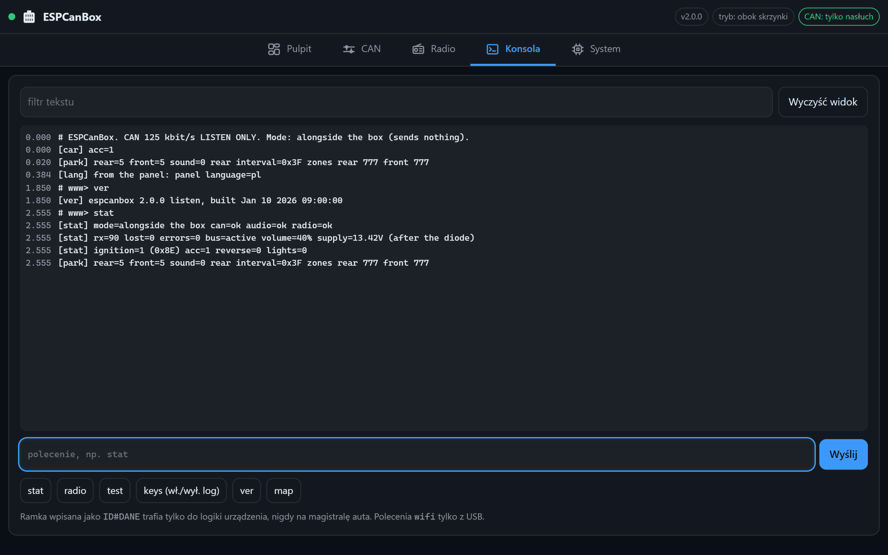](../../assets/screenshots/pl/panel-console.png)

Te same linie co w konsoli USB, z filtrem tekstu i przyciskiem **Wyczyść widok** (czyści tylko
ekran). Wpisz polecenie i naciśnij **Wyślij** albo użyj szybkich przycisków `stat`, `radio`,
`test`, `keys (wł./wył. log)`, `ver`, `map`.

- Ramka wpisana jako `ID#DATA` trafia tylko do logiki urządzenia, nigdy na magistralę auta.
- Polecenia `wifi` działają tylko przez USB: zawierają hasła.
- `cantx reset` i `set NN VV` działają tylko przez USB.

Wszystkie polecenia: [Konsola USB](console.md).

[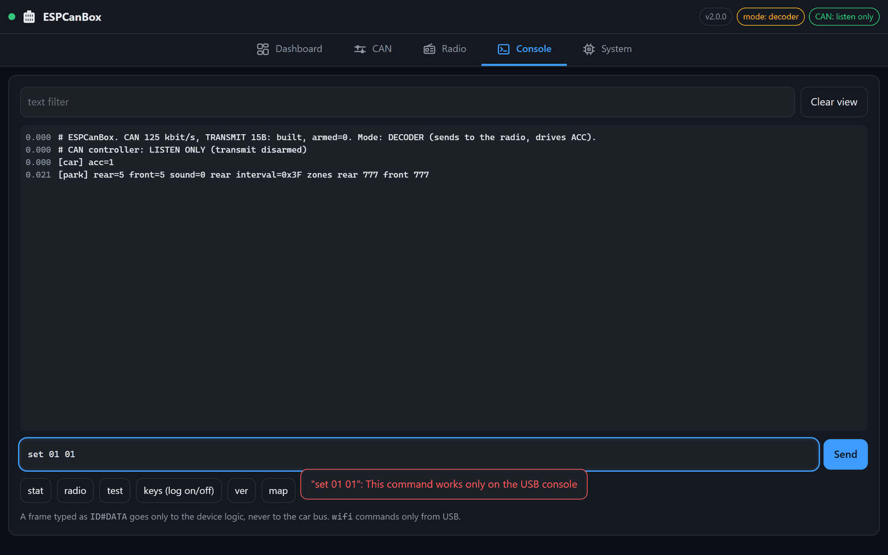](../../assets/screenshots/panel-console-usb-only.png)

[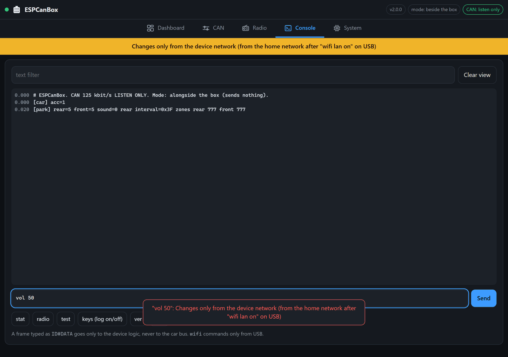](../../assets/screenshots/panel-console-home-network-read-only.png)

## System {#system}

[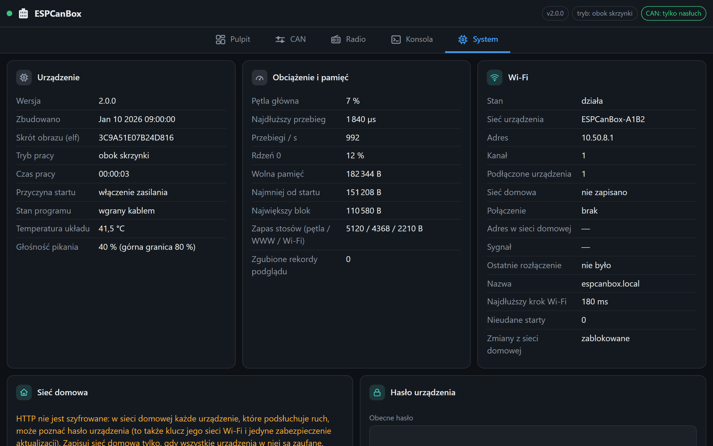](../../assets/screenshots/pl/panel-system.png)

- **Urządzenie**: wersja, czas kompilacji, skrót obrazu (`elf`), tryb pracy, czas pracy, przyczyna
  startu, stan programu, temperatura układu, głośność pikania.
- **Obciążenie i pamięć**: obciążenie pętli głównej, najdłuższy przebieg, przebiegi na sekundę,
  obciążenie rdzenia 0, wolna pamięć, najmniej od startu, największy blok, zapas stosów (pętla /
  WWW / Wi-Fi), zgubione rekordy podglądu.
- **Wi-Fi**: stan, nazwa i adres sieci urządzenia, kanał, podłączone urządzenia, sieć domowa,
  połączenie, adres w sieci domowej, sygnał, ostatnie rozłączenie, nazwa, najdłuższy krok Wi-Fi,
  nieudane starty, czy zmiany z sieci domowej są dozwolone.
- **Sieć domowa**: nazwa i hasło (8 do 63 znaków albo 64 cyfry szesnastkowe). **Zapisz sieć** albo **Zapomnij sieć domową**.
  Po zmianie Wi-Fi urządzenia startuje od nowa na ok. 1 do 3 s; przy pracującym silniku urządzenie
  nie łączy się z siecią domową.
- **Hasło urządzenia**: obecne hasło, dwa razy nowe hasło (10 do 63 znaków ASCII, bez spacji). Po
  zmianie każdy telefon musi połączyć się ponownie z siecią urządzenia, z nowym hasłem.
- **Kopia ustawień**: **Zapisz do pliku** pobiera plik `.json` z językiem panelu, głośnością
  piknięć i tabelą przycisków; **Wczytaj z pliku** wysyła taki plik z powrotem. Nie ma w nim
  nigdy haseł, sieci domowej, nadawania na CAN ani ustawień pojazdu. Szczegóły:
  [Ustawienia](../../en/reference/settings.md) (po angielsku).
- **Program**: zobacz niżej.
- **Język** i **Wyloguj** na dole.

[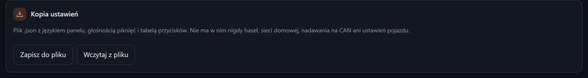](../../assets/screenshots/pl/panel-system-settings-backup.png)

[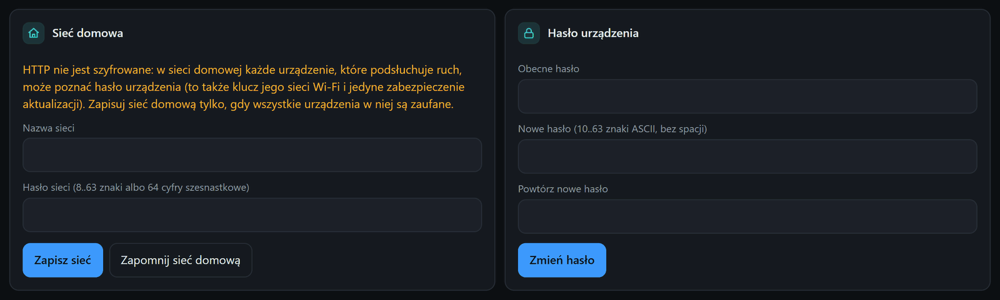](../../assets/screenshots/pl/panel-system-network-password.png)

[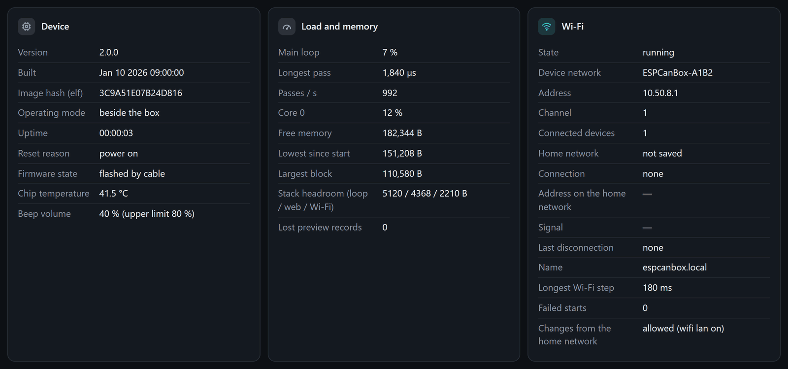](../../assets/screenshots/panel-system-home-network-admin.png)

### Aktualizacja programu {#firmware-update}

> [!WARNING]
> **Aktualizuj tylko na postoju**
>
> Gdy urządzenie zapisuje nowy program, na chwilę przestaje odbierać ramki CAN i obsługiwać
> radio, a dźwięk czujników może się rwać. Urządzenie odmawia aktualizacji albo ją przerywa, gdy
> włączy się bieg wsteczny albo czujniki.

1. Na komputerze zbuduj obraz środowiska, którego chcesz używać, na przykład `listen_wifi`.
   W terminalu w katalogu `firmware` wpisz:

    ```bash
    uvx platformio run -e listen_wifi
    ```

    Oczekiwane: `SUCCESS`. Plik to `firmware/.pio/build/listen_wifi/firmware.bin` (dla innego
    środowiska jego nazwa zamiast `listen_wifi`).
2. Karta **Program** to kreator w trzech krokach. **Krok 1, Wybierz plik programu:** wskaż
   `firmware.bin` ze swojego builda albo, z wydania, plik `.bin` bez `-merged` w nazwie (plik
   `-merged` służy tylko do wgrywania kablem USB i zostanie odrzucony).
3. **Krok 2, Sprawdź plik:** panel czyta znacznik w pliku i pokazuje produkt, wersję, czas
   kompilacji, tryb pracy, to, czy program może nadawać na CAN auta, i czy ma panel sieciowy. Plik
   bez znacznika tego urządzenia jest odrzucany, zanim cokolwiek zostanie wysłane. Gdy plik ma
   inny tryb pracy, inne ustawienie nadawania na CAN albo nie ma panelu sieciowego, każda różnica
   dostaje własne ostrzeżenie z polem do zaznaczenia; krok 3 otwiera się dopiero, gdy wszystkie
   pola są zaznaczone.
4. **Krok 3, Wgraj i poczekaj na wynik:** naciśnij **Wgraj program** i potwierdź. Panel pokazuje
   postęp, potem czeka na restart i sprawdza, który program działa. „Gotowe” oznacza, że nowy
   program działa i jest potwierdzony. Jeśli nowy program się nie potwierdzi, urządzenie wraca do
   poprzedniego, a panel mówi „Nastąpiło COFNIĘCIE”. Po błędzie panel podpowiada, co zrobić.

[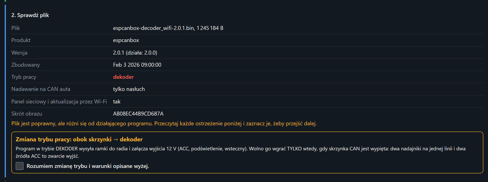](../../assets/screenshots/pl/panel-system-firmware-wizard.png)

**Powrót do poprzedniego programu:** urządzenie ma dwa miejsca na program, a po aktualizacji
program, który działał wcześniej, zostaje w drugim miejscu (wiersz „Drugie miejsce” w stanie
wyżej). **Wróć do poprzedniego** uruchamia go ponownie; urządzenie się restartuje. Inne przyciski:
**Odśwież stan**, **Restart urządzenia**.

> [!CAUTION]
> **Obraz w trybie dekoder załącza wyjścia 12 V**
>
> Obraz w trybie dekoder wysyła ramki do radia i załącza ACC, podświetlenie i wsteczny. Wgrywaj go
> tylko przy wypiętej skrzynce CAN: dwa nadajniki na jednej linii i dwa źródła ACC to
> zwarcie wyjść.

[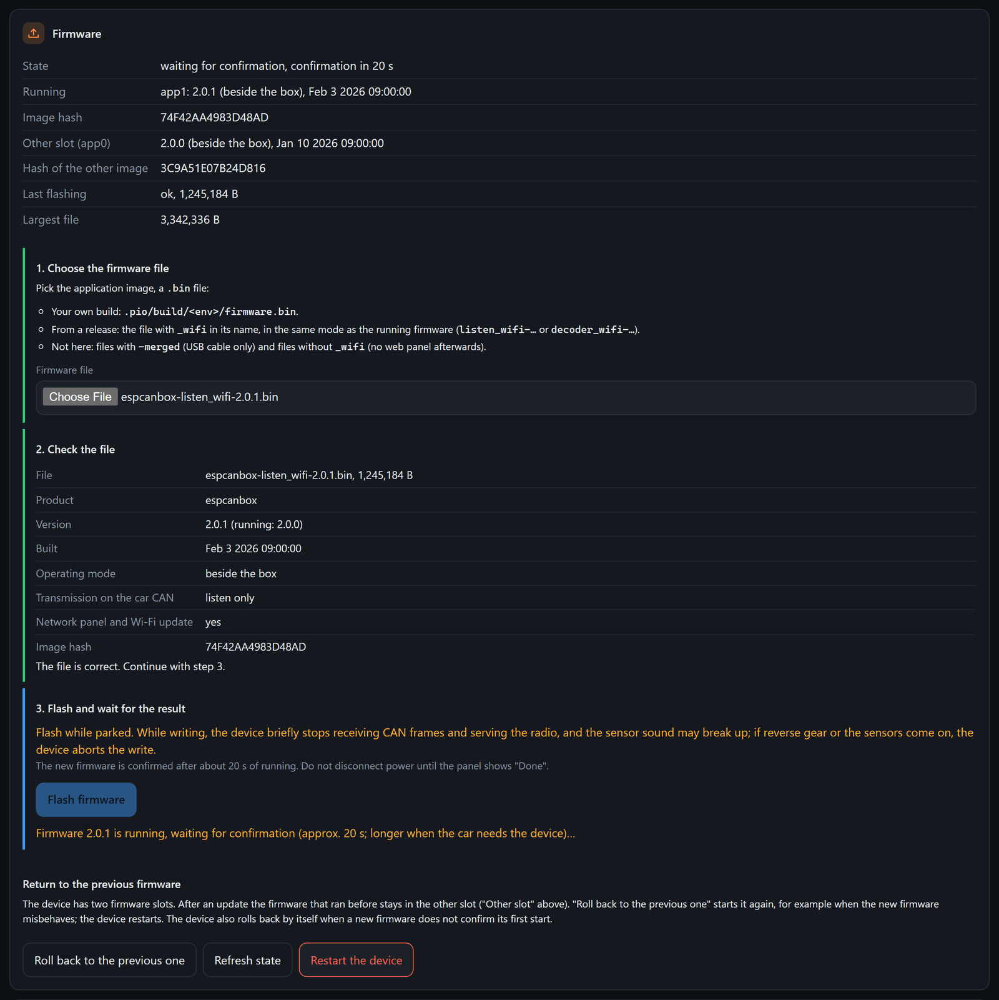](../../assets/screenshots/panel-ota-pending.png)

[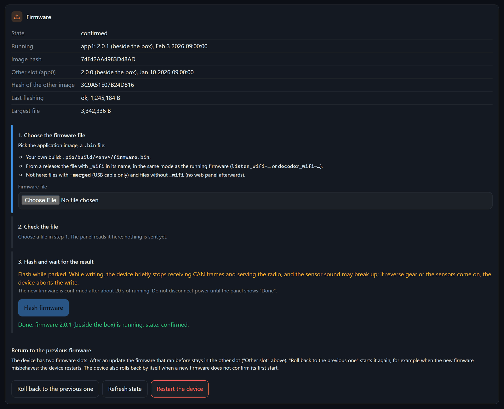](../../assets/screenshots/panel-ota-done.png)

## Języki {#languages}

Domyślnie panel mówi po angielsku. Wybrany język jest zapisywany w urządzeniu (klucz NVS
`ui_lang`), więc każda przeglądarka otwiera się w nim; przeglądarka trzyma tylko kopię podręczną
(`localStorage`, klucz `ui_lang`). W stronie panelu jest tylko angielski: inny słownik panel pobiera
z urządzenia (`GET /i18n/<lang>.json`) po wybraniu języka, a do tego czasu pokazuje angielski.
Słowniki są w `firmware/web/i18n/`.
Polski słownik napisał autor; niemiecki, hiszpański, rosyjski i ukraiński to tłumaczenia maszynowe
oznaczone „needs native review”, a panel pokazuje uwagę, gdy wybierzesz jeden z nich.
Jak je poprawić: [Tłumaczenia](../contributing/translations.md) i
[Słowniczek](../contributing/glossary.md).

Dalej: wszystkie polecenia są na stronie [Konsola USB](console.md). Gdy coś nie działa, zobacz
[Rozwiązywanie problemów](../troubleshooting/index.md).
