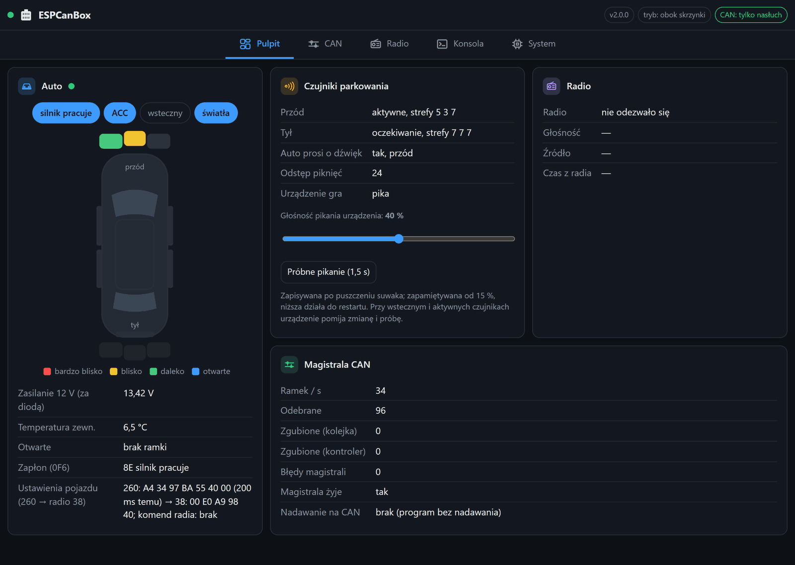

# Najczęstsze pytania

> [!NOTE]
> **Tłumaczenie maszynowe, wymaga sprawdzenia**
>
> Tę stronę przetłumaczono automatycznie. Wiążący jest tekst angielski. Jak zgłosić poprawkę:
> [Tłumaczenia](../contributing/translations.md#send-your-work).

Krótkie odpowiedzi na pytania, które padają najczęściej. Szczegóły są pod linkami.

## Czy urządzenie nadaje na magistralę CAN mojego auta? {#does-the-device-transmit-on-my-cars-can-bus}

Domyślnie nie. Żadne środowisko poza `decoder_tx_wifi` nie zawiera w ogóle kodu nadawania na CAN,
a kontroler pracuje w trybie tylko do nasłuchu. `decoder_tx_wifi` nadaje dopiero po uzbrojeniu
poleceniem `cantx on` i restarcie, i tylko ramki z listy dozwolonych w profilu auta: w aucie
wzorcowym ramkę `15B`, sprawdzaną tylko po ID i długości. Ramka `1A9` istnieje tylko w wersji
zbudowanej z `-DCAN_TX_EXPERIMENTAL=1`. Szczegóły: [Nadawanie na magistralę CAN](../safety/transmit.md).

## Czy zadziała z moim autem? {#will-it-work-with-my-car}

Zmierzony profil ma tylko Peugeot 508 SW z 2015 roku (PSA AEE2010). W każdym innym aucie zaczynasz
od profilu `generic` w `listen_generic_wifi`: nic nie dekoduje, nic nie wysyła do radia i nigdy nie
przełącza wyjść 12 V. Nagrywasz swoją magistralę i piszesz własny profil:
[Dostosuj do siebie](../make-it-yours/find-your-bus.md).

## Czy magistrala przy radiu to CAN high-speed? {#is-the-bus-at-the-radio-high-speed-can}

W aucie wzorcowym działa z prędkością 125 kbit/s (zmierzone (measured)). Jej napięcia, średnio
CANH 0,65 V i CANL 4,5 V przy włączonym zapłonie, wyglądają na CAN **low-speed fault-tolerant**,
a nie high-speed, gdzie obie linie są w okolicy 2,5 V. To wniosek z pomiaru multimetrem; do
potwierdzenia potrzebny jest oscyloskop. Transceiver high-speed 3,3 V odbiera tę magistralę bez
błędów (zmierzone).

## Czy mogę sterować klimatyzacją z radia? {#can-i-control-the-climate-from-the-radio}

Nie. W aucie wzorcowym pojedyncze ramki `364` z urządzenia nie zmieniły klimatyzacji (zmierzone:
kilka naciśnięć, warianty 4-bajtowy i 6-bajtowy). Ramki zostały potwierdzone na magistrali, ale
temperatura się nie zmieniła. Drugi kierunek, czyli stan klimatyzacji pokazywany w radiu, jest
zrobiony: 26 z 27 ramek zgadzało się z tym, co w nagraniu wysłała skrzynka CAN (test na
komputerze). Program nie ma ramki klimatyzacji do wysłania: przyciski klimatyzacji w radiu tylko
wypisują linię w konsoli.

## Czy mogę zmieniać ustawienia pojazdu z ekranu radia? {#can-i-change-vehicle-settings-from-the-radio-screen}

Tylko w wersji z nadawaniem, uzbrojonej. BSI (moduł nadwozia) przyjęło żądania `15B` dla sześciu
pozycji w obie strony: asystent parkowania, tylna wycieraczka przy cofaniu, czas oświetlenia
„prowadź mnie do domu”, czas oświetlenia powitalnego, dźwięk, otwieranie drzwi (zmierzone: zmiana
pojawiła się w ramce `260`). Co każda zmiana robi w aucie, nie sprawdzono.

## Czy muszę wyjąć swoją skrzynkę CAN? {#do-i-have-to-remove-my-can-box}

Nie. W trybach `listen` urządzenie pracuje **obok** skrzynki: słucha auta i linii radia i nic nie
wysyła. W trybach `decoder` pracuje **zamiast** skrzynki: najpierw odłącz skrzynkę, bo dwa
nadajniki na jednej linii radia i dwa źródła ACC zwierają wyjścia.

## Czy rozładuje mi akumulator? {#will-it-drain-my-battery}

Nie wiadomo. Prąd urządzenia w uśpieniu nie jest zmierzony; głębokie uśpienie i wybudzenie z
magistrali wypróbowano w jednym aucie 20.11.2026. Wi-Fi pobiera około 100 mA (liczba z komentarza w kodzie, nie pomiar tej
płytki), dlatego wyłącza się, gdy auto zasypia.

## Które środowisko wgrać najpierw? {#which-environment-should-i-flash-first}

`listen` (domyślne przy zwykłym `uvx platformio run -t upload` w `firmware/`): tylko nasłuch, bez
sieci. Potem
`listen_wifi` dla panelu WWW. Na środowisko `decoder` przechodź dopiero, gdy sprawdzisz, że
zdekodowane sygnały są prawidłowe. Patrz [Wgraj program](../quick-start/flash.md).

## Czy obrazy programu są podpisane? {#are-firmware-images-signed}

Nie. Każdy, kto zna hasło urządzenia, może wgrać przez Wi-Fi dowolny obraz. Aktualizacja sprawdza
plik pod kątem pomyłek (znacznik produktu, tryb, znacznik nadawania), nie pod kątem podróbki.
Trzymaj hasło w tajemnicy. Patrz [Model zabezpieczeń](../safety/security.md).

## Dlaczego niektóre słowa są po polsku? {#why-are-some-words-in-polish}

Projekt zaczął się po polsku. Kilka rzeczy zachowuje oryginalne słowa, bo zależą od nich narzędzia
albo pliki: znaczniki kroków w nagraniach (`# KROK` = step), część słów w zamrożonych wzorcach
testów, nazwy sieci w KiCadzie i napisy na miedzi prototypu v1. Stare polskie polecenia konsoli
nadal działają jako aliasy.

## Czy to produkt? Kto go wspiera? {#is-this-a-product-who-supports-it}

Nie. To projekt hobbystyczny, udostępniony w obecnym stanie, bez gwarancji. Nie jest
przeznaczony do niczego, co wpływa na bezpieczeństwo jazdy. Projekt nie jest powiązany z firmami
Peugeot, Stellantis, Simple Soft, Raise, Junsun ani FYT; te nazwy mówią tylko, co testowano.

## Jak poprosić o pomoc? {#how-do-i-ask-for-help}

Otwórz zgłoszenie (issue) w repozytorium i dołącz:

1. wynik `ver` i `stat` (a przy problemach z radiem także `radio`);
2. twoje auto, radio i nazwę środowiska;
3. co zrobiłeś, czego się spodziewałeś, co się stało;
4. krótkie nagranie, **zanonimizowane** przez `tools/sanitize_capture.py`, uruchomione w głównym
   katalogu repozytorium, nie w `firmware/` (patrz [Model zabezpieczeń](../safety/security.md#before-you-share-anything)
   i [Nagrania z auta](../testing/captures.md)).

Nigdy nie wklejaj wyniku `wifi showpass`. Odpowiedzi przychodzą, gdy autor albo inny współtwórca
ma czas.

Dalej: problemy, które naprawdę wystąpiły, razem ze sprawdzeniami, opisuje
[Rozwiązywanie problemów](index.md).
