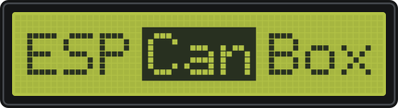

# Обзор

> [!NOTE]
> **Машинный перевод, требует проверки**
>
> Эта страница переведена автоматически. Обязательным является английский текст. Как прислать
> исправление перевода: [Переводы](../en/contributing/translations.md#send-your-work).

Этот проект — открытое устройство на ESP32-S3, которое стоит между шиной CAN автомобиля и
магнитолой на Android. Оно может заменить CAN-адаптер («адаптер»), который продаётся вместе с
магнитолой.

> [!CAUTION]
> **Любительский проект, предоставляется как есть**
>
> Вы используете его на свой страх и риск, на своём автомобиле. По умолчанию устройство
> **только слушает** шину автомобиля. Для передачи нужна отдельная сборка и ручное
> разрешение. Не используйте его ни для чего, что влияет на безопасность. Прочитайте
> [Безопасность](getting-started/safety.md), прежде чем что-либо подключать.

> [!NOTE]
> **Не связан с производителями**
>
> Проект не связан с Peugeot, Stellantis, Simple Soft, Raise, Junsun или FYT, не одобрен ими
> и не имеет к ним отношения. Их названия используются только для того, чтобы сказать, что
> было проверено.

## Что делает устройство {#what-the-device-does}

- **Слушает шину CAN автомобиля** в режиме только прослушивания, трансивер удерживается в
  режиме молчания. Ни одно окружение сборки, кроме `decoder_tx_wifi`, вообще не содержит кода
  передачи.
- **Подаёт звуковые сигналы парктроников** через свой динамик, по кадру `0E1`.
- **Общается с магнитолой** в режиме декодера, по UART, по протоколу «XP» адаптера Simple Soft:
  кнопки, отображение парктроников, бортовой компьютер, наружная температура, состояние
  климат-контроля, двери и настройки автомобиля.
- **Управляет тремя выходами 12 В** в режиме декодера: ACC (питание магнитолы), подсветка и
  задний ход.
- **Веб-панель** через собственную сеть Wi-Fi: состояние, кадры CAN в реальном времени,
  консоль, запись и обновление прошивки.
- **Консоль USB** с фиксированным форматом строк (`can0 ID#DATA`, комментарии начинаются с `#`).

Как части работают вместе: [Как это работает](../en/getting-started/how-it-works.md).

## Что проверено {#what-is-tested}

Прошивка и плата разработаны и измерены на **одном** автомобиле с **одной** магнитолой:

| Автомобиль | Профиль | Статус |
|---|---|---|
| Peugeot 508 SW, 2015 (PSA AEE2010) | `psa_aee2010` | измерено (measured) на одном автомобиле |
| любой автомобиль | `generic` | только прослушивание: записывает кадры, ничего не отправляет магнитоле, выходы 12 В выключены |

На эталонном автомобиле шина у магнитолы работает на 125 кбит/с (измерено: приём без ошибок).
Напряжения на ней похожи на низкоскоростную отказоустойчивую CAN (low-speed fault-tolerant);
для подтверждения нужен осциллограф. Подробности: [Peugeot 508 SW](../en/reference/vehicles/peugeot-508.md).

Дерево прошивки в этом репозитории переработано на основе версии, которая работает в эталонном
автомобиле. Оно компилируется и проходит тесты на компьютере, но **ещё не проверено на стенде**
на устройстве.

## С чего начать {#where-to-start}

Читайте страницы в таком порядке:

1. [Безопасность](getting-started/safety.md): что может пойти не так и правила проекта.
2. [Что нужно](../en/getting-started/requirements.md): плата, детали и инструменты.
3. [Быстрый старт](quick-start/flash.md): сборка, прошивка и открытие панели на столе, без автомобиля.
4. Затем один из двух путей:
    - **У вас не эталонный автомобиль:** [Под свой автомобиль](make-it-yours/porting-checklist.md)
      показывает, как найти шину, записать её, расшифровать кадры и написать профиль.
    - **У вас эталонный автомобиль и магнитола:** [Установка в автомобиль](../en/install-in-car/checklist.md).
5. [Поделитесь](make-it-yours/contribute.md) своими записями или описанием своего автомобиля.

Платы ещё нет? Макет устройства запускает веб-панель на вашем компьютере с записью из
автомобиля, см. [Первый запуск](quick-start/first-boot.md).

## Лицензии {#licences}

Предварительно, до первого публичного выпуска: код Apache-2.0, документация CC BY 4.0,
аппаратная часть CERN-OHL-S-2.0. Автор: grabowski98.
