# Огляд

> [!NOTE]
> **Машинний переклад, потребує перевірки**
>
> Цю сторінку перекладено автоматично. Обов'язковим є англійський текст. Як надіслати
> виправлення: [Переклади](../en/contributing/translations.md#send-your-work).

Цей проєкт — відкритий пристрій на ESP32-S3, який стоїть між шиною CAN автомобіля і магнітолою
на Android. Він може замінити CAN-адаптер («адаптер»), який продають разом із магнітолою.

> [!CAUTION]
> **Хобі-проєкт, наданий «як є»**
>
> Ви використовуєте його на власний ризик, у власному автомобілі. Типово пристрій
> **лише прослуховує** шину автомобіля. Для передачі потрібна окрема збірка і ручна активація.
> Не використовуйте його ні для чого, що впливає на безпеку. Прочитайте
> [Безпеку](getting-started/safety.md), перш ніж щось підключати.

> [!NOTE]
> **Без зв'язку з виробниками**
>
> Цей проєкт не пов'язаний з Peugeot, Stellantis, Simple Soft, Raise, Junsun чи FYT, не
> схвалений ними і не має з ними жодних стосунків. Їхні назви вжито лише для того, щоб сказати,
> що саме перевірено.

## Що робить пристрій {#what-the-device-does}

- **Прослуховує шину CAN автомобіля** в режимі лише прослуховування, трансивер утримується
  в тихому стані. Жодне середовище збірки, крім `decoder_tx_wifi`, взагалі не містить коду
  передачі.
- **Подає звукові сигнали парктроніків** через власний динамік, за кадром `0E1`.
- **Обмінюється даними з магнітолою** в режимі декодера, через UART, за протоколом «XP»
  адаптера Simple Soft: кнопки, екран парктроніків, бортовий комп'ютер, зовнішня температура,
  стан клімат-контролю, двері та налаштування автомобіля.
- **Керує трьома виходами 12 V** в режимі декодера: ACC (живлення магнітоли), підсвічування
  і задній хід.
- **Веб-панель** через власну мережу Wi-Fi: стан, кадри CAN наживо, консоль, запис і оновлення
  прошивки.
- **Консоль USB** з незмінним форматом рядків (`can0 ID#DATA`, коментарі починаються з `#`).

Як частини працюють разом: [Як це працює](../en/getting-started/how-it-works.md).

## Що перевірено {#what-is-tested}

Прошивку і плату розробили та виміряли на **одному** автомобілі з **однією** магнітолою:

| Автомобіль | Профіль | Статус |
|---|---|---|
| Peugeot 508 SW, 2015 (PSA AEE2010) | `psa_aee2010` | виміряно (measured) на одному автомобілі |
| будь-який автомобіль | `generic` | лише прослуховування: записує кадри, нічого не надсилає на магнітолу, виходи 12 V вимкнені |

На еталонному автомобілі шина біля магнітоли працює на 125 kbit/s (виміряно: прийом без
помилок). Її напруги схожі на низькошвидкісну відмовостійку CAN (low-speed fault-tolerant); щоб
це підтвердити, потрібен осцилограф. Подробиці: [Peugeot 508 SW](../en/reference/vehicles/peugeot-508.md).

Стан: версія 2.0.0 компілюється, проходить тести на комп'ютері, перевірена на стенді на платі ESP32-S3-WROOM-1-N16R8 і випробувана в одному автомобілі 20.11.2026, включно з глибоким сном і пробудженням від шини.

## З чого почати {#where-to-start}

Читайте сторінки в такому порядку:

1. [Безпека](getting-started/safety.md): що може піти не так і правила проєкту.
2. [Що потрібно](../en/getting-started/requirements.md): плата, деталі та інструменти.
3. [Швидкий старт](quick-start/flash.md): збірка, прошивка і відкриття панелі на столі, без
   автомобіля.
4. Далі один із двох шляхів:
    - **Ваш автомобіль не еталонний:** [Під свій автомобіль](make-it-yours/porting-checklist.md)
      показує, як знайти шину, записати її, декодувати кадри і написати профіль.
    - **У вас еталонний автомобіль і магнітола:** [Встановлення в автомобіль](../en/install-in-car/checklist.md).
5. [Поділіться](make-it-yours/contribute.md) своїми записами або описом свого автомобіля.

Ще немає плати? Імітатор пристрою запускає веб-панель на вашому комп'ютері із записом
з автомобіля, див. [Перший запуск](quick-start/first-boot.md).

## Ліцензії {#licences}

Код Apache-2.0, документація CC BY 4.0, апаратна частина CERN-OHL-S-2.0. Яка ліцензія охоплює
які файли і які частини інших проєктів є в образах прошивки: `README.md` і `NOTICE`
у репозиторії. Автор: grabowski98.
